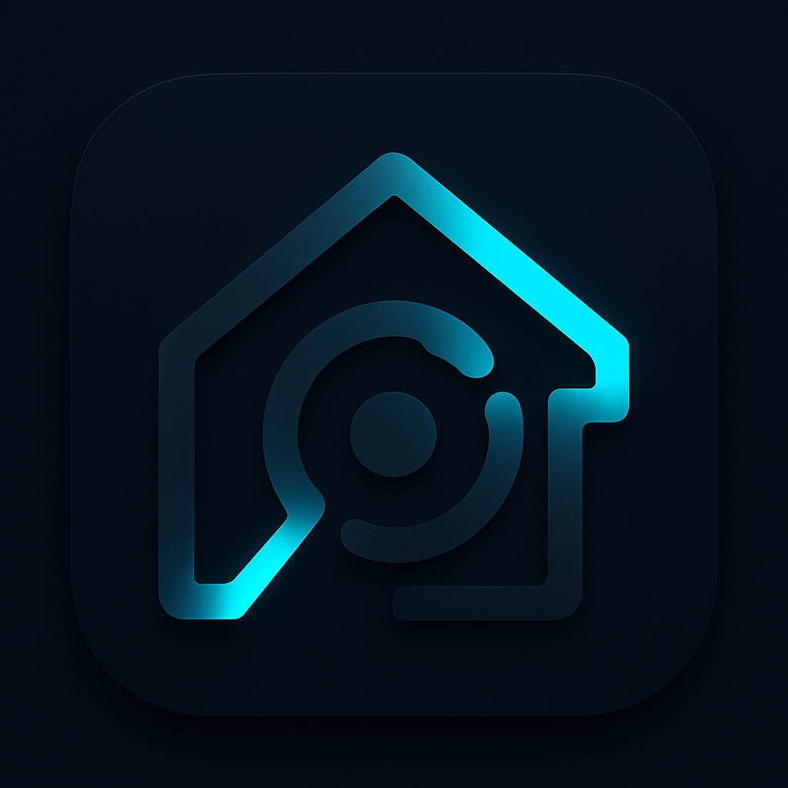
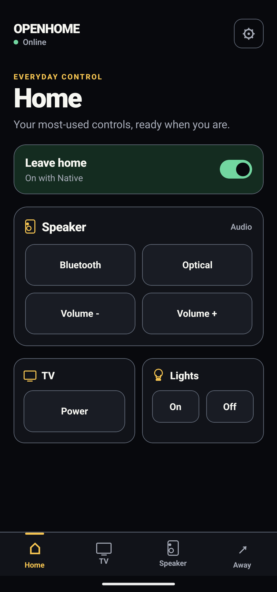
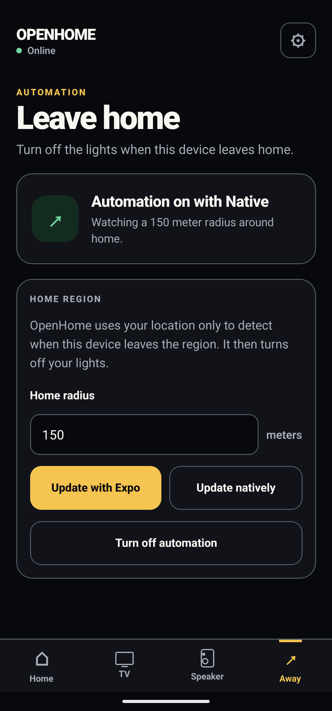
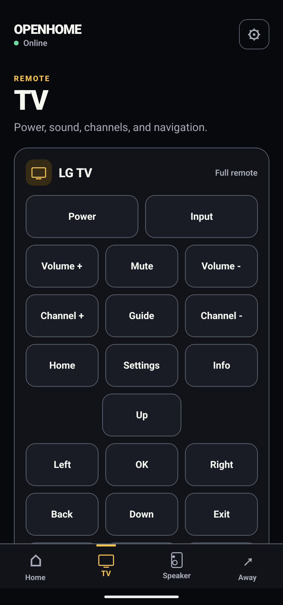
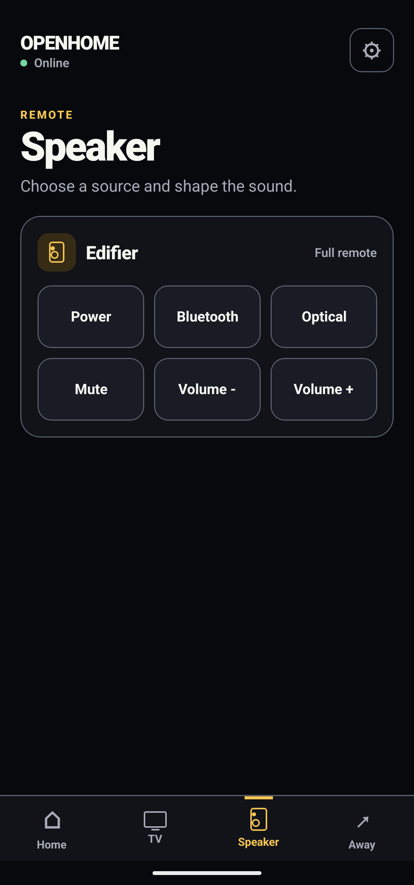
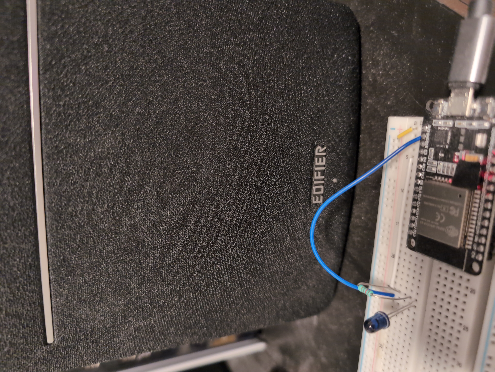
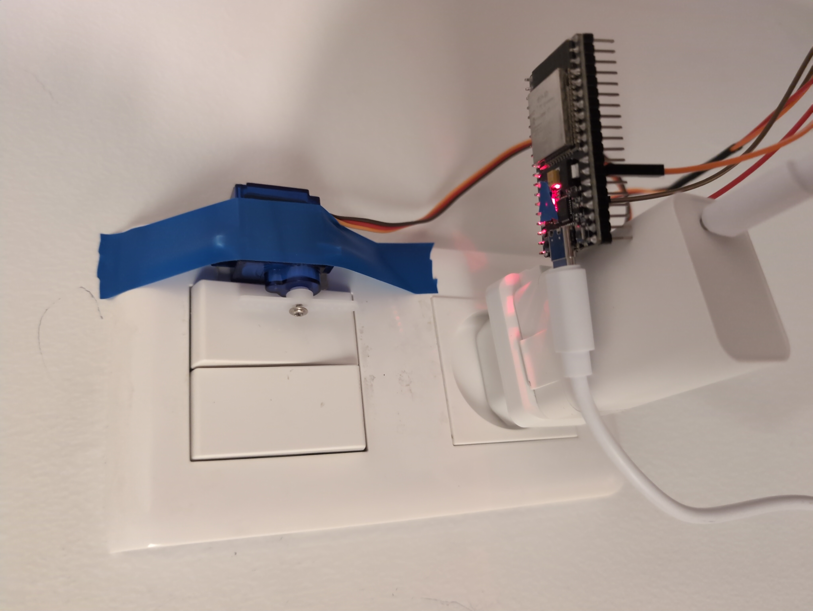
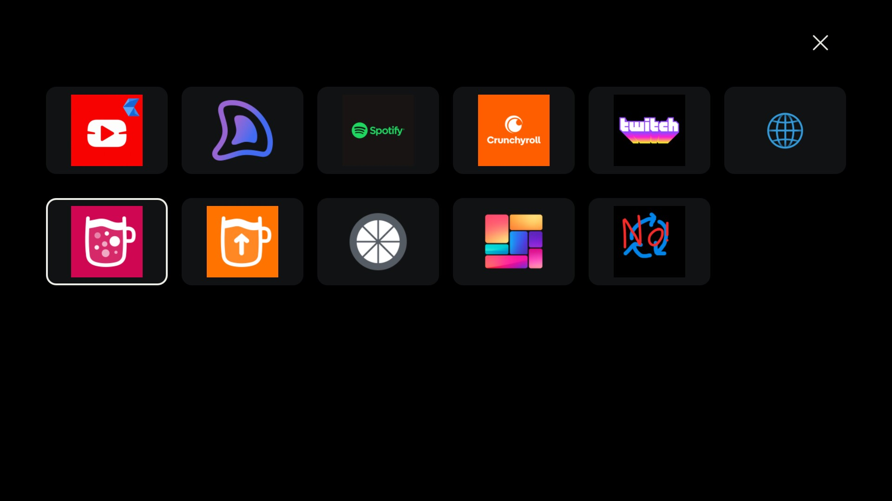
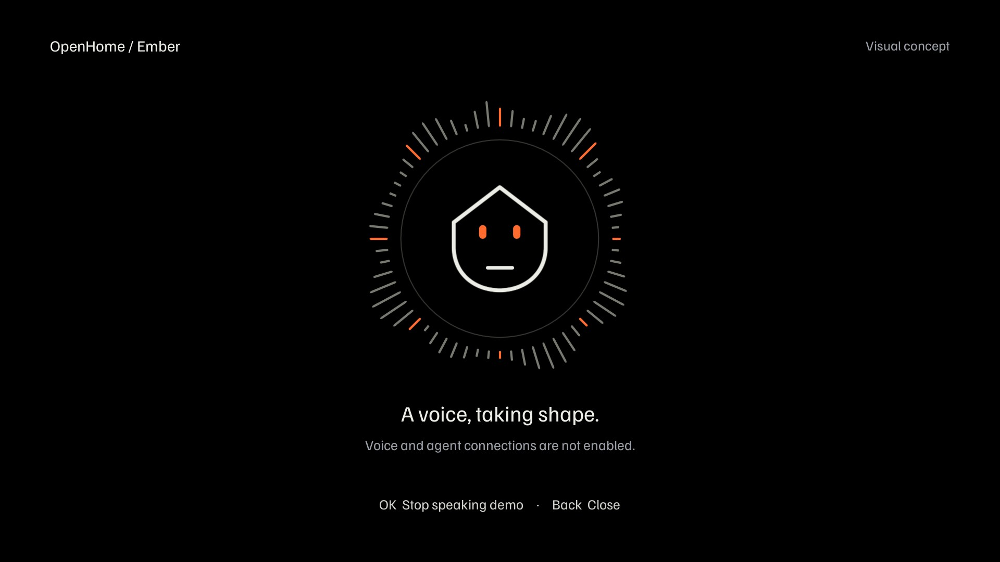
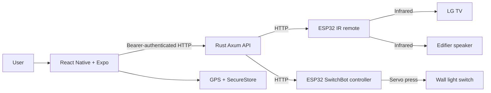

<h1 align="center">openhome</h1>

  

  <video src="https://github.com/user-attachments/assets/b9dff174-448f-4b85-b109-6cc2e2b53ebe"></video>

OpenHome is a self-hosted home control system with a cross-platform Android and iOS app, a household dashboard and a native LG webOS TV launcher. The mobile client is built with React Native and Expo and communicates exclusively with a Rust Axum API.

The API authenticates the client and forwards HTTP requests to two ESP32 devices:

- **ESP32 IR remote:** sends infrared commands to an LG TV and an Edifier speaker.
- **ESP32 SwitchBot controller:** drives a servo that physically turns a light switch on or off.

The app can also register a home geofence and automatically ask the API to turn off the lights when the phone leaves the configured area.

## Screenshots

| Home | Leave home automation |
| :---: | :---: |
|  |  |

| TV remote | Speaker remote |
| :---: | :---: |
|  |  |

## Hardware Demo

| ESP32 infrared controller | ESP32 SwitchBot controller |
| :---: | :---: |
|  |  |

## Features

- Control lights, an LG TV, and an Edifier speaker.
- Load available infrared commands dynamically from the API.
- Swipe between Home, TV, Speaker, and Away tabs.
- Store the Base URL, API key, and geofence configuration in Expo SecureStore.
- Monitor a home geofence without continuous GPS polling.
- Retry a persisted light-off command after a temporary background failure.
- Use either Expo Location or the Android framework location backend.
- View and manage Docker containers on the homelab server.
- Monitor and control AdGuard Home DNS protection.
- Aggregate RSS and Atom feeds into a timeline with read state.

## Dashboard

The OpenHome dashboard runs on a hacked digital photo frame as a dedicated household display. It brings together a clock, weather, home controls, travel, workouts, recovery, lists and Immich photo albums, with an idle slideshow when the display is not in use.

| Travel | Photos |
| :---: | :---: |
|  |  |

These screenshots use anonymous synthetic data. See [dashboard/docs/redesign](dashboard/docs/redesign/README.md) for screenshots of all pages in desktop and phone layouts.

## TV

OpenHome TV replaces LG Home on a rooted LG webOS TV using PearWebOS and a native QML interface. The launcher brings apps and home controls together on a clean black screen, with large icons for the Magic Remote.

| Before: LG Home | After: OpenHome TV |
| :---: | :---: |
|  |  |

| App drawer | Agent speaking concept |
| :---: | :---: |
|  |  |

- Large app icons, a full app drawer, pointer navigation and LG's app reordering.
- A 24-hour clock, Danish date, today's weather and Charge, Rest and Effort rings.
- Lights on/off and speaker Bluetooth/optical controls through the OpenHome API.
- Cinema and warm night picture profiles, switched from the eye control or the red remote button.
- Input Hook shortcuts for apps, lights and speaker inputs, including remapped streaming buttons.
- Reversible Alexa blocking and privacy controls, with backups and rollback instructions.
- A fullscreen circular agent with a speaking animation demo. Voice input, speech models and Hermes integration remain future work.

See the [TV guide](tv/README.md) for setup, architecture and rollback, and the [annotated Magic Remote](tv/assets/remote-keymap.png) for all shortcuts.

## Architecture

The Expo client uses a Clean Architecture-inspired structure:

- `domain` contains parsing, validation, and control definitions.
- `application` owns state transitions and coordinates operations.
- `infrastructure` contains the Axum API, SecureStore, GPS, and geofence adapters.
- `ui` contains React Native screens and components.

The mobile client never contacts an ESP32 directly. The Axum API is the single integration boundary and uses `IR_BASE_URL` and `SWITCHBOT_BASE_URL` to reach the devices.

## API Image

The Axum API is available as the Docker image [`patrickhaahr/openhome-api:latest`](https://hub.docker.com/r/patrickhaahr/openhome-api).

API access is protected by a Bearer API key. The mobile app stores the key in the platform's secure storage. Use HTTPS outside a trusted local network.

The shared [Compose stack](api/compose.yml) runs the API, MCP and Bun dashboard
from their `latest` images, using a private `.env` beside the Compose file.
See the [dashboard deployment guide](dashboard/README.md#docker-deployment) for
image publishing, Raspberry Pi updates and Caddy routing on the existing hostname.

## Deployment

Run `devenv shell -- just deploy` to patch-bump, check, build locally for amd64 and
arm64, publish, deploy to the Pi and verify the release. See the
[deployment skill](.agents/skills/deploy/SKILL.md) for agent operation and the
[deployment guide](dashboard/README.md#docker-deployment) for setup and recovery.
