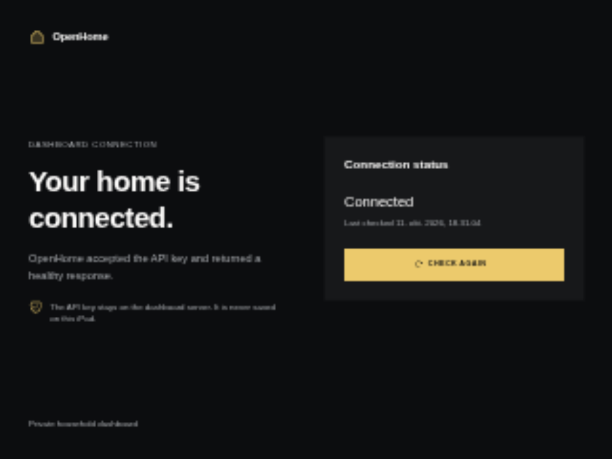
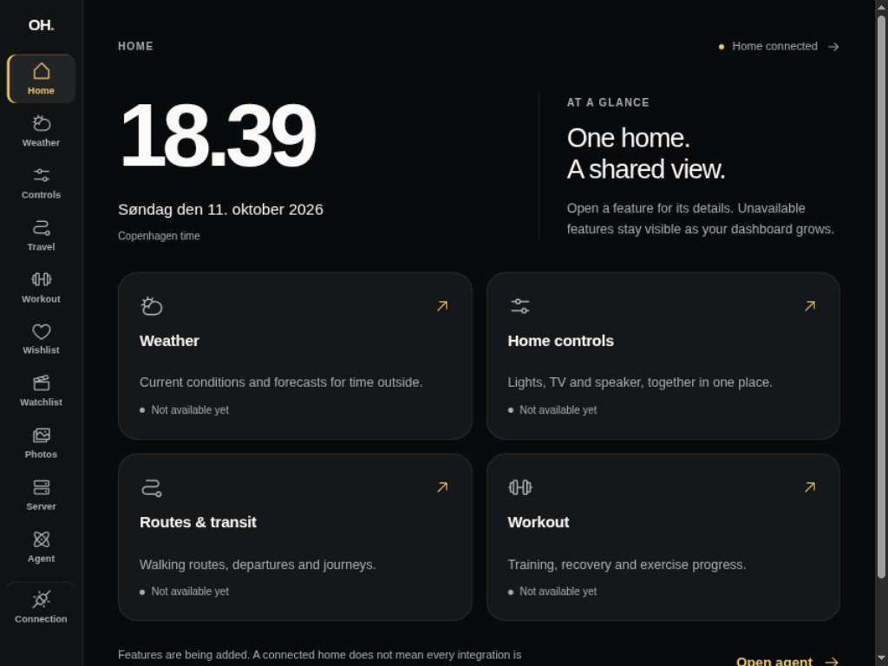
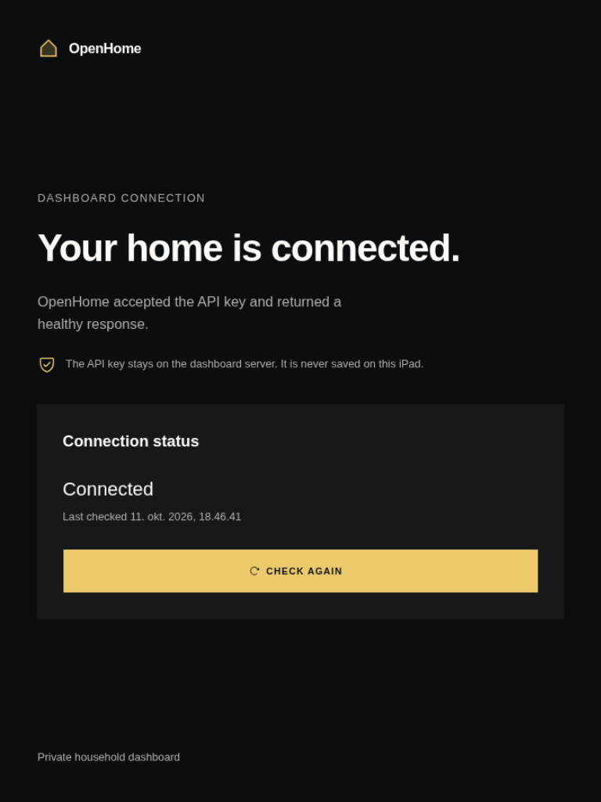
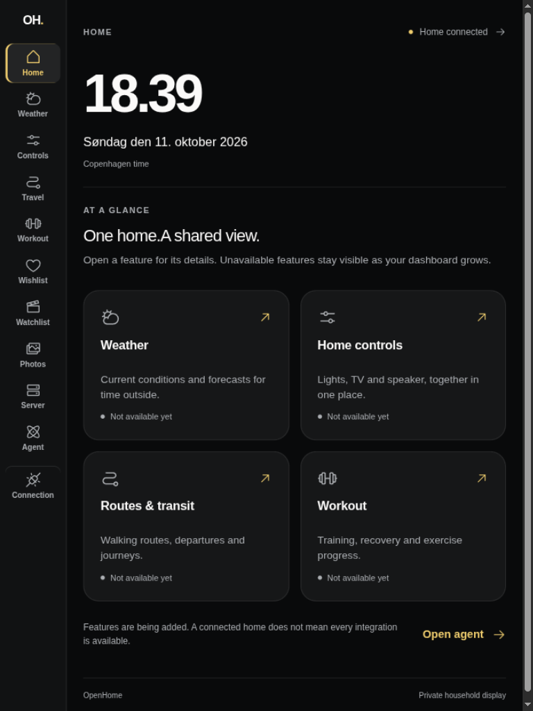
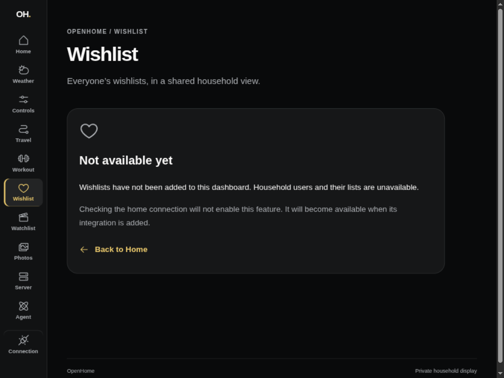
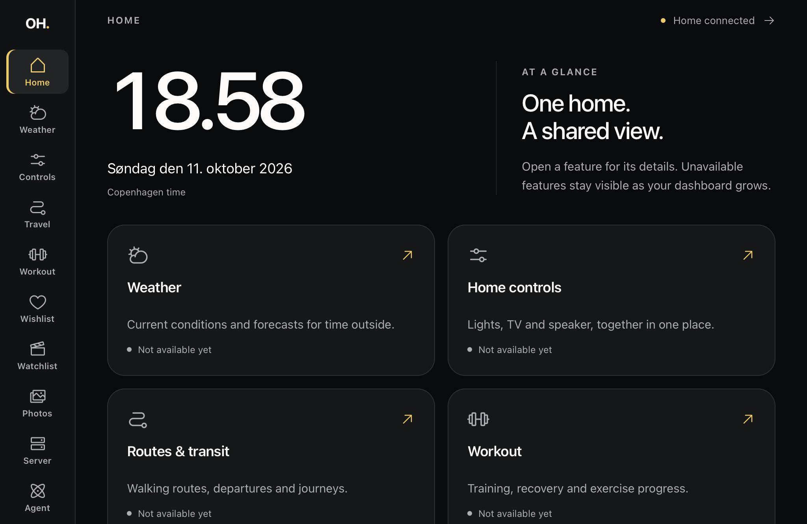
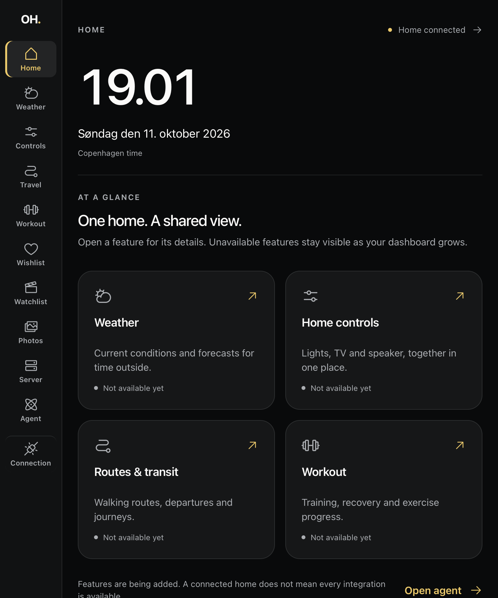
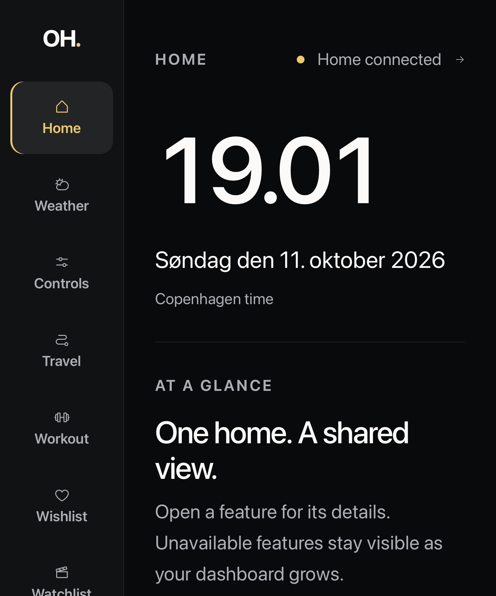

# Home frame verification (#91)

This slice follows #70 and the updated design direction in #69/#70: the
Executor prototype is inspiration, while production uses TanStack Start,
shared shadcn primitives and the existing server-held Axum connection.

## Evidence

The before image shows #151's connected screen. The after images use only the
isolated authenticated Axum health fixture with its synthetic API key. There
are no household records, provider connections, coordinates or private hosts.
All unfinished features explicitly say **Not available yet**.

| Before (1024 × 768)              | Home (1024 × 768)                 |
| -------------------------------- | --------------------------------- |
|  |  |

| Before (768 × 1024)                                   | Home (768 × 1024)                      |
| ----------------------------------------------------- | -------------------------------------- |
|  |  |

## Automated and desktop checks

- `devenv shell -- just dashboard-check`: format, lint, typecheck, 16 tests and
  production build passed. Existing authenticated health/failure/privacy tests
  remain intact under `/connection`.
- Rendered navigation tests cover Home cards, persistent sidebar links, browser
  back, current-page indication and heading focus. The test caught an early
  focus attempt before the destination rendered; navigation now focuses after
  TanStack's `onRendered` event.
- The rendered clock test checks Danish time/date across Copenhagen midnight,
  a hidden display and immediate catch-up on visibility.
- Collaborative desktop preview checked 1024 × 768 and 768 × 1024, real sidebar
  navigation, focused feature states and keyboard activation. All eleven rail
  destinations fit at 1024 × 768 with 56 px minimum height. Browser emulation
  is not a physical touch or Safari compatibility result.
- Reflow checked at 512 × 384 and with the root text size enlarged to 200%,
  including Connection. The document did not overflow horizontally; the
  narrow navigation bar scrolls to reach every destination.
- Skip-link activation moves focus to the main content; page changes move it
  to the destination heading. Visual focus-ring verification remains part of
  the device pass because the automated preview document is not window-focused.
- The reviewer caught the narrow skip-link target scrolling under the sticky
  rail. A text-scaled anchor offset keeps the heading and first control below
  it; the browser geometry check failed before the fix and passed afterward
  at normal and 200% root text size. The DOM test environment cannot measure
  layout, so this is verified at the actual browser boundary.
- The reduced-motion stylesheet suppresses transitions/animations; the clock
  itself does not animate. No continuous animation or provider polling is added.

## Physical Safari inspection — 11 October 2026

The attached iPad 6th generation (`iPad7,5`), running iPadOS 17.7.11, was
inspected through Safari Web Inspector over USB after Web Inspector was enabled
on the device. Safari loaded the development dashboard through a localhost USB
tunnel, using the same isolated authenticated Axum health fixture. These are
actual Safari page snapshots, excluding browser chrome and other tabs.

| Landscape · 1024 × 665 CSS px                        | Portrait · 768 × 921 CSS px                        |
| ---------------------------------------------------- | -------------------------------------------------- |
|  |  |

- Both orientations rendered without horizontal document overflow. Safari
  supported the theme's `oklch` colors and `svh` viewport sizing.
- Inspector-driven link activation reached all eleven navigation destinations
  in portrait. Each destination had the correct URL, current-page indication
  and focused heading; browser history returned Weather to Home. Connection
  reported the synthetic API as connected. No console errors were observed
  during inspection and navigation.
- The landscape rail had 735 px of content in its 665 px viewport and was
  independently scrollable. Portrait content scrolling kept the rail fixed.
  At 200% root text size, Home and Connection had no horizontal document
  overflow, and scrolling the rail brought Connection fully into view.
  This text enlargement is not Safari page zoom or a physical pinch gesture.
- The live clock advanced across the 19.00 minute boundary and continued to
  19.02 while Safari remained visible.
- Portrait inspection caught joined headline sentences when the responsive
  layout hid the line break. A real Safari `innerText` assertion failed before
  adding the separating space and passed afterward. The portrait snapshots
  show the fix; landscape was captured before it, where the line break remains.

Physical finger taps/swipes, Safari 200% page zoom, hardware keyboard and visible
focus, reduced-motion settings, date rollover and hidden/resumed clock behavior
still require manual device verification. Remote DOM activation and screenshots
do not complete those gates in #70/#69.

Feature implementation, provider health, the integrated Home (#133), data
recovery/drafts (#119) and release acceptance remain separate slices. No parent
issue is closed by this evidence.
