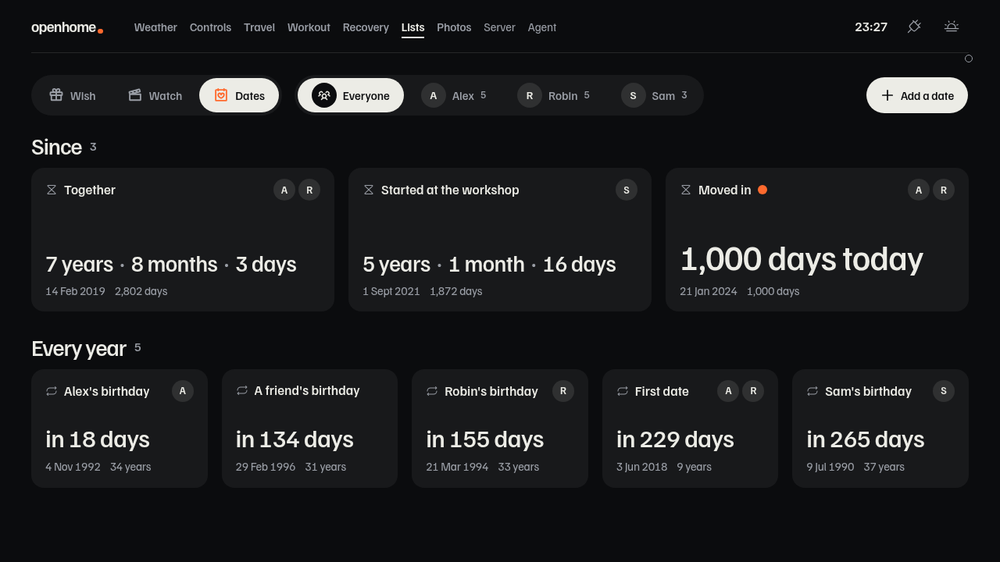
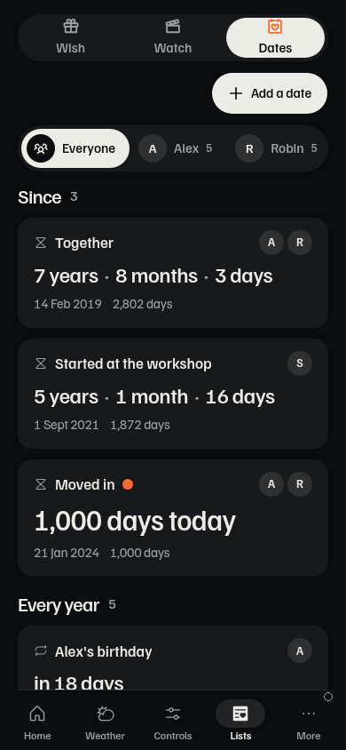
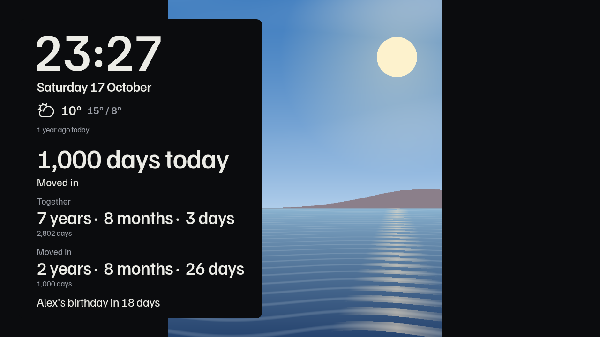
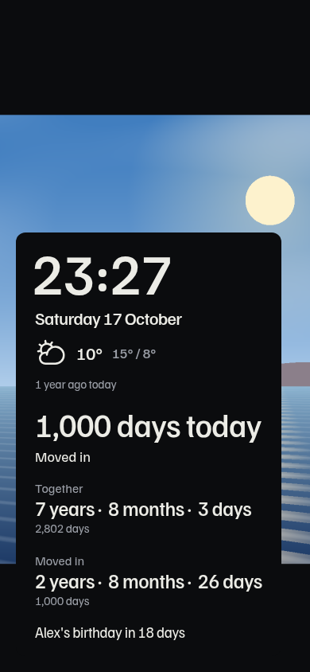

# Important Dates and idle photos

Captured from `just dashboard-synthetic` with invented people, dates and drawn
photos. The preview seeds “Moved in” at 1,000 days on the seed day; no household
services, identities or credentials are used.

The idle lead shares the filtered Important Dates read with the elapsed counters
and upcoming line. Axum supplies the milestone; the display refreshes at
Europe/Copenhagen midnight. The clock stays larger than the milestone, including
on a 1280 × 720 display.

| View  | Landscape                                 | Phone                                |
| ----- | ----------------------------------------- | ------------------------------------ |
| Dates |  |  |
| Idle  |    |    |

[Idle, 1920 × 1080](idle-wall.png) · [Idle, 820 × 1180](idle-portrait.png)
