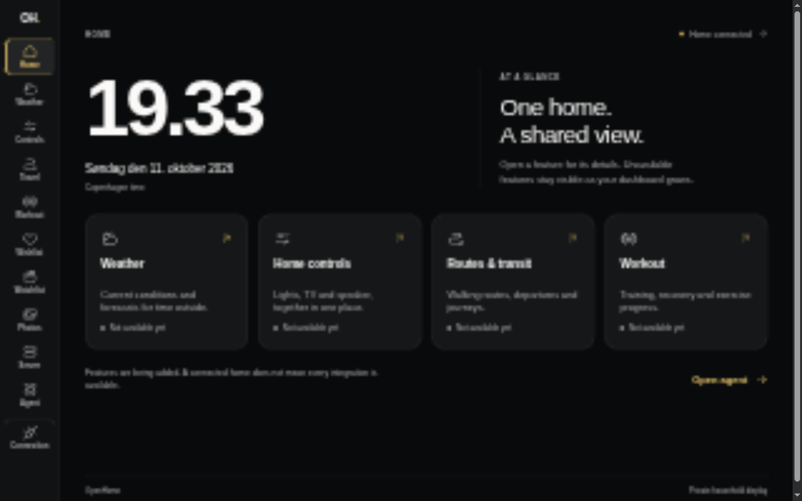
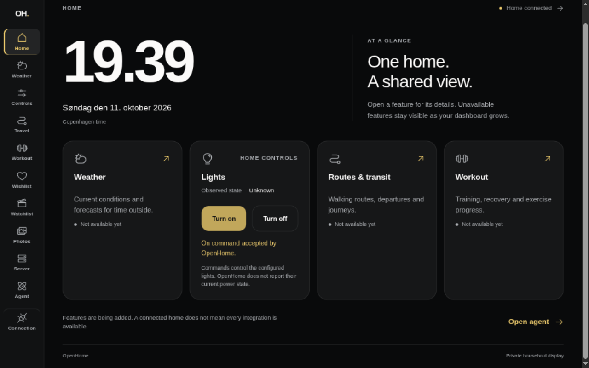
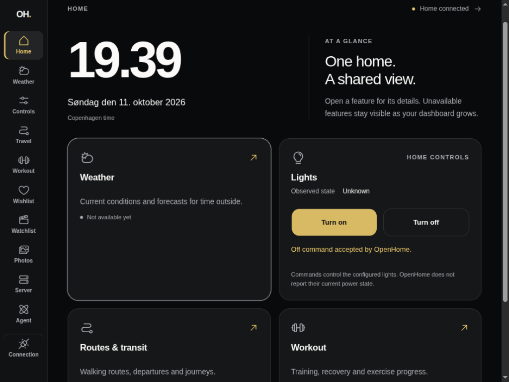
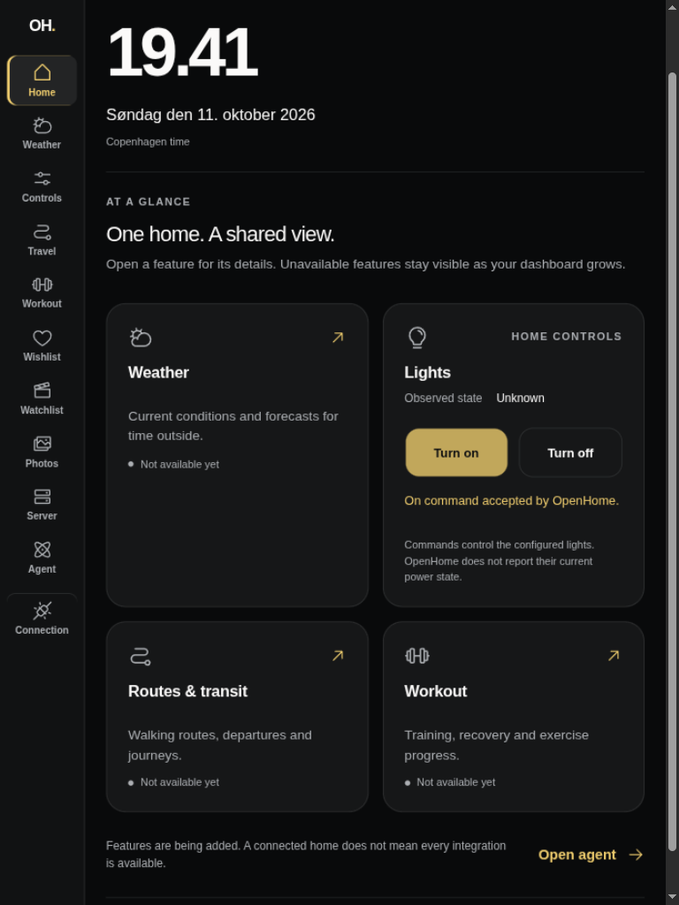
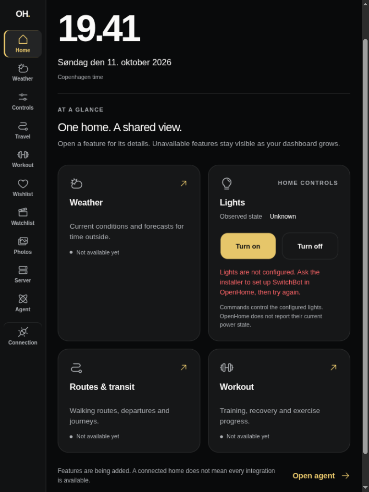
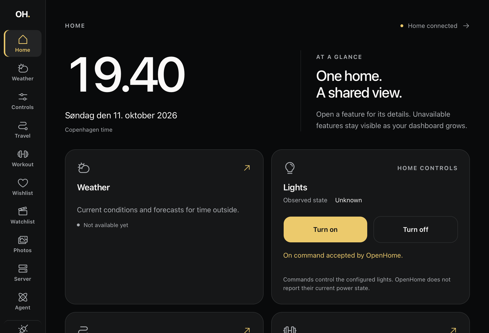

# Light controls verification (#92)

Home now sends the existing Axum light on/off commands through the private
TanStack server. A command acknowledgement stays separate from **Observed
state: Unknown**. TV and speaker remotes remain later slices of #71.

## Public visual evidence

All captures use synthetic API responses and a synthetic server-held API key.
They contain no household devices, identities, provider addresses or credentials.

| Before · 1280 × 800                        | After · 1280 × 800                                                           |
| ------------------------------------------ | ---------------------------------------------------------------------------- |
|  |  |

| Landscape · 1024 × 768                             | Portrait · 768 × 1024                            |
| -------------------------------------------------- | ------------------------------------------------ |
|  |  |

## Automated and browser checks

- `devenv shell -- just dashboard-check`: formatting, lint, types, 26 tests and
  the production build pass. Existing authenticated Axum health tests remain
  intact after sharing the private request transport with light commands.
- `devenv shell -- just api-test-integration switchbot`: all five existing
  production SwitchBot route tests pass; no API behavior changes were needed.
- Rendered controls verify pending announcements, disabled buttons, queued-tap
  suppression, accepted on/off outcomes, missing setup, provider failure, RPC
  failure and recovery. Every result keeps observed power unknown.
- Controlled HTTP responses verify authenticated POST paths, deployment URL
  prefixes, safe acknowledgements, rejected credentials, malformed responses,
  missing setup, redirect refusal and a bounded stalled command. No command is
  retried automatically.
- The collaborative browser exercised the real TanStack POST server function
  against a synthetic Axum boundary: accepted commands, missing setup, provider
  errors and connection loss recover without exposing private response text.
  Three queued activations dispatched one authenticated command. An unsupported
  `toggle` input was rejected before dispatch.
- Landscape and portrait have no horizontal document overflow, and command
  buttons are at least 56 CSS px high. At 200% root text size in portrait, a
  browser assertion found overflowing button text before the layout fix. The
  buttons now stack when needed, and the same assertion passes. This is text
  enlargement, not browser page zoom.

## Actual Safari inspection — 11 October 2026

The attached iPad 6th generation (`iPad7,5`, iPadOS 17.7.11) loaded the synthetic
dashboard over a USB tunnel, inspected through Safari Web Inspector.

- Actual Safari shows unknown observed power before and after acknowledgement.
- With a delayed response, three inspector-driven activations produced one
  command; both buttons disabled and the pending announcement appeared, then
  the accepted result re-enabled them.
- Missing SwitchBot setup produced actionable feedback. A subsequent accepted
  command recovered without a page reload.
- At normal and 200% root text size, the document had no horizontal overflow and
  both button labels fit. Normal text size and Home were restored afterward.
- No Safari console errors were observed during these checks. Physical finger
  taps, portrait hardware rotation and Safari page zoom remain manual release
  checks; remote DOM activation is not physical touch verification.

## Live household smoke

One deliberately chosen `devenv shell -- openhome lights on` command used the
configured private OpenHome connection. The real Axum API acknowledged it with
`{"message":"Light switched on"}`. No live command was used as an automated
fixture or public capture. This verifies the live command acknowledgement;
physical power was not independently observed and remains unknown in the UI.

This completes the light-command slice; it does not close the parent controls
specification (#71) or dashboard release tracker (#69).
