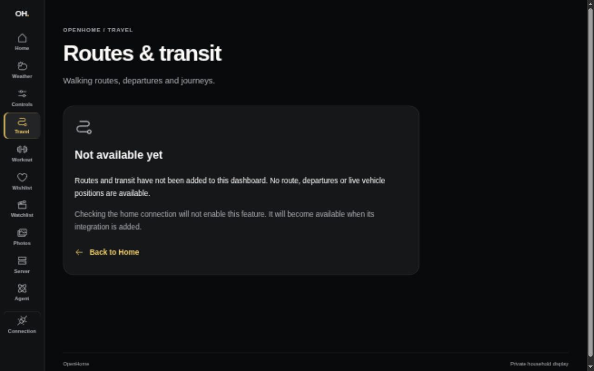
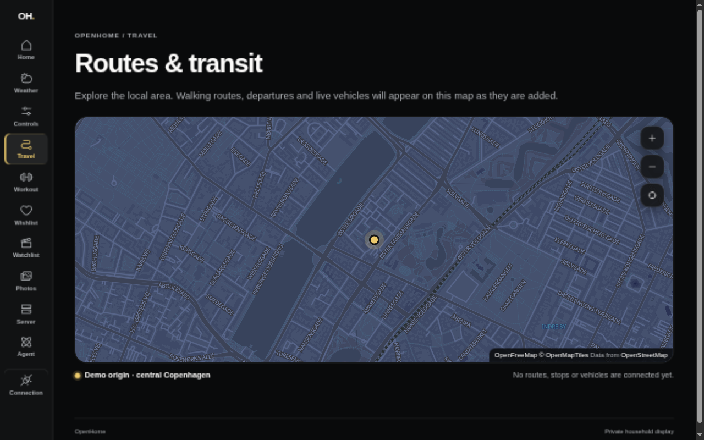

# Private-origin 2D map (#104)

The Travel view now renders the shared map. Route/transit overlays and the
local 3D toggle are subsequent tickets; this slice does not invent those data.

Configure the Axum API privately with `MAP_ORIGIN_LATITUDE` and
`MAP_ORIGIN_LONGITUDE`, or explicitly enable `MAP_DEMO_ORIGIN=true` for public
demonstrations. Leaving all three empty shows setup instructions. The demo
cannot become an implicit production default or be combined with private
coordinates. Restart Axum after changing its configuration.

The captures use the isolated authenticated Axum fixture and the unrelated
central Copenhagen demo point. They contain no household configuration.

| Before                            | After                                   |
| --------------------------------- | --------------------------------------- |
|  |  |

## Observed evidence — 2026-10-11

- Real OpenFreeMap tiles, provider attribution, origin marker, zoom, keyboard
  pan and recenter rendered in the desktop preview. Blocking provider style
  requests showed the retry state; restoring access and retrying loaded the map.
- Navigating to Home removed the map canvas, including on actual Safari.
  The component test verifies that a hidden page defers map initialization.
  The production preview loads the bundled worker on Travel and loads no
  MapLibre resources on Home.
- The loading-timeout regression fails without cancellation of the pending
  import and passes with it. Tests also exercise actual MapLibre initialization
  in an environment without WebGL and the retry UI, plus authenticated Axum
  origin reads and dashboard setup/transport failures.
- Target hardware: iPad7,5, iPadOS 17.7.11, actual Safari viewport 1024×665.
  Real tiles, attribution and controls rendered without horizontal overflow.
  The user confirmed that finger pan and pinch zoom work smoothly. Inspector
  button/navigation checks are distinct from that physical-touch confirmation.

Additional captures: [portrait](portrait.png),
[provider failure](provider-failure.png),
[actual iPad Safari](ipad-safari.png).

Parent #75 remains open for 3D and sustained interaction checks; the release
tracker #69 requires its remaining integrated device/provider acceptance.
