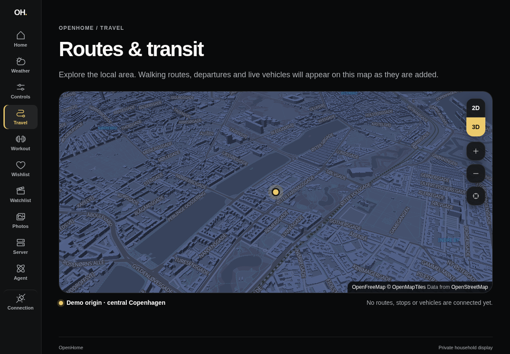

# Private-origin 2D map (#104)

The Travel view now renders the shared map. Route/transit overlays arrive with
their integrations; this slice does not invent those data.

Configure the Axum API privately with `MAP_ORIGIN_LATITUDE` and
`MAP_ORIGIN_LONGITUDE`, or explicitly enable `MAP_DEMO_ORIGIN=true` for public
demonstrations. Leaving all three empty shows setup instructions. The demo
cannot become an implicit production default or be combined with private
coordinates. Restart Axum after changing its configuration.

The captures use the isolated authenticated Axum fixture and the unrelated
central Copenhagen demo point. They contain no household configuration.

| Before                            | After                                   |
| --------------------------------- | --------------------------------------- |
|  |  |

## Observed evidence — 2026-10-11

- Real OpenFreeMap tiles, provider attribution, origin marker, zoom, keyboard
  pan and recenter rendered in the desktop preview. Blocking provider style
  requests showed the retry state; restoring access and retrying loaded the map.
- Navigating to Home removed the map canvas, including on actual Safari.
  The component test verifies that a hidden page defers map initialization.
  The production preview loads the bundled worker on Travel and loads no
  MapLibre resources on Home.
- The loading-timeout regression fails without cancellation of the pending
  import and passes with it. Tests also exercise actual MapLibre initialization
  in an environment without WebGL and the retry UI, plus authenticated Axum
  origin reads and dashboard setup/transport failures.
- Target hardware: iPad7,5, iPadOS 17.7.11, actual Safari viewport 1024×665.
  Real tiles, attribution and controls rendered without horizontal overflow.
  The user confirmed that finger pan and pinch zoom work smoothly. Inspector
  button/navigation checks are distinct from that physical-touch confirmation.

Additional captures: [portrait](portrait.png),
[provider failure](provider-failure.png),
[actual iPad Safari](ipad-safari.png).

## Local 3D buildings (#105)

The 2D/3D toggle tilts the same map to 55° and extrudes OpenMapTiles building
heights. The origin marker stands in for future route, stop and vehicle
overlays: it stays above the buildings, and switching keeps the center and zoom.

| 2D                       | 3D                                |
| ------------------------ | --------------------------------- |
|  |  |

Fallbacks are explicit. Below zoom 14 the 3D view says to zoom in; a view with
no buildings near the map center says so; a provider style without building
data disables 3D.
Losing the WebGL context in 3D restarts the map in 2D at the same viewport
([capture](3d-graphics-fallback.png)). Losing it in 2D keeps the existing retry
state.

### Observed evidence — 2026-10-12

- Desktop preview against the authenticated Axum fixture: switching, the
  zoom-in notice and `WEBGL_lose_context` fallback (center and zoom preserved)
  behaved as described. [Portrait](3d-portrait.png) fits without overflow.
- Target hardware: iPad7,5, actual Safari viewport 1024×665. Twenty automated
  2D/3D switches 1.5 s apart left the map ready without graphics failure:
  frame intervals median 17 ms, p95 29 ms, worst 139 ms. Eighty keyboard pans
  in 3D over 16 s: median 17 ms, p95 19 ms, worst 141 ms.
  [Actual iPad Safari capture](ipad-safari-3d.png).
- Finger pan and pinch in 3D on the physical iPad still need confirmation by
  hand; Web Inspector cannot produce real touches, so the pans above were
  keyboard-driven.

The no-building-data notice was reasoned from the rendered-features check and
not reproduced: the demo area has buildings everywhere.

Parent #75 stays open until routes and transit use these map views. The
release tracker #69 still requires integrated device/provider acceptance.
