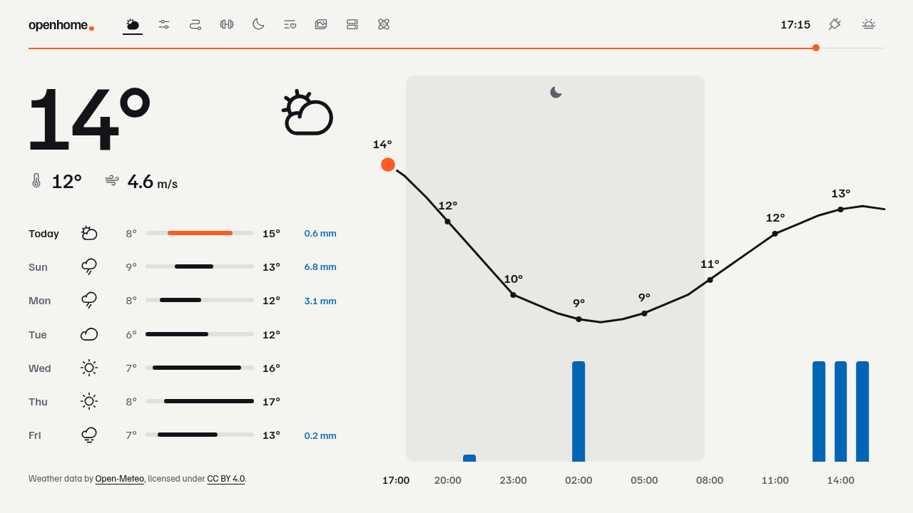
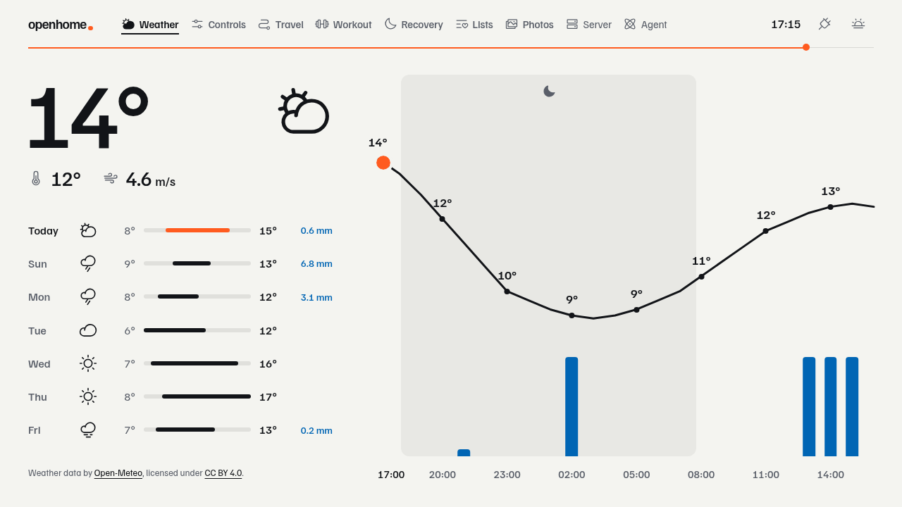
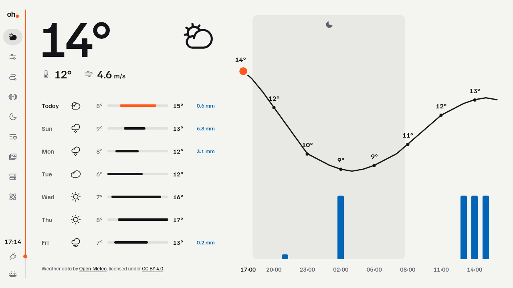
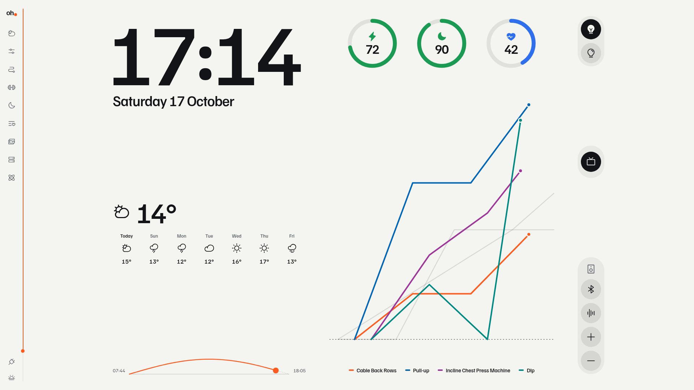
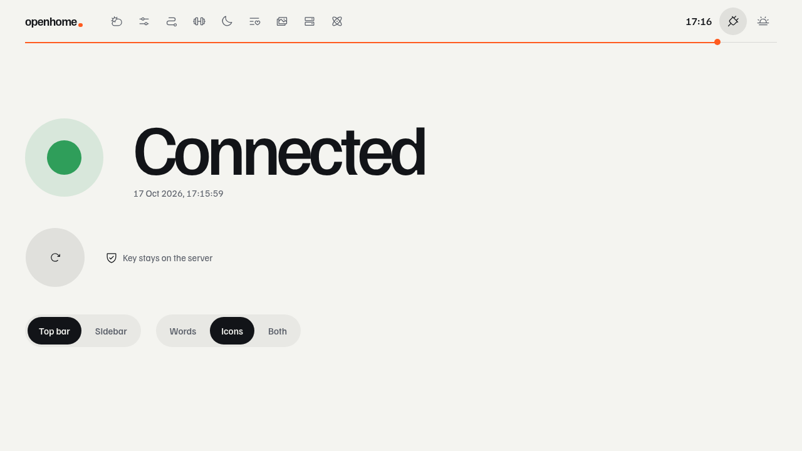
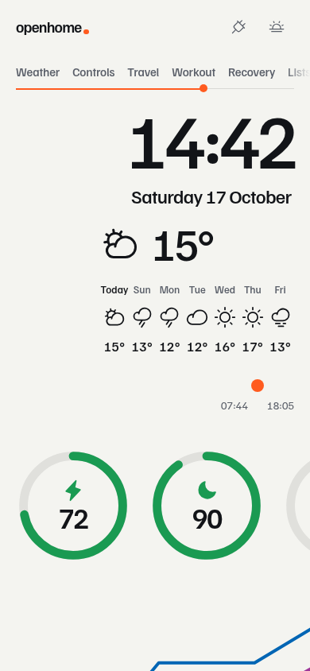
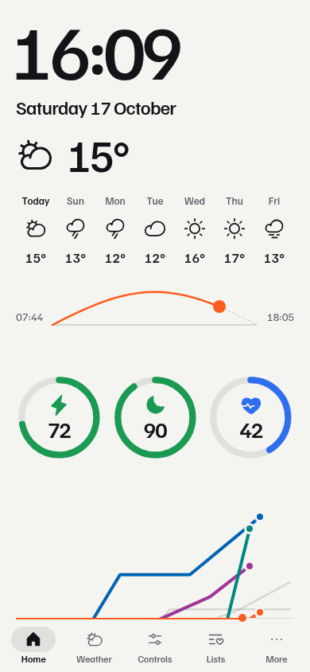
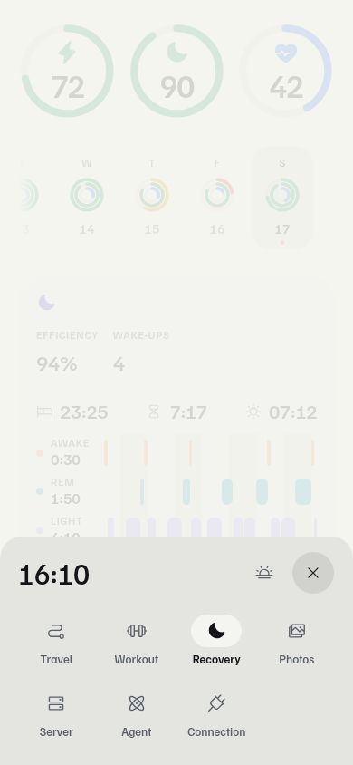

# Navigation layouts

Two layouts, kept side by side. Double-tap the logo to switch between them, or use the
switches on Connection. Both choices are cookies read on the server, so the first draw is
right. Captured from `just dashboard-synthetic`.

| Top bar, words (default) | Top bar, icons          | Top bar, both         |
| ------------------------ | ----------------------- | --------------------- |
|   |  |  |

| Sidebar, 1280 × 720     | Sidebar, 1920 × 1080              | Connection switches         |
| ----------------------- | --------------------------------- | --------------------------- |
|  |  |  |

| Phone before                                   | Phone tab bar                | More sheet              |
| ---------------------------------------------- | ---------------------------- | ----------------------- |
|  |  |  |
