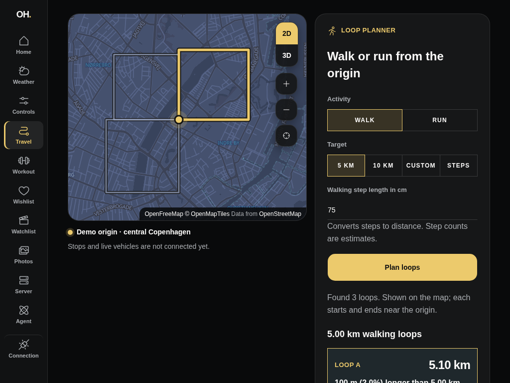
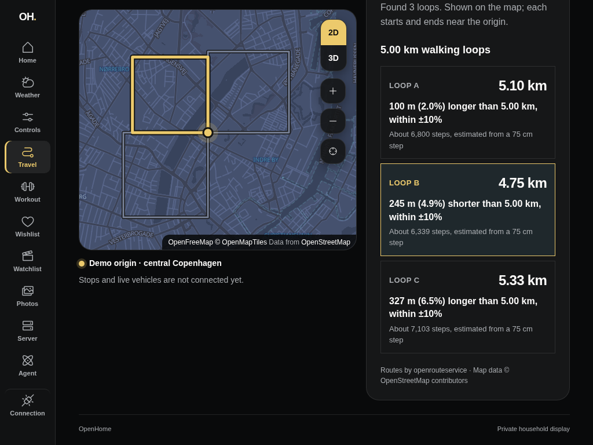
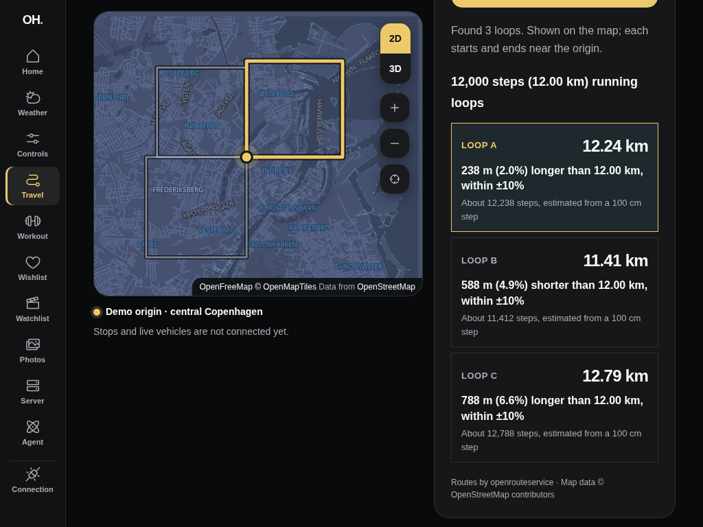
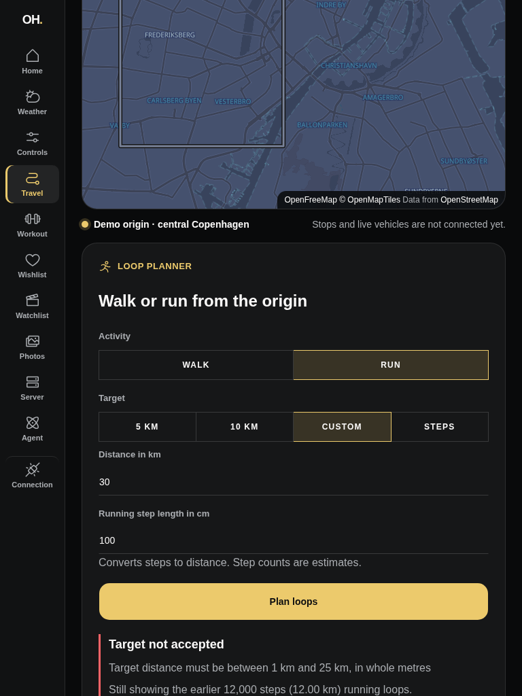
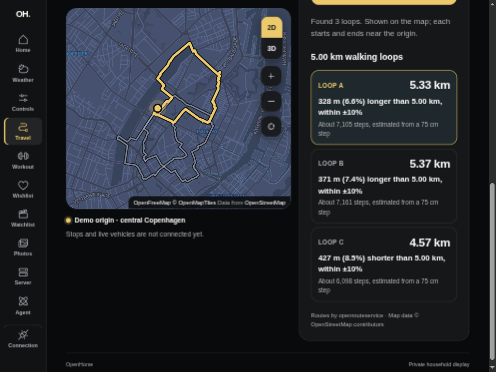
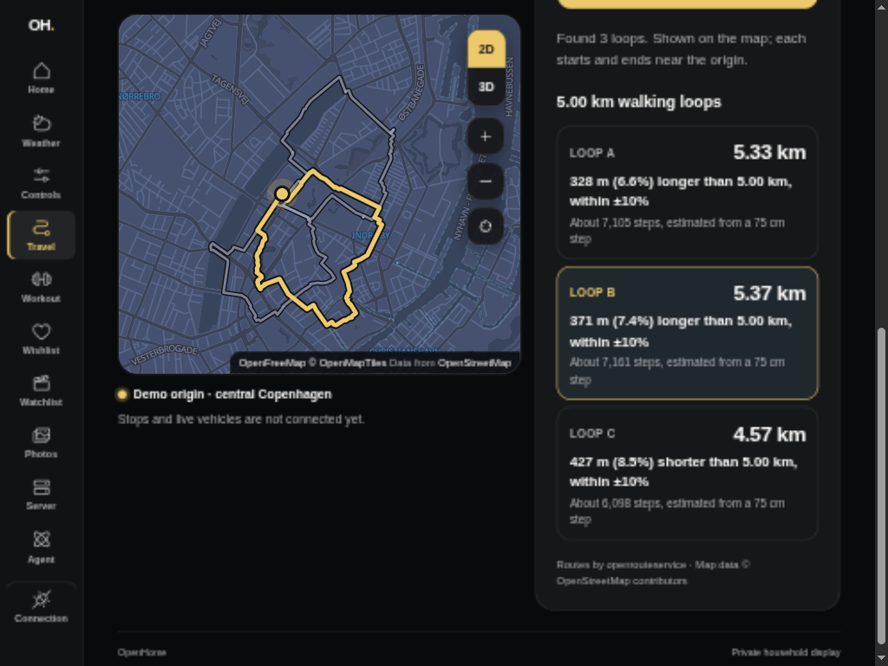
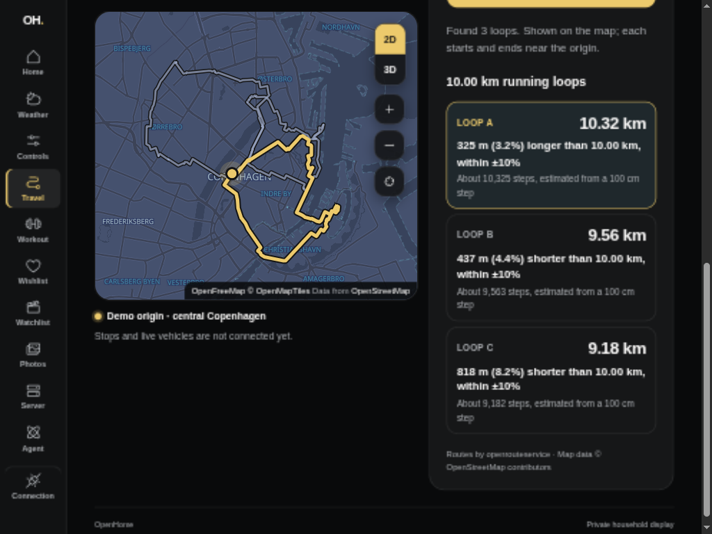
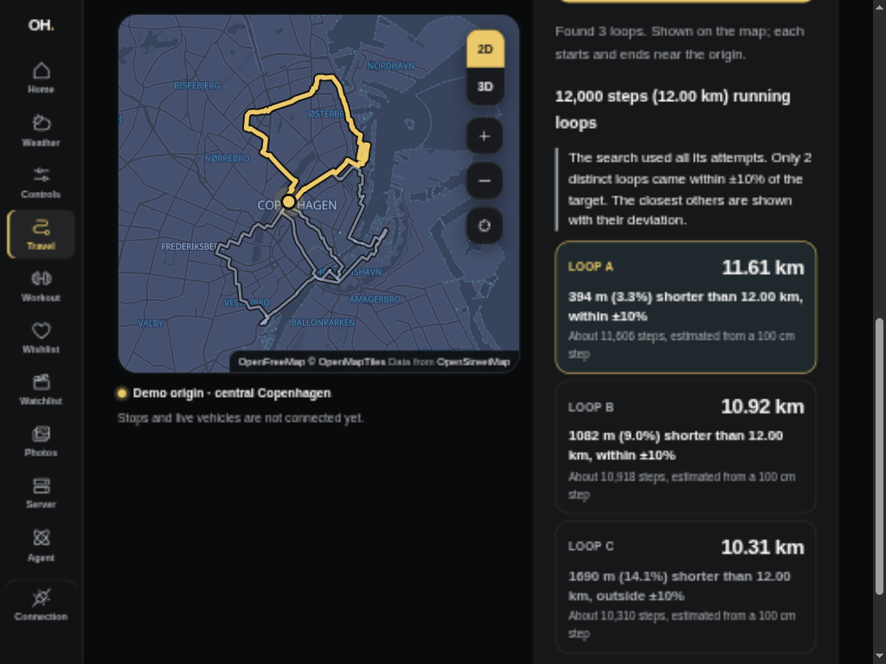
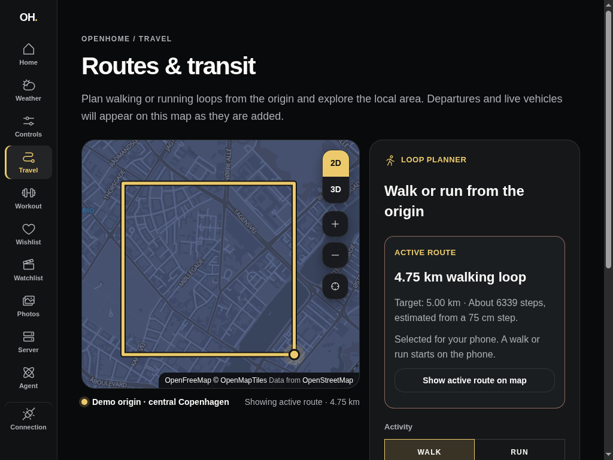
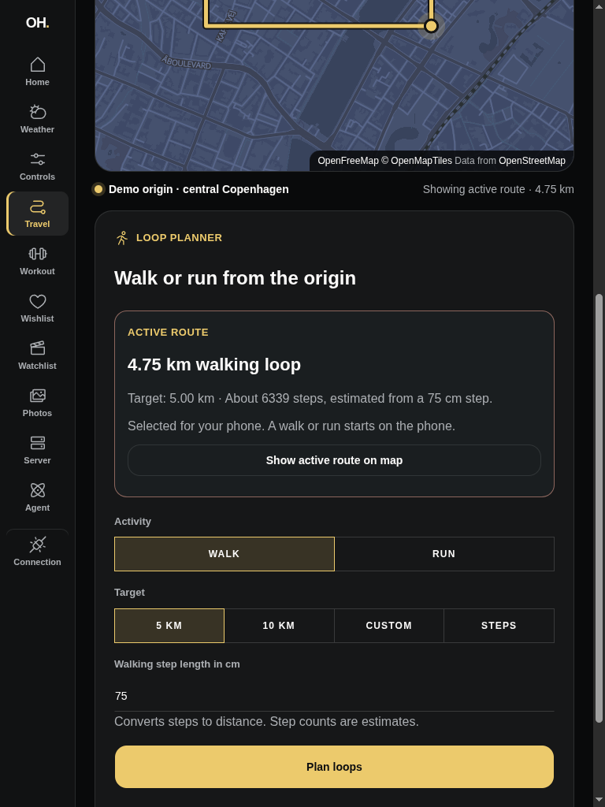

# Walking loop (#106)

Travel can now plan a 5 km walking loop from the shared map origin. Axum asks
the household's self-hosted openrouteservice for a pedestrian round trip,
measures the returned geometry itself and only then hands it to the dashboard.
The dashboard draws that geometry on the shared map and reports the measured
length against the target.

Configure the Axum API privately with `OPENROUTESERVICE_URL`, the instance base
URL ending before `/v2` (for example `http://openrouteservice:8082/ors`). The
instance must have the `foot-walking` profile enabled, and a map origin must be
configured. Leaving it empty shows setup instructions. OpenHome never calls
HeiGIT's public API: the origin goes only to the household's own instance.

The captures use the isolated authenticated Axum fixture with the unrelated
central Copenhagen demo point. **In the before/after, 3D and portrait captures
the drawn loop is a synthetic rectangle served by a loopback stand-in for
openrouteservice, not a real walkable path.** It exercises the real request,
measurement and rendering path end to end. The real loop below came from the
household's own instance.

| Before (1024 × 768)         | After (1024 × 768)                  |
| --------------------------- | ----------------------------------- |
|  |  |

| 3D buildings (1024 × 768)               | Portrait (768 × 1024)                               |
| --------------------------------------- | --------------------------------------------------- |
|  |  |

## Observed evidence — 2026-10-12

- Axum integration tests drive a wiremock openrouteservice through the
  authenticated route: request shape (`round_trip.length`, ferries avoided),
  a matching loop, a labeled 16% deviation, rejection of loops that start far
  from the origin, do not close or miss the target by more than 50%, malformed
  or disagreeing provider responses, no-route versus outage outcomes, and
  invalid requests rejected before the provider is contacted. Upstream error
  text never reaches the response or the logs.
- Dashboard component tests run against the real Axum fixture: a generated
  loop is measured and drawn from the origin, provider failures and malformed
  routes clear the map instead of keeping an old loop, and an out-of-tolerance
  loop is labeled as outside ±10%.
- Desktop preview: the loop is fitted once, stays drawn when switching to 3D
  buildings and reflows below the map in portrait.

## Real loop from the self-hosted provider — 2026-10-12

The household's openrouteservice 10.0.1 instance initially built only the
image's default `driving-car` graph, so the real Axum route answered
`provider-unavailable` (openrouteservice code 2003, unknown profile) instead of
inventing a route. Enabling `ors.engine.profiles.foot-walking.enabled=true`
built the walking graph for Denmark in about three minutes.

From the demo origin, the real Axum route then generated a 5.37 km loop:
371 m (7.4%) over the 5 km target, within ±10%, starting and ending 3.5 m from
the origin. The same request with openrouteservice's extra details showed it
suits walking:

- Way types: 89% footway, 8.4% street, 1.2% path, 0.4% cycleway and 0.4% steps.
  No motorways, tolls or ferries.
- Surfaces: mostly paving stones, with compacted gravel around Christiansborg
  and some asphalt.
- Route: Øster Farimagsgade, Sølvgade, Adelgade, Borgergade, the Købmagergade
  and Amagertorv pedestrian streets, Højbro Plads, Christiansborg, Marmorbroen,
  Frederiksholms Kanal, the Latin Quarter, Vester Voldgade and Nansensgade.


To repeat the check against an instance:

```sh
OPENROUTESERVICE_URL=https://<instance>/ors devenv shell -- just dashboard-health-fixture-run
```

# Loop alternatives, running and step targets (#107)

Travel now plans walking or running loops for 5 km, 10 km, a custom distance
or a step target, and compares up to three distinct alternatives on the map.
Axum converts steps with the household's step length, searches up to six
round-trip seeds for three distinct loops within ±10%, caches completed
searches and reports a shortfall instead of padding the set
([ADR 0009](../../../docs/adr/0009-loop-alternatives-and-step-targets.md)).

The captures use the isolated authenticated Axum fixture with the unrelated
central Copenhagen demo point. **Its loopback stand-in for openrouteservice
answers each seed with a synthetic square in its own direction, not a real
walkable path.** It exercises the real request, search, measurement and
rendering path end to end.

| Three 5 km walking loops (1024 × 768)           | Comparing Loop B (1024 × 768)                   |
| ----------------------------------------------- | ----------------------------------------------- |
|  |  |

| 12,000 running steps at 100 cm (1024 × 768)            | Rejected target keeps earlier loops (768 × 1024)                               |
| ------------------------------------------------------ | ------------------------------------------------------------------------------ |
|  |  |

## Observed evidence — 2026-10-12

- Axum integration tests drive a wiremock openrouteservice through the
  authenticated route: three distinct matching loops end the search after three
  seeds; running requests avoid steps; step targets convert with the request's
  step length; repeated loops are not counted twice; a 16% deviation is kept but
  never labelled a match; later requests are corrected for overshoot; completed
  searches are served from the cache while interrupted ones are retried;
  matching loops replace near-misses on the same streets; a later waypoint
  refusal does not end the search; tolerance labels agree at the rounding
  boundary; a queued search reports provider unavailability within its own
  time budget;
  no-route, outage and invalid responses stay explicit outcomes; invalid
  targets and step lengths are rejected before the provider is contacted.
- Dashboard component tests run against the real Axum fixture: the 5 km preset
  returns three measured loops that all start and end at the origin and are
  handed to the map with one highlighted; a running step target sends the
  running step length and labels steps as estimates; Axum's reason for an
  unsupported target is shown; failures keep the earlier loops and their
  heading; a shortfall is explained and deviations are labelled outside ±10%.
  Input errors identify and describe their field, and the result announcement
  includes any shortfall explanation.
- Desktop preview: the map stays in view beside the planner while scrolling to
  compare alternatives in landscape and the planner follows the map in
  portrait.

## Real alternatives from the self-hosted provider — 2026-10-12

The same openrouteservice 10.0.1 instance used for #106 generated these routes
through the current authenticated Axum endpoint and dashboard. The isolated
fixture supplies the unrelated Copenhagen demo origin and temporary database;
**every route below comes from the live pedestrian graph, not its synthetic
provider.** All five searches were also repeated against the instance's HTTPS
endpoint, producing identical plans and geometry to the cluster-service
check. No private hostname, household coordinates or credentials are included
in the evidence.

| Request                         | Converted target | Measured alternatives A / B / C | Matches within ±10% | Search    |
| ------------------------------- | ---------------- | ------------------------------- | ------------------- | --------- |
| Walking, 5 km                   | 5,000 m          | 5,328 / 5,371 / 4,573 m         | 3                   | Complete  |
| Walking, 10,000 steps at 75 cm  | 7,500 m          | 7,933 / 7,938 / 6,827 m         | 3                   | Complete  |
| Running, 10 km                  | 10,000 m         | 10,325 / 9,563 / 9,182 m        | 3                   | Complete  |
| Running, 12,000 steps at 100 cm | 12,000 m         | 11,606 / 10,918 / 10,310 m      | 2                   | Exhausted |
| Walking, custom 8.5 km          | 8,500 m          | 8,443 / 8,100 / 9,298 m         | 3                   | Complete  |

The running Step Target used all six attempts. Its third loop is 1,690 m
(14.1%) short and is labelled outside ±10%; the dashboard explains that only
two distinct loops matched instead of presenting all three as matches.

| Three real 5 km walking loops (1024 × 768)                  | Comparing the real Loop B (1024 × 768)                    |
| ----------------------------------------------------------- | --------------------------------------------------------- |
|  |  |

| Three real 10 km running loops (1024 × 768)                 | Real running Step Target with a shortfall (1024 × 768)                                      |
| ----------------------------------------------------------- | ------------------------------------------------------------------------------------------- |
|  |  |

Suitability was inspected for all 15 returned alternatives by repeating their
exact provider seed, calibrated length and avoidance options with `waytype`,
`waycategory` and `surface` extra information. The repeated geometry matched
the geometry returned by Axum in every case, and independently measured
geometry agreed with each reported distance to the nearest metre.

- Every loop starts 3.5 m from the demo origin and closes at its starting point.
- No returned alternative contains a motorway or ferry according to the
  provider's [way categories](https://giscience.github.io/openrouteservice/api-reference/endpoints/directions/extra-info/waycategory).
- All six running alternatives contain no steps. The three 5 km walking loops
  are 86.57%, 89.05% and 94.53% footway according to the provider's
  [way types](https://giscience.github.io/openrouteservice/api-reference/endpoints/directions/extra-info/waytype).
- The walking alternatives visit different areas: Sortedam Dossering and
  Kronprinsessegade; Christiansborg and Marmorbroen; and the pedestrian streets
  around Kultorvet and Strøget. Running alternatives reach Kastellet and
  Christianshavn, Nørrebro, and Østerbro.
- During the cluster-service check, stopping the temporary provider relay
  before an uncached 13 km request
  produces `provider-unavailable`; all three earlier real running loops remain
  on the map and can still be compared. Restarting the relay allows a retry.

Repeat against the configured instance with
`OPENROUTESERVICE_URL=https://<instance>/ors devenv shell -- just dashboard-health-fixture-run`.

# Persisted Active Route (#108)

Compare the alternatives, then use **Select Loop A/B/C** to persist the inspected
loop. The Active route panel identifies the last confirmed choice independently
of the alternatives currently being compared. Reloading Travel restores its
summary and draws its saved geometry; Show active route on map returns to it.
Starting a walk or run belongs to the phone's Route Session.

The authenticated mobile read is `GET /api/routes/active`; selection uses
`PUT /api/routes/active` with `{ "route_id": "<generated loop identity>" }`.
The read returns `{ "state": "none" }` before first selection, or
`{ "state": "selected", "route": { "id": "…", "version": 1, … } }`.
The route includes activity, original target (including converted step distance),
step length, actual distance, deviation, estimated steps and LineString geometry.
The revision increases when the selected identity changes. Retrying the current
identity keeps the revision. Axum accepts only previously generated candidates;
client-supplied geometry cannot become an Active Route. See
[ADR 0010](../../../docs/adr/0010-persisted-active-route-selection.md).

Selection shows pending feedback and confirms success only after Axum has
persisted it. A failed replacement keeps the last confirmed route visible.
Check selection reconciles a response that was lost after saving. Failed reads
state that an earlier choice may still be saved. Candidate retention is bounded
at 96 recent choices plus the selected route; a pruned choice asks for replanning.
The selected snapshot remains stored regardless of provider/cache availability.

## Observed evidence — 2026-10-12

- Authenticated API tests use migrated SQLite: running Step Target selection,
  exact geometry/distance retrieval, idempotent retries, database reconnect with
  no origin/provider, atomic concurrent revisions, unknown/forged candidates,
  failed-write rollback and bounded candidate retention.
- Rendered dashboard tests select Loop B through the real authenticated Axum
  fixture, unmount/reload the read, restore its summary and map geometry, show
  pending feedback, retain the confirmed choice after a failed replacement and
  offer recovery for unavailable reads and pruned candidates. Showing/checking
  a saved route synchronizes the inspected candidate; when the saved route is
  outside the alternatives, selection waits for another comparison. A rendered
  Travel route refresh also replaces the map's displayed route when another
  client selects a different loop.
- The desktop browser verifies real Start server functions: compare B, select
  B, then reload Travel; the saved 4.75 km loop returns without generating again.
  Public captures use only the unrelated Copenhagen demo origin and synthetic
  fixture squares, which are not real walkable paths.
- Physical iPad Safari and phone GPS/session acceptance remain separate release
  checks; this slice implements the authenticated phone read contract.

| Before: compared loops only                | After: saved selection restored on reload            |
| ------------------------------------------ | ---------------------------------------------------- |
|  |  |


