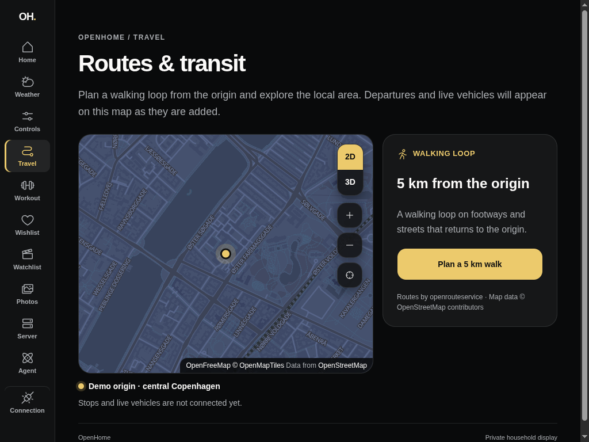
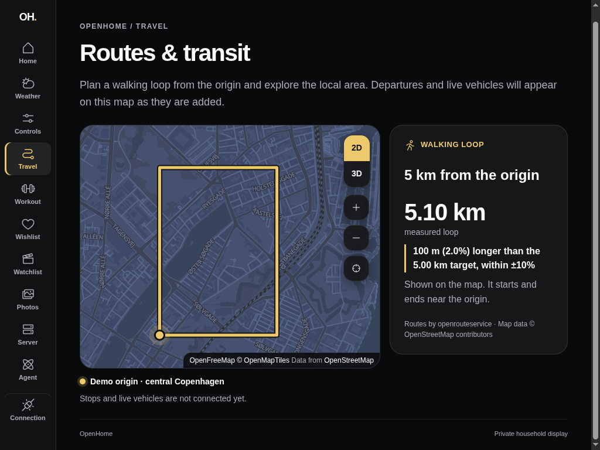
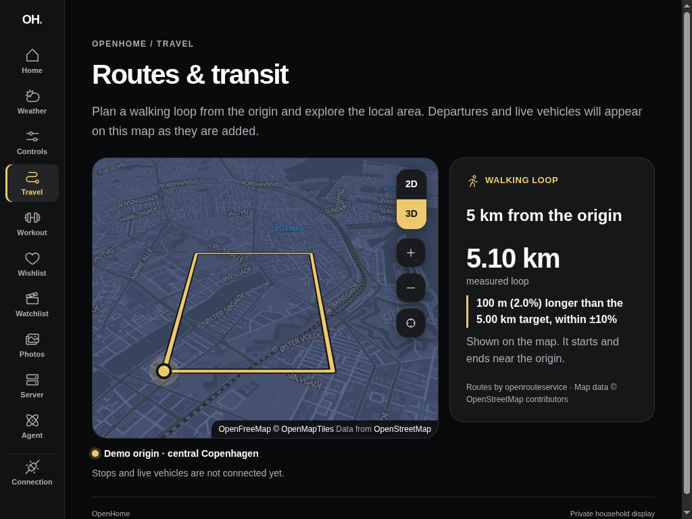
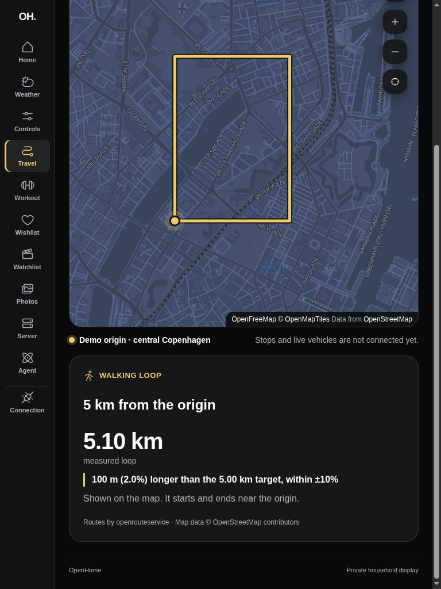
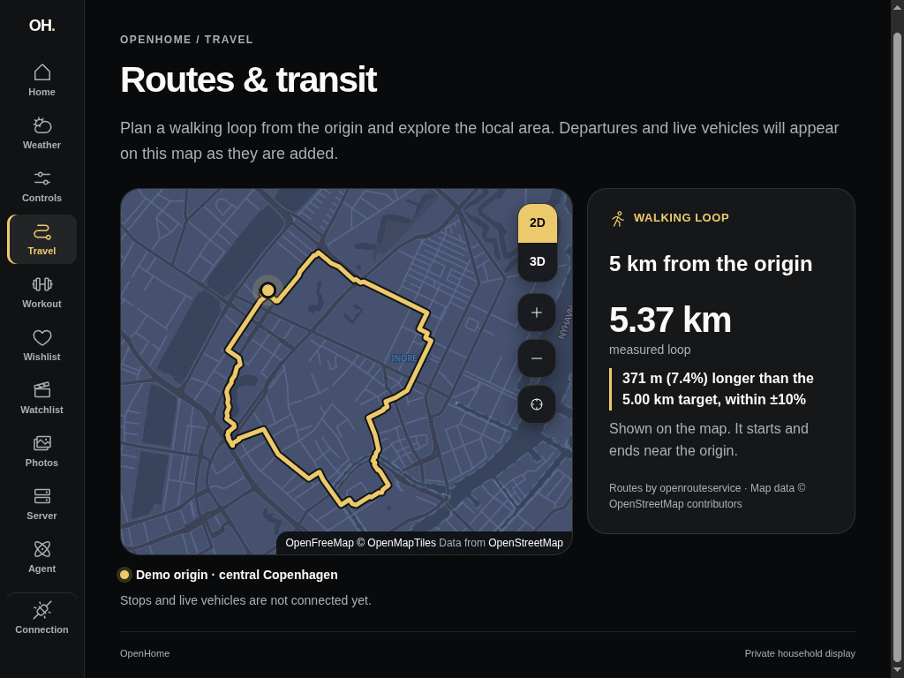

# Walking loop (#106)

Travel can now plan a 5 km walking loop from the shared map origin. Axum asks
the household's self-hosted openrouteservice for a pedestrian round trip,
measures the returned geometry itself and only then hands it to the dashboard.
The dashboard draws that geometry on the shared map and reports the measured
length against the target.

Configure the Axum API privately with `OPENROUTESERVICE_URL`, the instance base
URL ending before `/v2` (for example `http://openrouteservice:8082/ors`). The
instance must have the `foot-walking` profile enabled, and a map origin must be
configured. Leaving it empty shows setup instructions. OpenHome never calls
HeiGIT's public API: the origin goes only to the household's own instance.

The captures use the isolated authenticated Axum fixture with the unrelated
central Copenhagen demo point. **In the before/after, 3D and portrait captures
the drawn loop is a synthetic rectangle served by a loopback stand-in for
openrouteservice, not a real walkable path.** It exercises the real request,
measurement and rendering path end to end. The real loop below came from the
household's own instance.

| Before (1024 × 768)         | After (1024 × 768)                  |
| --------------------------- | ----------------------------------- |
|  |  |

| 3D buildings (1024 × 768)               | Portrait (768 × 1024)                               |
| --------------------------------------- | --------------------------------------------------- |
|  |  |

## Observed evidence — 2026-10-12

- Axum integration tests drive a wiremock openrouteservice through the
  authenticated route: request shape (`round_trip.length`, ferries avoided),
  a matching loop, a labeled 16% deviation, rejection of loops that start far
  from the origin, do not close or miss the target by more than 50%, malformed
  or disagreeing provider responses, no-route versus outage outcomes, and
  invalid requests rejected before the provider is contacted. Upstream error
  text never reaches the response or the logs.
- Dashboard component tests run against the real Axum fixture: a generated
  loop is measured and drawn from the origin, provider failures and malformed
  routes clear the map instead of keeping an old loop, and an out-of-tolerance
  loop is labeled as outside ±10%.
- Desktop preview: the loop is fitted once, stays drawn when switching to 3D
  buildings and reflows below the map in portrait.

## Real loop from the self-hosted provider — 2026-10-12

The household's openrouteservice 10.0.1 instance initially built only the
image's default `driving-car` graph, so the real Axum route answered
`provider-unavailable` (openrouteservice code 2003, unknown profile) instead of
inventing a route. Enabling `ors.engine.profiles.foot-walking.enabled=true`
built the walking graph for Denmark in about three minutes.

From the demo origin, the real Axum route then generated a 5.37 km loop:
371 m (7.4%) over the 5 km target, within ±10%, starting and ending 3.5 m from
the origin. The same request with openrouteservice's extra details showed it
suits walking:

- Way types: 89% footway, 8.4% street, 1.2% path, 0.4% cycleway and 0.4% steps.
  No motorways, tolls or ferries.
- Surfaces: mostly paving stones, with compacted gravel around Christiansborg
  and some asphalt.
- Route: Øster Farimagsgade, Sølvgade, Adelgade, Borgergade, the Købmagergade
  and Amagertorv pedestrian streets, Højbro Plads, Christiansborg, Marmorbroen,
  Frederiksholms Kanal, the Latin Quarter, Vester Voldgade and Nansensgade.



To repeat the check against an instance:

```sh
OPENROUTESERVICE_URL=https://<instance>/ors devenv shell -- just dashboard-health-fixture-run
```
