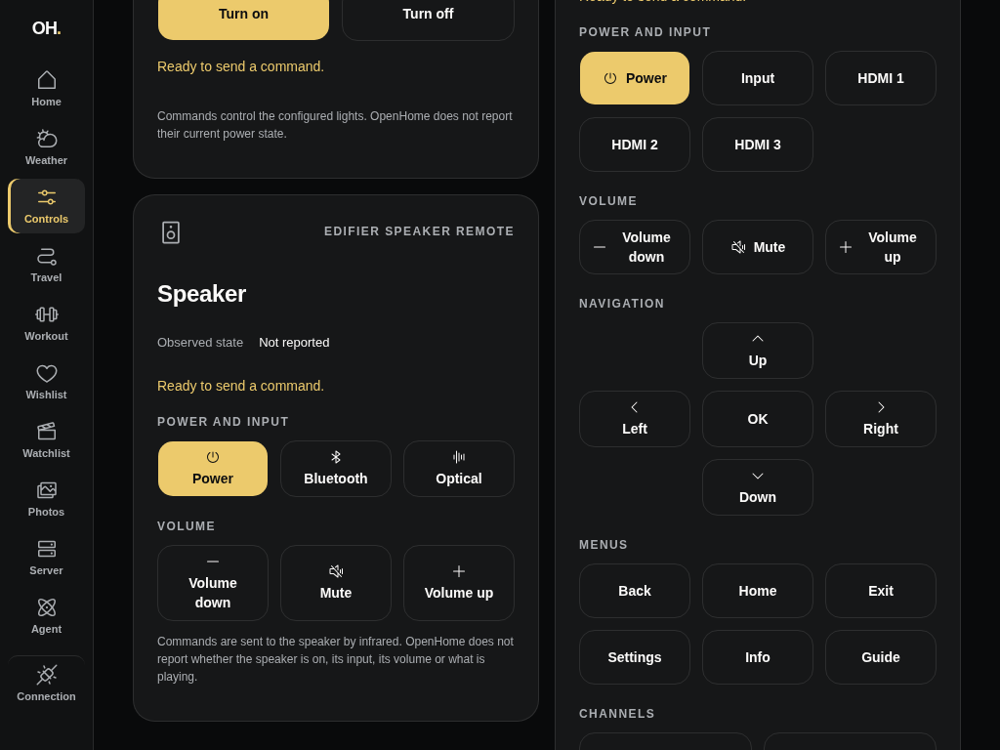
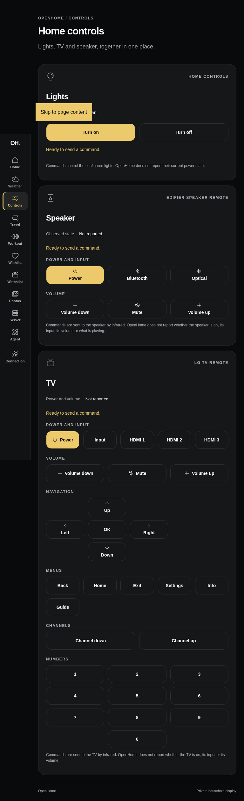
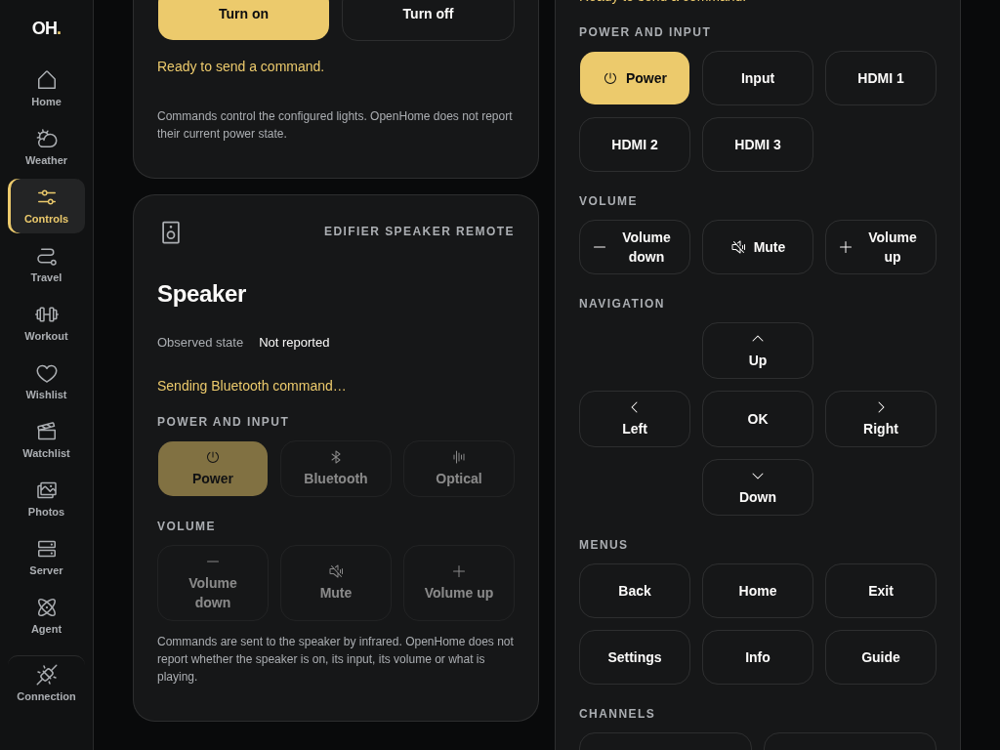
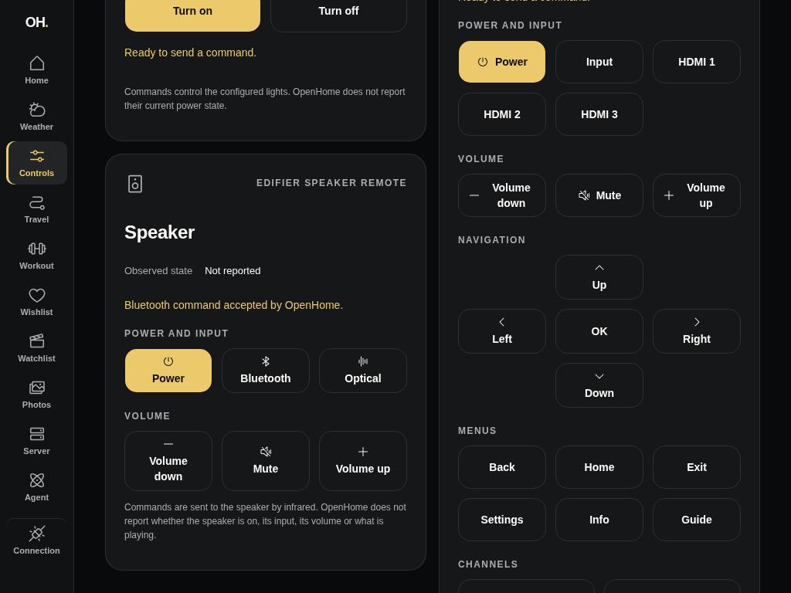
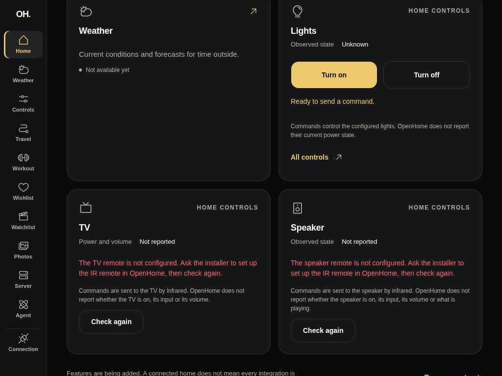
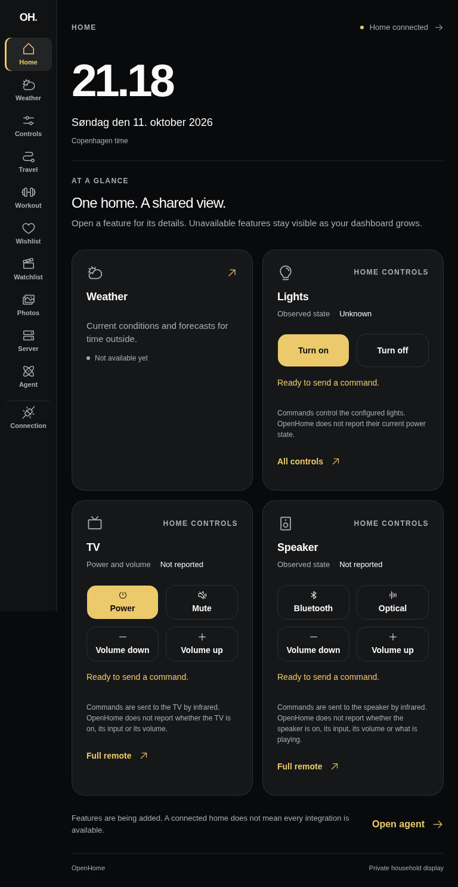
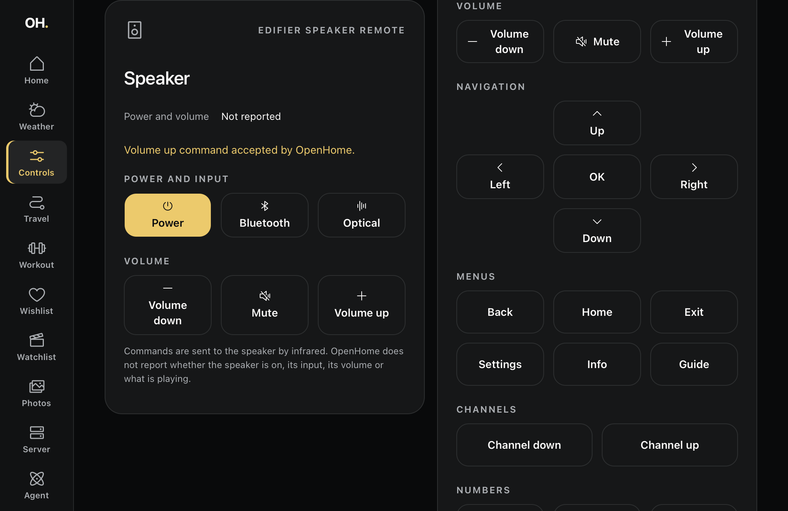

# Speaker remote verification (#94)

Home now offers the common Edifier speaker commands (Bluetooth, Optical,
Volume down and Volume up). The focused Controls view (`/controls`) offers every
reported speaker command in two rows: Power and input, then Volume. The TV and
speaker share one discovery at `GET /api/ir`; speaker commands are sent through
the private TanStack server to `POST /api/ir/edifier`. A command acknowledgement
stays separate from **Observed state: Not reported**, which covers the
speaker's power, input, volume and playback.

The TV and speaker now render through one shared Dashboard Remote component, so
the speaker has the same pending guard, timeout, failure copy and **Check again**
recovery as the TV.

Home's four slots are Weather, Lights, TV and Speaker. The speaker takes the
slot the Routes & transit placeholder held; Travel stays in the navigation rail.
Controls now gives its two columns equal width. Lights and the speaker share the
left column, and the TV remote fills the right.

## Public visual evidence

All captures use a synthetic OpenHome boundary and a synthetic server-held API
key. They contain no household devices, identities, provider addresses or
credentials.

| Before · 1280 × 800                               | After · 1280 × 800                              |
| ------------------------------------------------- | ----------------------------------------------- |
|  |  |

| Controls · 1024 × 768                             | Controls portrait · 768 × 1024                            |
| ------------------------------------------------- | --------------------------------------------------------- |
|  |  |

| Pending · 1024 × 768                      | Accepted · 1024 × 768                                    | Missing IR setup · 1024 × 768                                            |
| ----------------------------------------- | -------------------------------------------------------- | ------------------------------------------------------------------------ |
|  |  |  |

## Automated and browser checks

- `devenv shell -- just dashboard-check`: formatting, lint, types, tests and
  the production build pass. No API behavior changed.
- Controlled HTTP responses verify that one authenticated discovery fills both
  remotes in remote order and drops unknown commands. Both remotes share each
  discovery failure, and a response missing either remote is unavailable.
  Commands are sent as JSON to `/api/ir/lgtv` and `/api/ir/edifier`, including
  under a deployment URL prefix. Provider text never reaches the browser.
- Rendered speaker remotes show only reported commands: the common ones on Home
  and grouped ones on the full remote. A burst of taps sends one command, and
  an accepted command never claims power, input or volume. An RPC rejection
  recovers without exposing private detail. Missing setup offers **Check
  again** and no command buttons. The TV tests now run through the same shared
  component.
- In a desktop browser against the synthetic boundary, three queued
  activations of **Optical** dispatched one command. The pending announcement
  appeared, then the accepted result. Landscape and portrait have no horizontal
  document overflow, and speaker buttons are at least 56 CSS px high. At 200%
  root text size, no speaker or TV button clips.

## Actual Safari inspection — 11 October 2026

The attached iPad 6th generation (iPadOS 17.7.11) loaded the synthetic
dashboard over a USB tunnel. It was inspected through Safari Web Inspector
(1024 × 665 CSS px, landscape).

- Controls showed all six synthetic speaker commands, 78 CSS px high, with no
  horizontal overflow.
- With a delayed response, three inspector-driven activations of **Volume up**
  produced one command. All speaker buttons were disabled during the pending
  announcement. The accepted result then showed the device state still
  **Not reported**. The capture predates renaming the speaker's state label
  from "Power and volume" to "Observed state".
- Safari's wider font broke **Bluetooth** mid-word in the original 2:3 Controls
  columns. The columns are now equal, and every speaker label fits on whole
  words on Controls and Home. At 200% root text size, no speaker or TV button
  clipped. Normal text size and the Controls route were restored.
- Physical finger taps, portrait hardware rotation and Safari page zoom remain
  manual release checks; remote DOM activation is not physical touch
  verification.

## Live household smoke — 11 October 2026

`devenv shell -- openhome ir status` returned the real IR remote's command
list. All six reported Edifier commands have dashboard buttons.

A local dashboard server then held the private connection. The Controls view
discovered all six speaker commands from the real Axum API. One deliberately
chosen **Volume down** command was sent from the browser, chosen because it is a
single small step that toggles nothing. The card showed **Volume down command
accepted by OpenHome.** and **Power and volume Not reported** (since renamed
**Observed state**). The server was
stopped immediately afterwards.

No live command was used as an automated fixture or public capture. The
speaker's response was not independently observed and remains unreported in
the UI.

This completes the speaker remote slice and the last open sub-issue of the
controls specification (#71). It does not close the dashboard release tracker
(#69).
