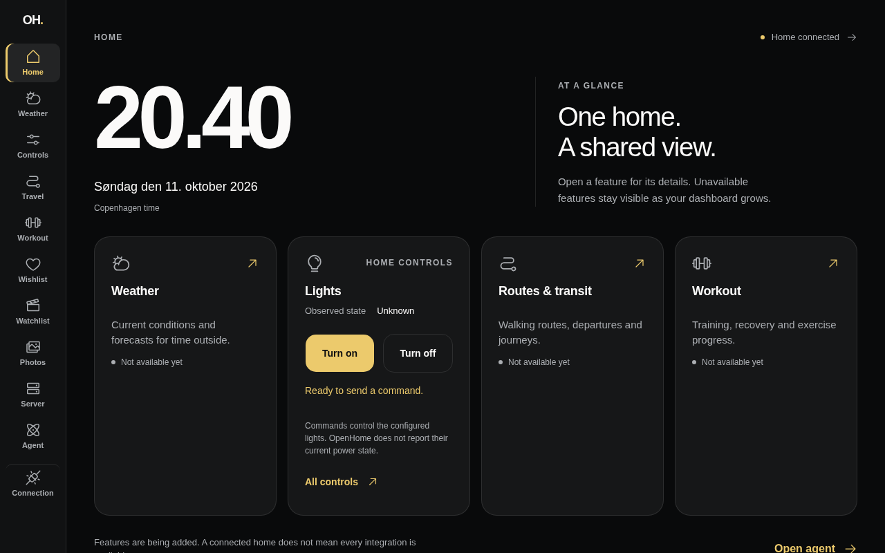
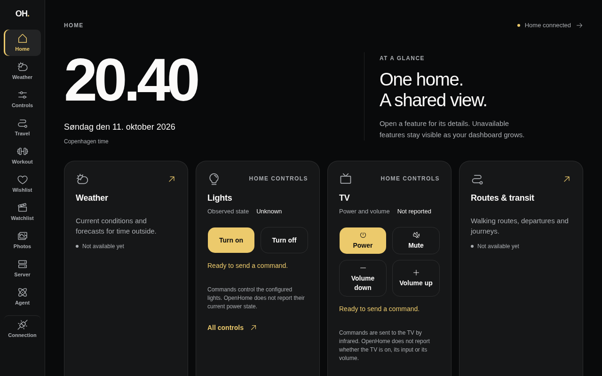
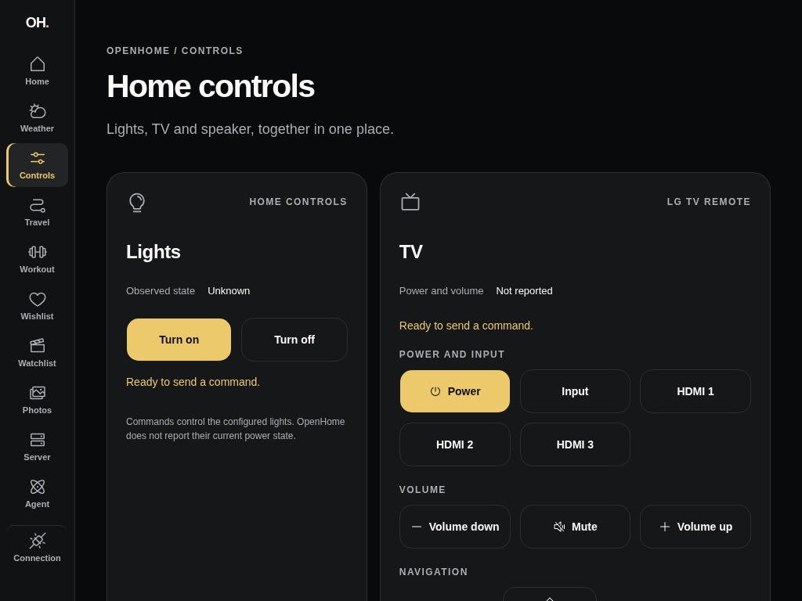
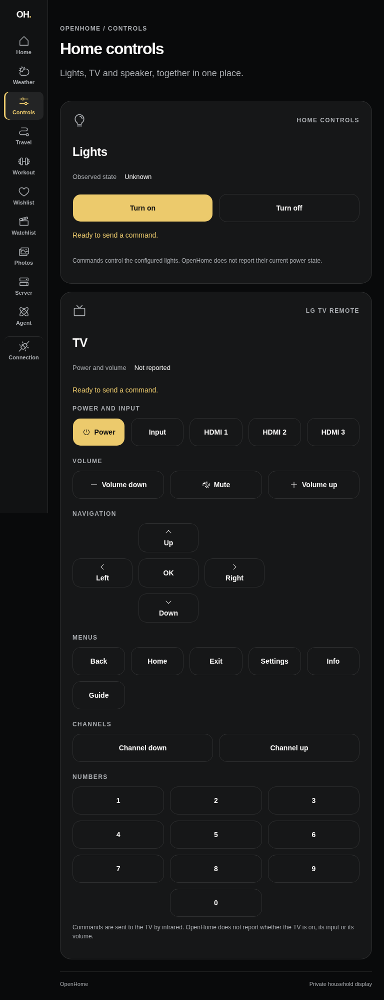
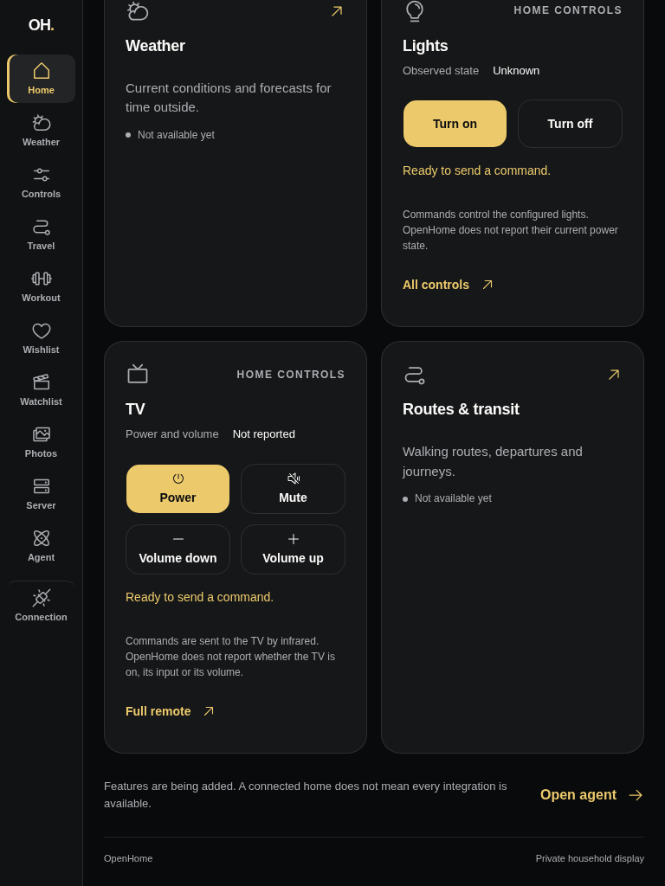
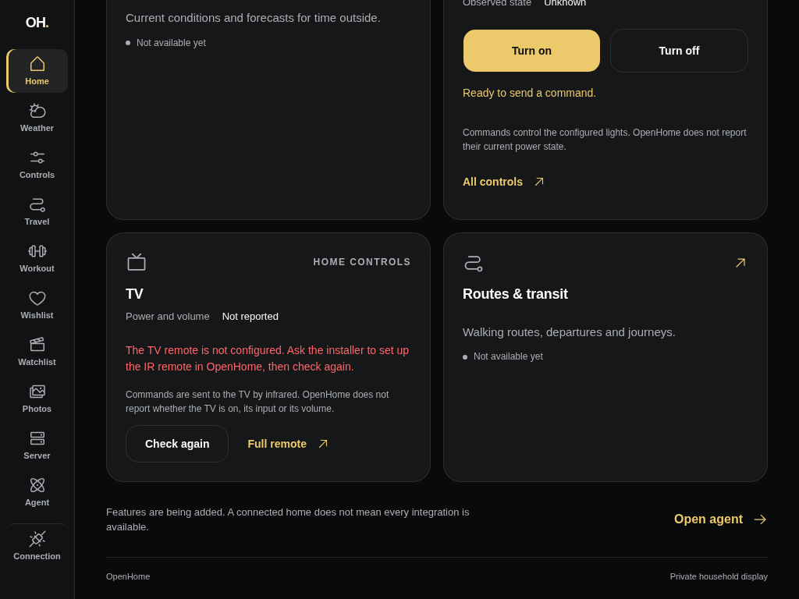
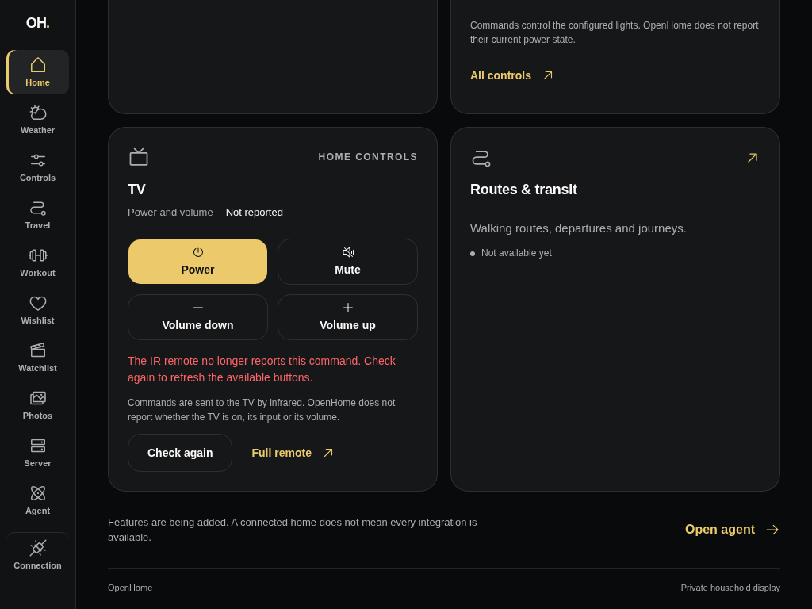
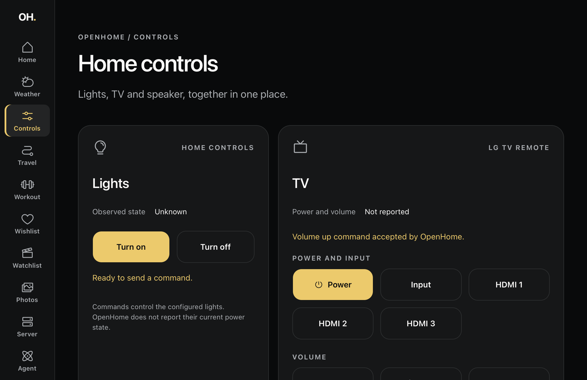

# TV remote verification (#93)

Home now offers the common LG TV commands, and the focused Controls view
(`/controls`) offers the full remote. Buttons come from the commands Axum
reports at `GET /api/ir`; commands are sent through the private TanStack server
to `POST /api/ir/lgtv`. A command acknowledgement stays separate from
**Power and volume: Not reported**. The speaker remote remains a later slice of #71.

Home keeps four cards: the TV card takes the slot the Workout placeholder held.
Workout stays in the navigation rail; it has no Home content yet.

## Public visual evidence

All captures use a synthetic OpenHome boundary and a synthetic server-held API
key. They contain no household devices, identities, provider addresses or
credentials.

| Before · 1280 × 800                     | After · 1280 × 800                         |
| --------------------------------------- | ------------------------------------------ |
|  |  |

| Controls · 1024 × 768                        | Controls portrait · 768 × 1024                       |
| -------------------------------------------- | ---------------------------------------------------- |
|  |  |

| Home portrait · 768 × 1024                     | Missing IR setup · 1024 × 768                                            | Stale command · 1024 × 768                                   |
| ---------------------------------------------- | ------------------------------------------------------------------------ | ------------------------------------------------------------ |
|  |  |  |

## Automated and browser checks

- `devenv shell -- just dashboard-check`: formatting, lint, types, tests and
  the production build pass.
- `devenv shell -- just api-test-integration ir`: all eight existing IR route
  tests pass. No API behavior changes were needed.
- Controlled HTTP responses verify authenticated discovery and JSON command
  dispatch with deployment URL prefixes. They also cover filtering of unknown
  reported commands, missing IR setup, an offline bridge, rejected credentials,
  malformed responses and commands the remote no longer knows. Only Axum's
  exact `Unknown command` 404 is treated as a stale command; any other 404 is
  reported as unavailable. Provider text never reaches the browser.
- Rendered remotes verify that only reported commands appear, grouped on the
  full remote. Queued and pending taps send a single command, and accepted
  results never claim power or volume. Failure, RPC rejection and stale
  discovery recover through **Check again** without a page reload. Missing
  setup offers no buttons, and disconnected states pause commands.
- Discovery is deferred in the route loaders and bounded at 6 seconds, so a
  slow IR bridge never delays Home or the lights. The pending-command guard
  sits above the deferred discovery, so a re-check while a command is in
  flight cannot re-enable the buttons.
- In a desktop browser against the synthetic boundary, three queued activations
  of **Volume up** dispatched one command. The pending announcement appeared,
  then the accepted result. A 404 command, missing IR setup and recovery all
  behaved as above. Landscape and portrait have no horizontal document overflow,
  and remote buttons are at least 56 CSS px high.

## Actual Safari inspection — 11 October 2026

The attached iPad 6th generation (`iPad7,5`, iPadOS 17.7.11) loaded the synthetic
dashboard over a USB tunnel, inspected through Safari Web Inspector
(1024 × 665 CSS px, landscape).

- Controls showed all 31 synthetic commands, no horizontal overflow and remote
  buttons 56 CSS px high. Home showed Power, Mute, Volume down and Volume up.
- With a delayed response, three inspector-driven activations of **Volume up**
  produced one command. All buttons disabled during the pending announcement,
  then the accepted result re-enabled them with power and volume still
  **Not reported**.
- At 200% root text size, the direction-pad labels overflowed their buttons.
  Their icon and label now stack, as on Home's quick buttons, and the same
  check found no clipped button or document overflow. Normal text size and the
  Controls route were restored.
- No Safari console errors were reported. Physical finger taps, portrait
  hardware rotation and Safari page zoom remain manual release checks; remote
  DOM activation is not physical touch verification.

## Live household smoke — 11 October 2026

`devenv shell -- openhome ir status` returned the real IR remote's command list;
all 31 reported LG TV commands have dashboard buttons.

A local dashboard server then held the private connection. The Controls view
discovered all 31 commands from the real Axum API. One deliberately chosen
**Info** command, chosen because it only shows an on-screen banner, was sent
from the browser. The card showed **Info command accepted by OpenHome.** and
**Power and volume Not reported**. The server was stopped immediately afterwards.

No live command was used as an automated fixture or public capture. The TV's
response was not independently observed and remains unreported in the UI.

This completes the TV remote slice; it does not close the parent controls
specification (#71) or dashboard release tracker (#69).
