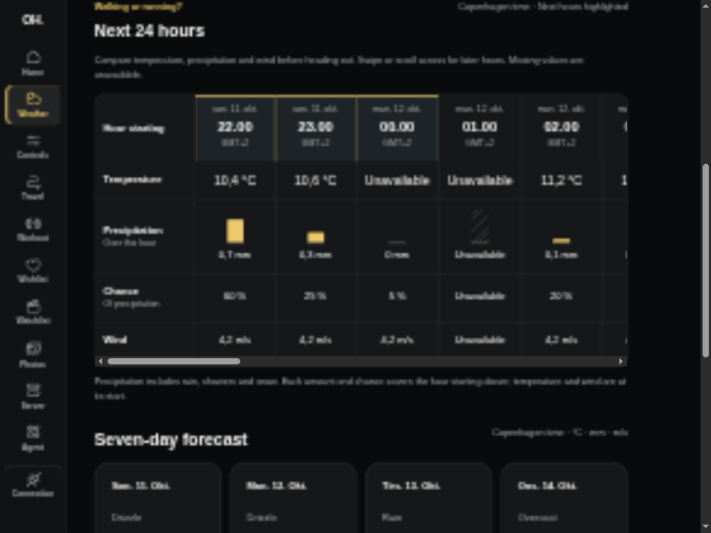
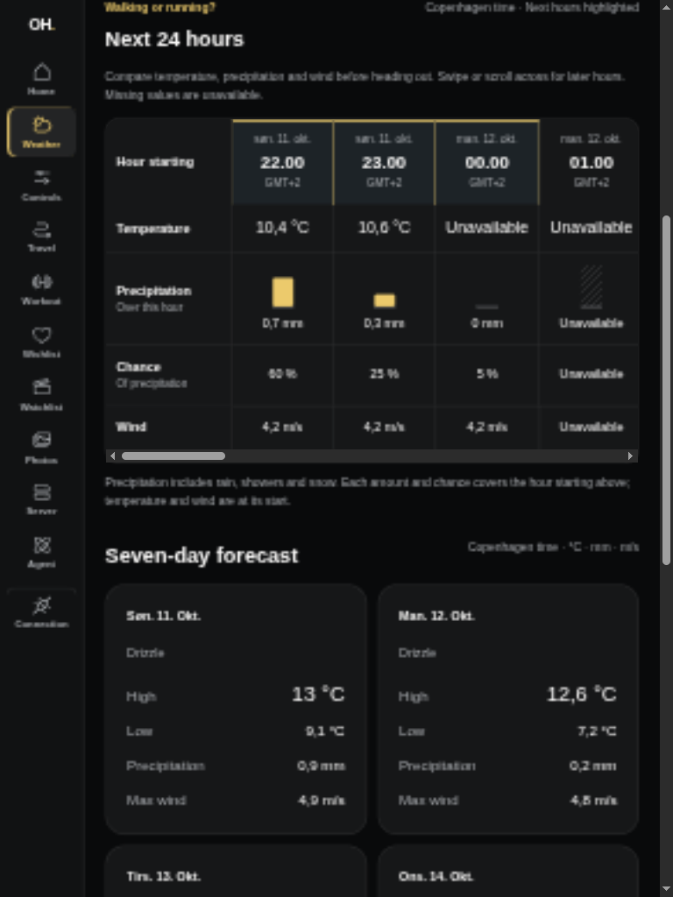
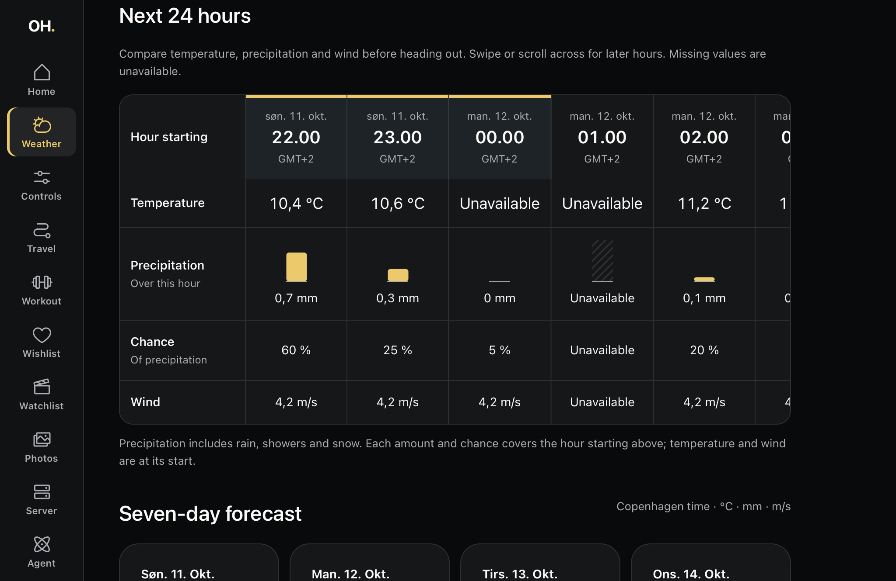

# Current weather and seven-day forecast (#95)

Home shows current conditions; `/weather` shows current temperature, apparent
temperature, wind and seven dated daily forecasts. Reads go through the private
TanStack server to authenticated `GET /api/weather`. Home defers weather
independently of controls. The hourly slice (#96) adds a 24-hour comparison with temperature, precipitation
amount/chance and wind. The next three hours are highlighted for planning a walk
or run; no suitability score or personalized advice is inferred.

## Public evidence

Captures use synthetic credentials and a fixed anonymous forecast for an
unrelated central Copenhagen demo location. They are layout evidence, not live
household weather. Before is the existing parent-branch Home capture.

| Before                                                 | After                                  |
| ------------------------------------------------------ | -------------------------------------- |
|  |  |

| Weather landscape, 1024 × 768          | Weather portrait, 768 × 1024         |
| -------------------------------------- | ------------------------------------ |
|  |  |

| Stale cached forecast                            | Missing private location                     |
| ------------------------------------------------ | -------------------------------------------- |
|  |  |

## Verification

- `devenv shell -- just api-check` passes. Controlled Open-Meteo responses cover
  both DST transitions, Copenhagen midnight, missing values, rejected units and
  timezone, concurrent refreshes, the 15-minute freshness boundary, one-minute
  failure backoff, six-hour stale expiry and recovery. The route requires the
  API key even when location is missing.
- `devenv shell -- just dashboard-check` passes, including all 65 tests and
  the production build. HTTP application tests cover Home and Weather,
  dates/units, missing/stale/setup/failure states, privacy and browser streaming
  before weather completes. A rendered lifecycle regression covers validity
  expiry, a cached read shortly before expiry, failure retries, overnight pause
  while hidden and recovery when Safari resumes.
- On 2026-10-11 the production Axum executable, with isolated temporary
  databases and the unrelated demo location, fetched real Open-Meteo data:
  fresh current conditions and seven normalized days without coordinates in
  the response. No household credentials or providers were used.
- Browser preview verifies landscape/portrait reflow and 200% text size without
  horizontal document overflow. Check again moves from fresh to stale to
  missing setup and back to fresh without a reload. It respects Axum's cache.

## Actual iPad Safari

The paired target (`iPad7,5`, iPadOS 17.7.11) rendered synthetic weather through
a USB tunnel, inspected through Safari Web Inspector at 1024 × 665 CSS px.
All seven days were present with explicit units and Copenhagen times. Normal
and 200% root text size had no horizontal overflow; Check again measured
56 CSS px high. Inspector-driven navigation returned to Home and focused its
heading. A typed-route warning found during inspection was fixed by linking
the rail directly to `/weather`.

Physical portrait rotation, finger gestures and Safari page zoom remain manual
release checks. Text enlargement and inspector activation do not prove them.
This slice does not close #72 or #69.

## Private setup and caching

Set both `WEATHER_LATITUDE` and `WEATHER_LONGITUDE` in the API's private runtime.
Both absent or empty disables weather with an explicit setup state; partial or
invalid coordinates fail startup without echoing input. No provider key is
needed. The dashboard reuses `OPENHOME_API_URL` and `API_KEY`, has no location
configuration and never calls the provider directly.

One Axum instance shares a cache across views and clients: 15 minutes fresh,
failed refreshes at most once per minute, stale data retained for at most six
hours. Upstream calls time out after five seconds. Failed refreshes preserve
fetch/validity times. Both views refresh weather at its validity boundary,
retry unavailable or stale reads once a minute while visible, and refresh on
visibility resume independently of controls. Check again never forces an
upstream request. Cache is
lost on restart. Open-Meteo's free terms permit personal home automation; see
[ADR 0006](../../../docs/adr/0006-weather-provider-and-cache.md).

## Hourly conditions (#96)

The chart is a semantic table with a keyboard-focusable horizontal scroll region
and sticky measure labels. Dates and GMT offsets distinguish midnight and both
DST transitions. Amount bars share a scale; a hatched missing bar and explicit
Unavailable values distinguish missing data from zero precipitation. Each column
starts an hour: temperature/wind are instantaneous; amount/chance cover the
following hour and include rain, showers and snow.

| Before                                       | Hourly landscape                           | Hourly portrait                         |
| -------------------------------------------- | ------------------------------------------ | --------------------------------------- |
|  |  |  |

Verification on 2026-10-11:

- Controlled provider tests cover end-stamped precipitation, missing timestamps,
  null and invalid values, rejected hourly units/timestamps, absent hourly data,
  24-hour selection across both DST transitions, and stale window advancement.
  Review also found and fixed a daily-date integration defect: provider daily
  timestamps use a fixed request offset, so interpreting them with changing DST
  rules rejected autumn forecasts. The corrected provider fixture failed before
  the repair and now covers that case alongside hourly data.
  The shared cache/failure backoff still bounds requests across Home and Weather.
- Dashboard HTTP tests verify rendered units, missing/stale/error states,
  privacy, and local labels/offsets across both DST changes. Existing lifecycle
  coverage still protects refresh, hidden-page pause and visibility recovery.
- The production Axum executable fetched 24 real hours for the unrelated
  Copenhagen demo origin using isolated temporary databases and synthetic keys.
  Two consecutive reads retained the same fetch timestamp; responses contained
  no coordinates. Provider terms remain those recorded in ADR 0006.
- Browser previews at 1024 × 768 and 768 × 1024, and enlarged 200% text, keep
  horizontal overflow inside the chart. Row labels remain visible while it scrolls.
- Attached iPad7,5 / iPadOS 17.7.11 Safari rendered 24 columns at 1024 × 665 CSS
  px. Inspector-driven horizontal scrolling preserved sticky labels. 200% text
  initially exposed overflow from hidden accessibility text; positioning its
  scroll region fixed it, confirmed on the device. Physical portrait rotation,
  finger swipes and Safari page zoom remain manual release checks.

This slice does not close the #72 parent or the #69 release tracker.
