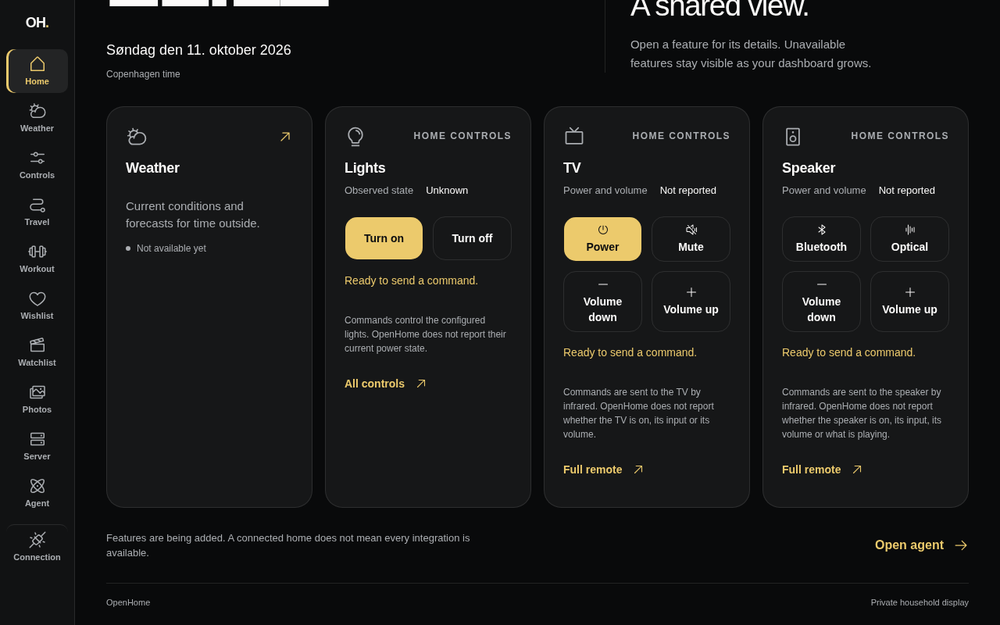
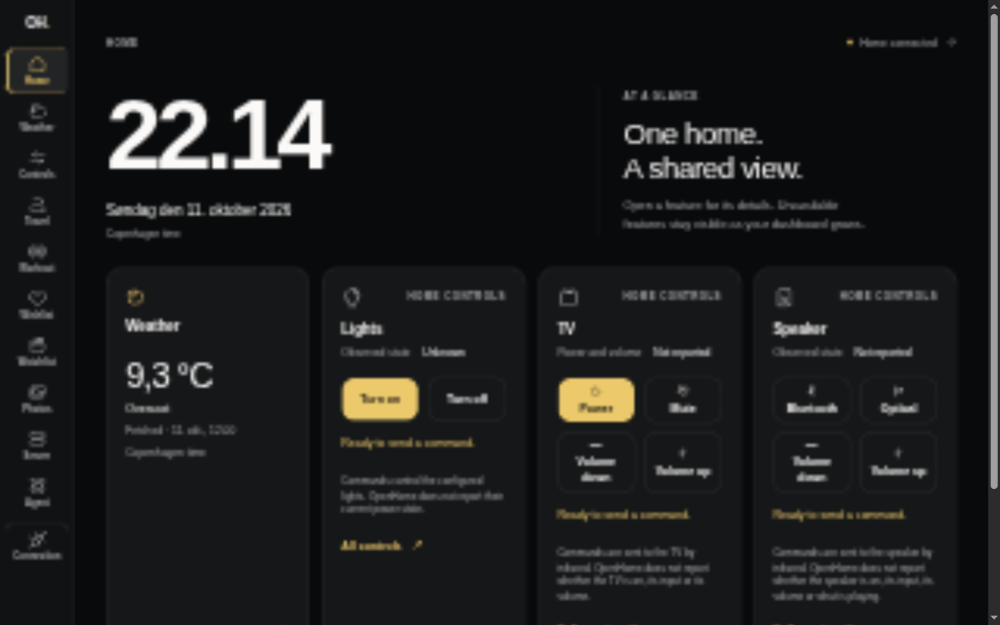
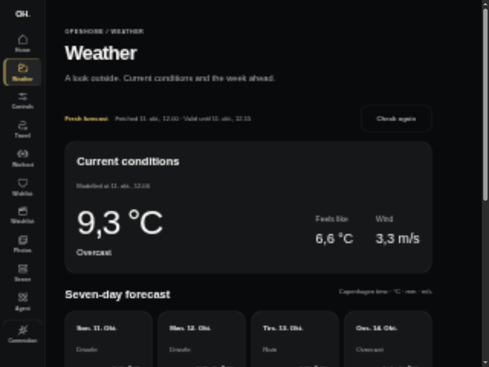
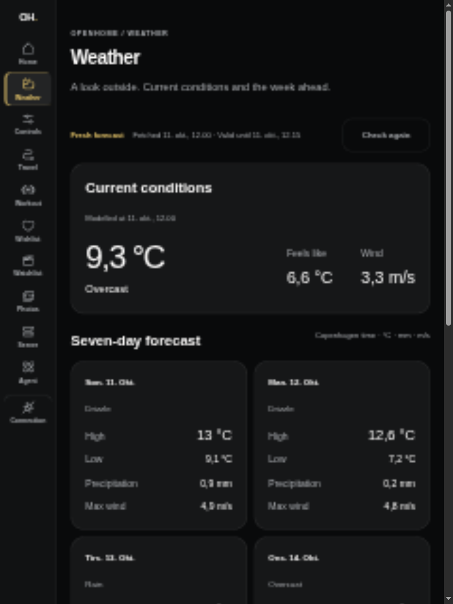
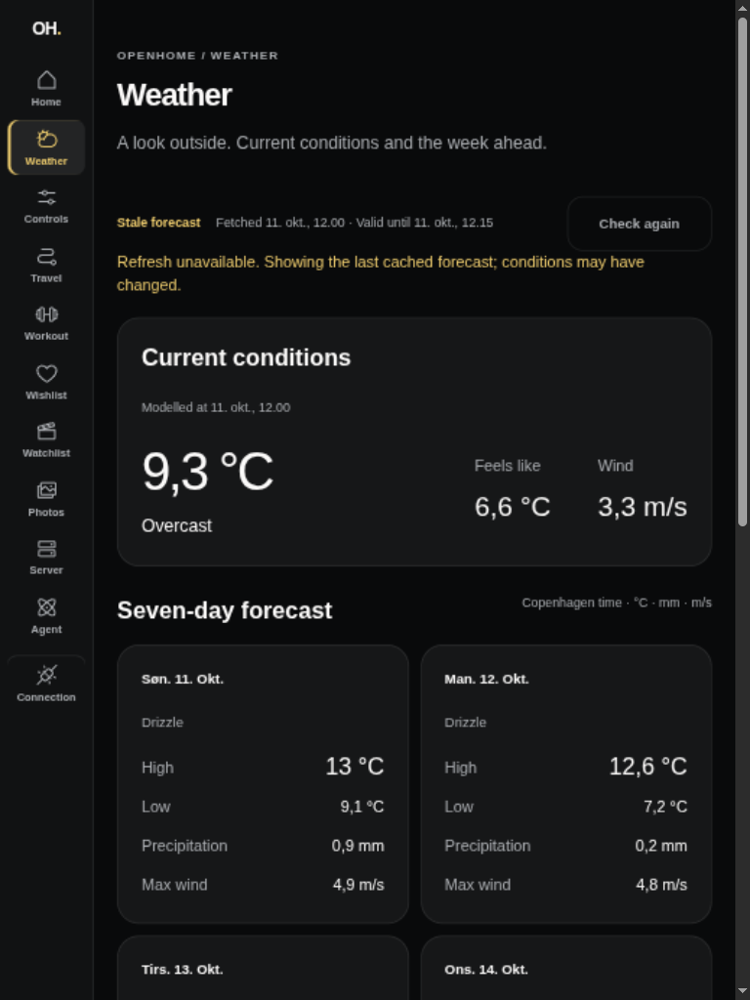
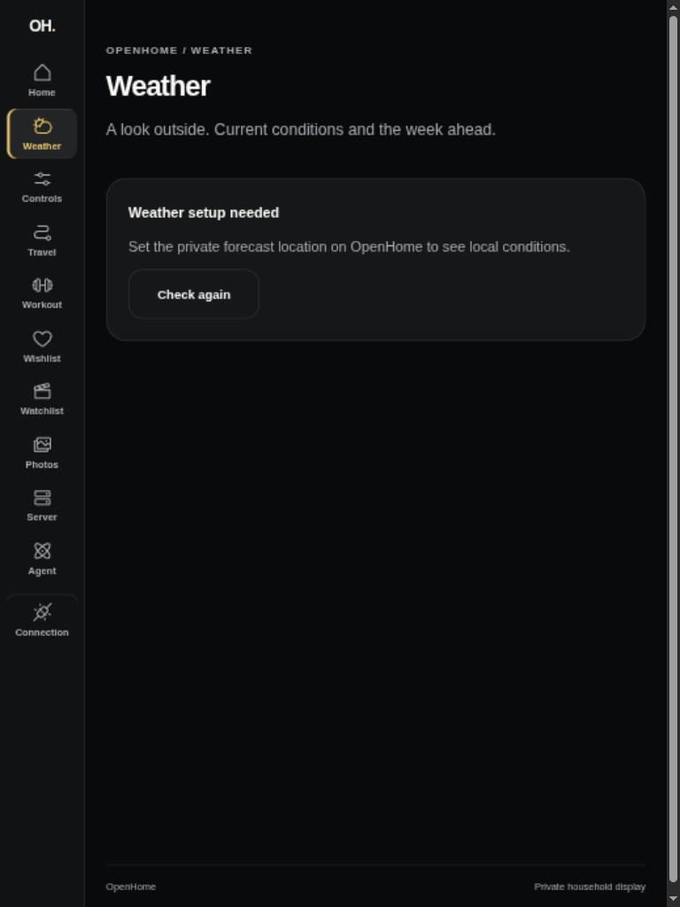
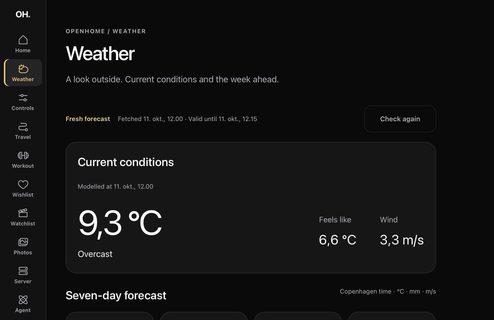

# Current weather and seven-day forecast (#95)

Home shows current conditions; `/weather` shows current temperature, apparent
temperature, wind and seven dated daily forecasts. Reads go through the private
TanStack server to authenticated `GET /api/weather`. Home defers weather
independently of controls. Hourly conditions remain the next slice, #96.

## Public evidence

Captures use synthetic credentials and a fixed anonymous forecast for an
unrelated central Copenhagen demo location. They are layout evidence, not live
household weather. Before is the existing parent-branch Home capture.

| Before                                                 | After                                  |
| ------------------------------------------------------ | -------------------------------------- |
|  |  |

| Weather landscape, 1024 × 768          | Weather portrait, 768 × 1024         |
| -------------------------------------- | ------------------------------------ |
|  |  |

| Stale cached forecast                            | Missing private location                     |
| ------------------------------------------------ | -------------------------------------------- |
|  |  |

## Verification

- `devenv shell -- just api-check` passes. Controlled Open-Meteo responses cover
  both DST transitions, Copenhagen midnight, missing values, rejected units and
  timezone, concurrent refreshes, the 15-minute freshness boundary, one-minute
  failure backoff, six-hour stale expiry and recovery. The route requires the
  API key even when location is missing.
- `devenv shell -- just dashboard-check` passes, including all 65 tests and
  the production build. HTTP application tests cover Home and Weather,
  dates/units, missing/stale/setup/failure states, privacy and browser streaming
  before weather completes. A rendered lifecycle regression covers validity
  expiry, a cached read shortly before expiry, failure retries, overnight pause
  while hidden and recovery when Safari resumes.
- On 2026-10-11 the production Axum executable, with isolated temporary
  databases and the unrelated demo location, fetched real Open-Meteo data:
  fresh current conditions and seven normalized days without coordinates in
  the response. No household credentials or providers were used.
- Browser preview verifies landscape/portrait reflow and 200% text size without
  horizontal document overflow. Check again moves from fresh to stale to
  missing setup and back to fresh without a reload. It respects Axum's cache.

## Actual iPad Safari

The paired target (`iPad7,5`, iPadOS 17.7.11) rendered synthetic weather through
a USB tunnel, inspected through Safari Web Inspector at 1024 × 665 CSS px.
All seven days were present with explicit units and Copenhagen times. Normal
and 200% root text size had no horizontal overflow; Check again measured
56 CSS px high. Inspector-driven navigation returned to Home and focused its
heading. A typed-route warning found during inspection was fixed by linking
the rail directly to `/weather`.

Physical portrait rotation, finger gestures and Safari page zoom remain manual
release checks. Text enlargement and inspector activation do not prove them.
This slice does not close #72 or #69.

## Private setup and caching

Set both `WEATHER_LATITUDE` and `WEATHER_LONGITUDE` in the API's private runtime.
Both absent or empty disables weather with an explicit setup state; partial or
invalid coordinates fail startup without echoing input. No provider key is
needed. The dashboard reuses `OPENHOME_API_URL` and `API_KEY`, has no location
configuration and never calls the provider directly.

One Axum instance shares a cache across views and clients: 15 minutes fresh,
failed refreshes at most once per minute, stale data retained for at most six
hours. Upstream calls time out after five seconds. Failed refreshes preserve
fetch/validity times. Both views refresh weather at its validity boundary,
retry unavailable or stale reads once a minute while visible, and refresh on
visibility resume independently of controls. Check again never forces an
upstream request. Cache is
lost on restart. Open-Meteo's free terms permit personal home automation; see
[ADR 0006](../../../docs/adr/0006-weather-provider-and-cache.md).
