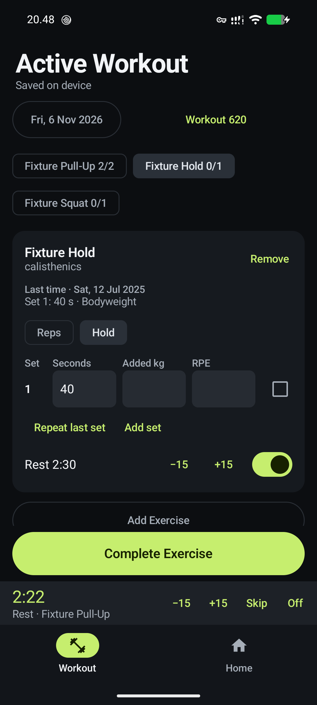

# Native Android acceptance

Epic #226's scoped native app passed independent physical release acceptance on
6 November 2026. Native Kotlin Android is now the supported mobile client; Expo
is deprecated for new development, with its source/build recipes retained.
No API/Dashboard functionality or existing fitness data was removed.

## Accepted artifact and journey

- Source: `522509028dc9d3890036d06b6ee097f8288a5865`.
- Pixel 8, Android 17 / GrapheneOS; signed non-debuggable release 0.1.0 (1),
  package `com.patrickhaahr.openhome`.
- APK SHA256: `20b57ac2abccbbf94a6e3a899e9ae032dd2e06a055778e7583fb6363a370da3e`.
- Isolated real Axum, invented credentials/data, loopback ADB forwarding. No
  household controls, real fitness records or controller capture were used.

The physical journey downloaded 620 Workouts, 540 dated weights and 33 Exercises.
With Axum stopped, it created an Exercise, repeated and adjusted a Workout,
confirmed sets, relaunched without losing work, omitted unchecked sets on finish,
corrected History and saved Profile and Body Weight. On API recovery, the proxy
dropped one committed response for each of five mutation kinds. Independent API
and database reads confirmed one new Workout, Exercise and weight, correct Exercise
references and values, and the final Profile revision, without duplicate creates.

Home fixtures exercised TV/full remote, Speaker, explicit Lights, Backlight and
advanced bedtime/profile tools, with honest acknowledgements and errors. Relaunch
and recovery did not replay failed Home commands. Nested Android Back, the 150s
default rest, remembered duration, deadline across relaunch, skip and visible expiry
passed. Real text/numeric keyboards and form layout were inspected on the Pixel.



## Checks and deliberate limits

All host recipe gates passed: API, MCP, Expo, native lint/build, firmware, CLI,
Dashboard and deployment checks. Signed release lint/build, alignment, signature,
manifest and package verification passed. Narrow API receipt/revision integration
tests and existing app tests supplied complementary contract evidence.

The current emulator inventory contained 64 tests. Five setup cases passed before
device-support shutdown/refresh failed. The user explicitly waived the remaining
59 in favor of physical release acceptance. Earlier focused passing test batches
were reused against unchanged code; this is not a claim of one green full suite.
Earlier timing/assertion failures were preserved, diagnosed and followed by passing
affected reruns, rather than silently counted as successes.

Physical cellular-only routing, felt vibration, a physical edge-swipe gesture,
exhaustive TalkBack/device/font-size coverage, upgrade from an existing native
release database, and live household hardware remain unclaimed. Prior emulator
cellular-default and gesture tests cover those software policies. Keeping Wi-Fi
for wireless ADB and stopping the fixture proves outage/recovery, not cellular
routing. No app data was cleared. The Pixel retains invented fixture data;
its temporary API is stopped.

The independent PR review subsequently found a repaired refused Workout could
precede a newly created Exercise in the outbox and stall. This was reproduced on
the original physical release against isolated Axum. The fix appends the replacement
create after its dependencies inside the existing save transaction. A second physical
release journey confirmed automatic Exercise-then-Workout delivery, correct identifiers
and sets, and exactly one created Workout without an extra Sync action or relaunch.
The existing app-level correction regression now includes this dependency case;
it was compiled, while runtime verification used the Pixel rather than instrumentation.
Native lint/build and signed-release verification passed after the repair.

## Lifecycle disposition (#266, integration #281)

Branch `lifecycle/android-266` reviewed six lifecycle candidates for one owner,
mutually exclusive variants carrying their data, and a recorded exit for each
non-terminal state. Independent policy, transport and observation facts stay
separate rather than becoming exclusive states. No state-machine framework was added.

| Candidate | Disposition | Owner | Valid states / types | Rationale |
| --- | --- | --- | --- | --- |
| Setup (#275) | Refactored | `SetupViewModel` (`submit`, `advance`, `fail`) | `SetupSubmission`: `Idle`, `Working(progress)`, `Failed(message)` | Separate `progress` and `error` fields could show both. A submit while `Working` is ignored. `SetupService.run` stays a linear sequence; persisted `SetupStatus` is a separate fact. |
| Home commands (#276) | Refactored | Each Home ViewModel for its own control group | `CommandFeedback`: `Idle`, `Loading`, `Sending`, `Acknowledged`, `Failed`; Backlight uses `BacklightOperation` with `status` and `outdated` kept apart | Pending/message/problem fields could disagree. `Acknowledged` means Axum accepted the request, never a device state. |
| Active Workout (#277) | Already explicit | `ActiveWorkoutRepository` | Row unconfirmed or confirmed; `FinishOutcome` | Every change is one serialized transaction; the Workout exists until the finishing transaction deletes it. KDoc only. |
| Local saves and correction (#278) | Already explicit | `WorkoutCorrections.save`, `ProfileRecords` | Sealed `CorrectionSave`, `BodyWeightSave` and Profile outcomes | One transaction returns one outcome; only `Saved` changes anything. KDoc only. |
| Outbox and WorkManager (#279) | Already explicit | `FitnessOutbox.deliverPending` | One `Delivery` per row; `DeliveryRun` | Acknowledgement and deletion commit together; the repeat under the same `request_id` is idempotent. KDoc only. |
| Rest timers and alarms (#280) | Already explicit | `RestTimers` | Stored timer running or over (`alerted`); `RestPreference` and the Android alarm are separate facts | The row owns the rest; the alarm only mirrors it through `syncAlarm`. KDoc only. |

Nothing is deferred. The Wi-Fi-only policy (`WifiNetworks`) and the Home 5 s call
timeout remain independent policy facts, not lifecycle states.

### Exits per changed lifecycle

"Demonstrated" names a passing emulator test. "Assumed" is source-backed
reasoning with no test that exercises it.

| Lifecycle / non-terminal state | Success | Failure | Cancellation | Timeout | Restart |
| --- | --- | --- | --- | --- | --- |
| Setup `Working` | Demonstrated: `SetupFlowTest` (history and weights offline after relaunch) | Demonstrated: `failedDownloadSavesNothingAndRetrySucceeds` (nothing saved, retry works) | Assumed: clearing the ViewModel cancels the run; the single commit leaves no partial data | None added; the shared HTTP client is unchanged and no test covers it | Demonstrated: `processKilledDuringDownloadDoesNotCompleteSetup` |
| Home `Sending` / `Loading` | Demonstrated: `HomeTvTest`, `HomeSpeakerLightsTest`, `HomeBacklightTest` (acknowledged text, controls re-enabled) | Demonstrated: Backlight lost-response and refresh-error test; no replay after restart | Assumed: ViewModel scope cancels the call | Demonstrated: `aCommandThatNeverAnswersFailsAtTheHomeCallTimeoutAndFreesTheControls` (5 s call timeout in `AppContainer.homeHttpClient`, no connection retry) | Not applicable: Home state is not persisted |
| Active Workout row / finish | Demonstrated: `ActiveWorkoutTest` finish and queued-sync test | Demonstrated: invalid sets cannot be confirmed | Assumed: Room rolls back an interrupted transaction | None | Demonstrated by the offline finish and queued-sync test; process death inside a transaction is assumed |
| Local save (correction, Profile, Body Weight) | Demonstrated: `WorkoutCorrectionTest`, `ProfileAndBodyWeightTest` | Demonstrated: invalid or duplicate input refused with nothing changed | Assumed: Room rollback on cancellation | None | Demonstrated: edits survive a restart then reach Axum once |
| Outbox row in flight | Demonstrated: delivery on Wi-Fi, one record in Axum | Demonstrated: lost response retried as one record; refused row set aside without blocking others; unreachable Axum keeps the row queued | Assumed: coroutine cancellation of a replaced pass leaves the row for the next pass | None added | Demonstrated: retry across a client restart |
| Rest timer running | Demonstrated: one vibration at the deadline | Not applicable | Demonstrated: ending the Workout ends the rest; turning rest off | None | Demonstrated: restart continues the deadline; process gone still vibrates once; force-stopped rest shown over silently. Early alarm (`NOT_YET`, clock moved back) is assumed |

Unresolved liveness gaps: none found. Each non-terminal state ends by response,
failure, user action or the persisted state read on the next start. The assumed
cells above are unproved, not proven guarantees.

### Evidence, reported separately

- **Room/outbox compatibility.** `git diff origin/master...HEAD` for `mobile/` changes no
  Room entity, DAO, schema or migration, no outbox row kind, no `request_id`, revision or
  retry rule. `FitnessOutbox`, `ActiveWorkoutRepository`, `ProfileRecords`,
  `WorkoutCorrection`, `RestTimers` and `SetupService` changed by KDoc only. Source
  changes are `ui/home` and `ui/setup` state holders and their screens. Upgrade from an
  existing native release database was not exercised.
- **Focused tests.** Added or changed e2e proof: Home in-flight blocking for lights,
  Speaker and TV; the Home call timeout; Setup retry while the API still fails; and
  driver steps for keyboard dismissal, editor exit and scroll margin. There is no
  JVM unit-test layer for these ViewModels.
- **Area gate.** `just mobile-check` ran its instrumentation: 67/67 emulator tests passed
  on emulator-5554 at the tree before this doc commit. This supersedes the earlier
  64-test inventory with its partial run.
- **Not covered:** a physical device for this branch; real Wi-Fi-only or cellular
  behavior on hardware (emulator `setWifi` only); live API or household data; background
  vibration; force-stop and reboot on hardware. The physical acceptance above applies
  to its recorded source, not to these later changes.

## Reproducing checks

Use [`mobile/README.md`](../mobile/README.md) for signed builds and installation.
Run project recipes through devenv. Host gates can run without instrumentation:

```sh
SQLX_OFFLINE=true devenv shell -- just check-api check-mcp mobile-lint mobile-build check-firmware check-cli check-dashboard deployment-check
```

`just mobile-check` also invokes instrumentation when an emulator is booted.
For future full device runs, use memory-safe groups with fresh device-tool boots
between them and archive results before each subsequent run overwrites the XML:

```sh
devenv shell -- just mobile-test SetupFlowTest
```

Never run data-clearing instrumentation on a physical phone. Real-Axum acceptance
uses `mobile-fixture-api`, `mobile-fixture-seed` and `mobile-fixture-lossy-proxy` with
throwaway databases and invented credentials. Check recipe arguments before use.
API code/SQL changes require affected API checks and query metadata regeneration;
offline SQLx checking does not replace maintaining that metadata.
