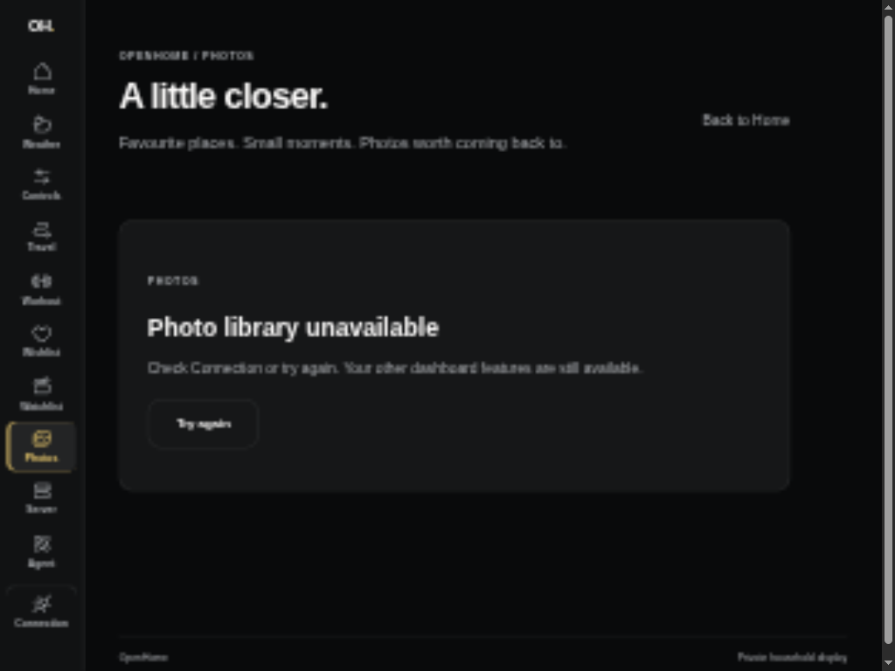
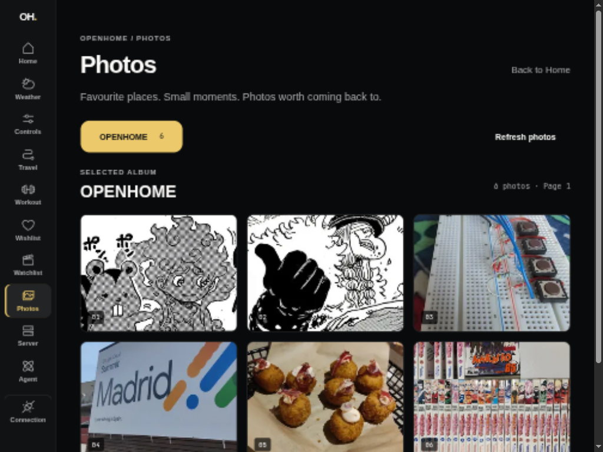
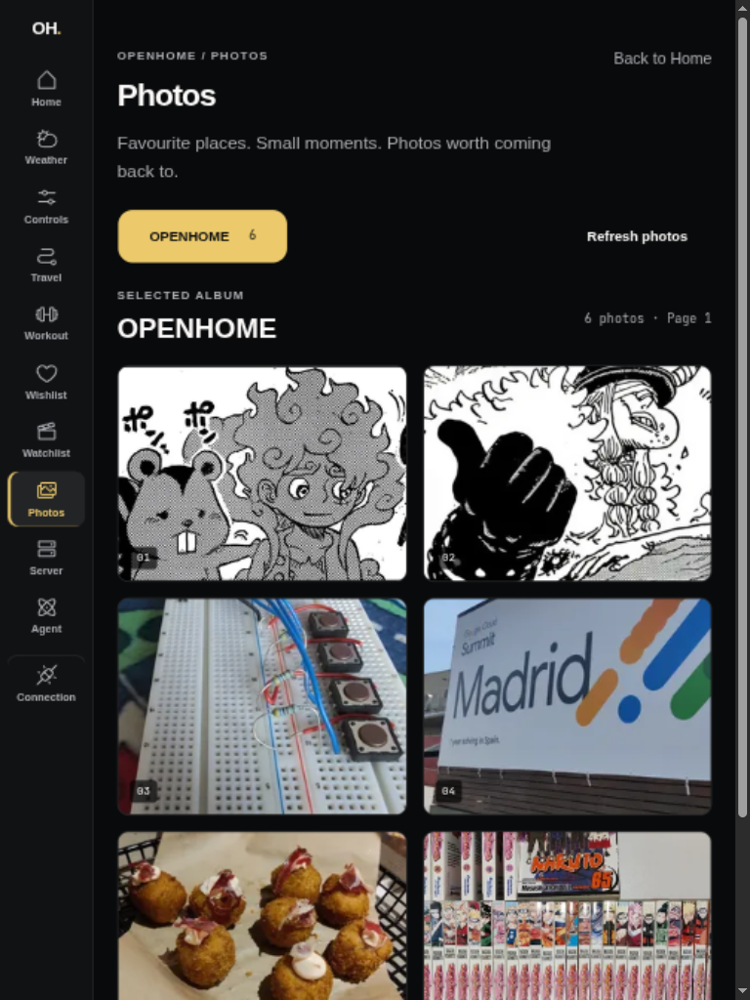
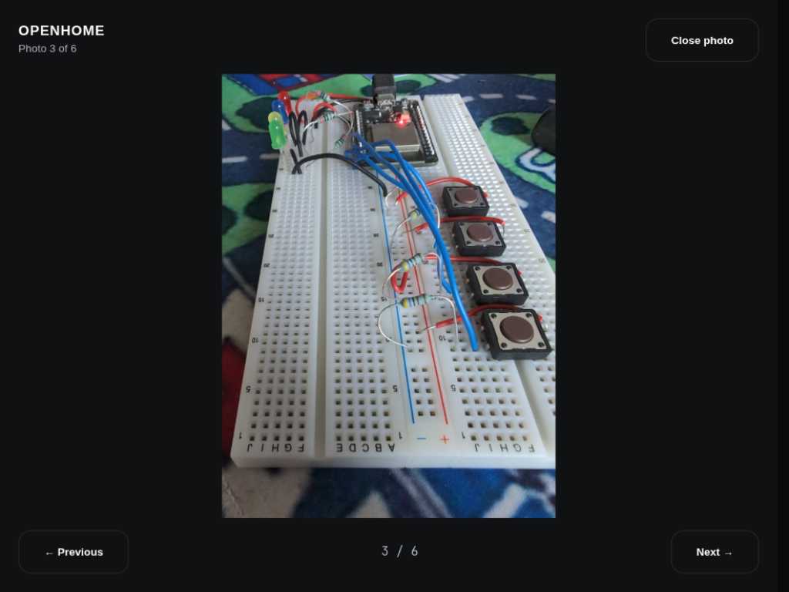

# Selected Immich gallery — #118

Recorded 2026-10-12 using only the explicitly approved **OPENHOME** album for
public evidence. A loopback Axum preview used the real Immich adapter and an
isolated in-memory state, with a synthetic OpenHome credential. No household
databases, private provider URLs/keys, identities, coordinates or other albums
are included in these captures.

## Browser evidence

These show the workflow before connecting the gallery, then the approved album
through production Start → authenticated Axum → installed Immich. They are not
screenshots of the old checkout. The landscape grid uses three columns; portrait
uses two. The full-screen dialog contains the preview, position, previous/next
and close controls. Arrow keys change photos; Escape returns focus to the selected
tile. No horizontal overflow was observed in either orientation. Only thumbnails
load in the grid and one resized preview loads while the dialog is open.

| Before connection | Approved album, landscape |
| --- | --- |
|  |  |

## Provider verification

Read-only installed-version check reported **Immich v2.7.5**. The approved album
contained six IMAGE assets. The real adapter smoke-tested both thumbnail and
preview for all six. One sampled thumbnail was WebP, 38,528 bytes; its preview was
JPEG, 117,061 bytes. No original/fullsize endpoint was requested. Existing read
permissions were sufficient; no provider data or configuration was changed.

Immich documents separate small thumbnails and larger resized previews in its
[official system settings](https://docs.immich.app/administration/system-settings/).
Installed-version requests independently verified these routes and formats.

## Automated proof

- Authenticated Axum/provider tests check selected-album scope, membership before
  media access, rejected originals, pagination, missing albums/assets, absent
  setup, private-field stripping, wrong album identity, malformed/oversized bodies,
  redirects, rejected credentials and upstream failure.
- Start HTTP tests check rendered metadata and same-origin bytes, no reflected
  secrets/private headers/redirects, invalid media inputs and sanitized missing media.
- Rendered tests check album/page selection, lazy thumbnail URLs, one preview,
  bounded previous/next, close, failed preview retry, new-photo recovery and empty,
  missing-setup, missing-album and provider states.
- A regression test first failed for photos loaded before hydration: React had
  missed their load event and left a loading overlay. A ref now reconciles the
  browser's completed-image state when the image attaches; the regression passes.
- Browser layout verification caught the centered dialog's inherited translation;
  the full-screen variant now uses independent positioning and fills the viewport.

Checks: `devenv shell -- just api-check` and `devenv shell -- just dashboard-check`
passed, including formatting, Clippy/lint, typecheck, the full API suite, all 98
dashboard tests (13 files) and the production build.

The single reviewer reported no standards findings and one recovery defect:
**First page** could switch a stale page in the second selected album to the first
album. A two-album interaction regression failed before the repair. Gallery data
now preserves the selected album through failures, and recovery opens its own
first page.

## Remaining release work

This completes the normal gallery slice only. #120 owns idle activation and safe
activity/draft/conversation/touch return. These desktop captures do not establish
physical iPad Safari compatibility or sustained slideshow memory/network behavior.
Keep parent #80 and release #69 open for those later acceptance gates.
