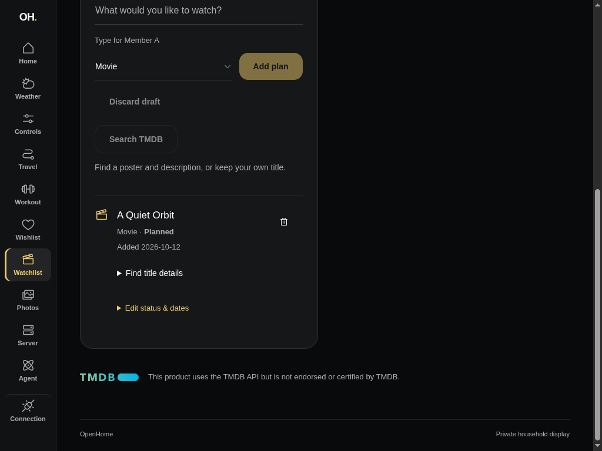
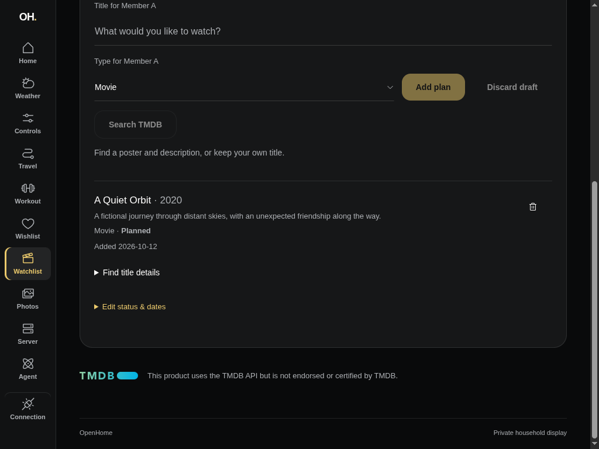
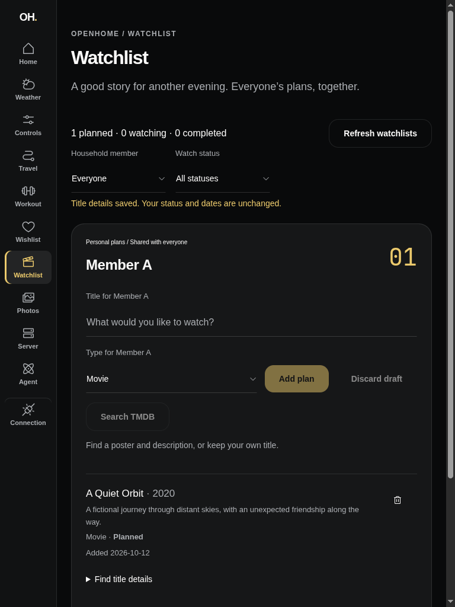

# Watchlist TMDB search and metadata — #103

Recorded 2026-10-12 with Member A and fictional media on an isolated, migrated
Axum database. The production Start dashboard calls authenticated Axum, which
calls a separate loopback synthetic provider through the real TMDB adapter.
No household configuration, real identities or provider credentials appear here.

## Browser evidence

The collaborative browser created Member A, added A Quiet Orbit manually, opened
**Find title details**, searched and selected the synthetic movie, and observed
its description and release year alongside the original planned status and added
date. The approved logo and required notice remain visible in Credits. The lone
owner card now uses the available width. Both 1024×768 landscape and 768×1024
portrait were inspected; portrait had no horizontal page overflow.

| Manual plan before enrichment | Metadata after enrichment (landscape) |
| --- | --- |
|  |  |

These are workflow before/after captures, not screenshots of the old checkout.
The synthetic poster path intentionally cannot load a real copyrighted image;
the UI keeps the title and details readable when an image fails. Rendered tests
independently verify the fixed, credential-free poster URL supplied to the image.

## Automated proof

- Migrated authenticated Axum tests exercise movie and TV searches, provider-held
  credentials, equal numeric IDs in different kinds, owner-targeted enrichment,
  completed status/date preservation, persisted reads, duplicate identity
  conflicts, and accepted retries without another provider request.
- Provider rejection, quota, server, malformed-body, redirect and wrong-ID failures
  are sanitized and consume no addition intention. Missing provider configuration
  leaves manual CRUD available. Search inputs/auth and unsafe poster paths are checked.
- Rendered tests exercise movie/series selection, descriptions/poster URLs,
  attribution, remount reads, search outage/manual fallback, failed detail selection
  followed by **Add manually**, and enrichment of a completed plan without date loss.
- Existing authenticated real MCP-to-Axum contracts remain green, including manual
  watchlist tools and read-only training tools. No new MCP provider tools are added.
- The single reviewer found a poster recovery bug: a failed reused image stayed
  hidden after a later success/replacement. A rendered regression failed before
  the repair. Both image paths now share URL-keyed poster rendering, resetting
  replaced nodes and revealing successful loads; the regression also verifies
  enrichment to a replacement URL.

Checks: `devenv shell -- just api-check`, `just dashboard-check`, `just mcp-check`,
and `just api-sqlx-prepare` (all inside devenv). Dashboard: 12 test files, 89 tests,
plus formatting, lint, typecheck and production build.

## Remaining release verification

TMDB's [official FAQ](https://developer.themoviedb.org/docs/faq) confirms free
non-commercial developer access with attribution. No TMDB runtime token was
available here, so live authenticated search/detail access is **unverified**.
These desktop captures also do not establish physical iPad Safari acceptance.
Keep the parent #74 and release #69 open for real-provider/device checks.
