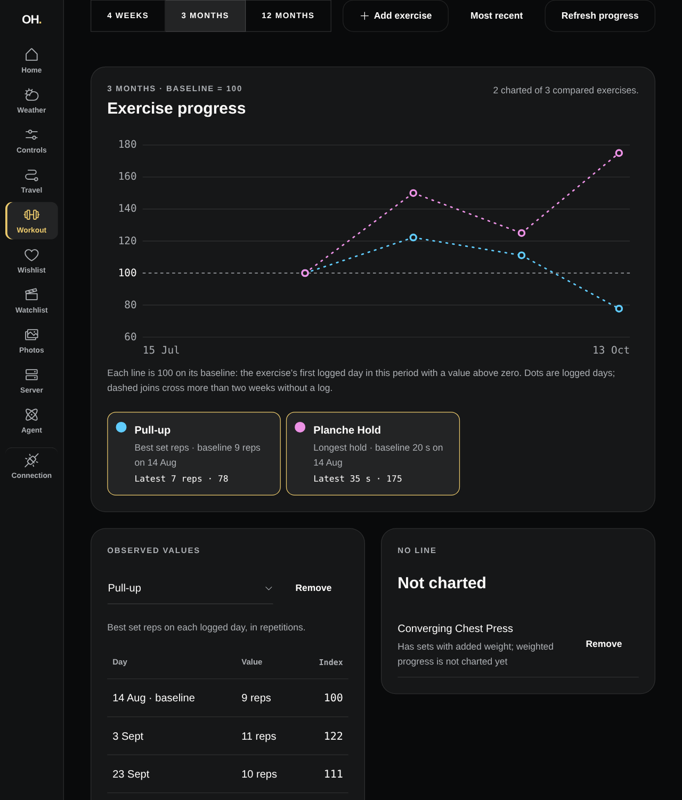
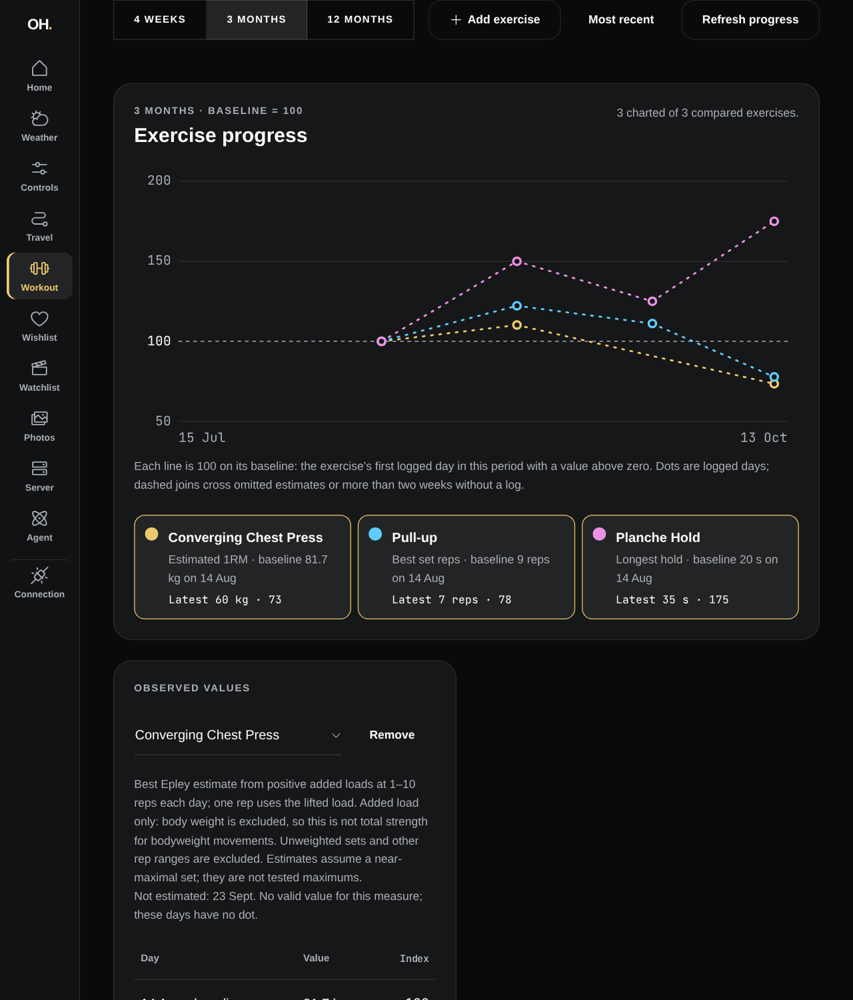
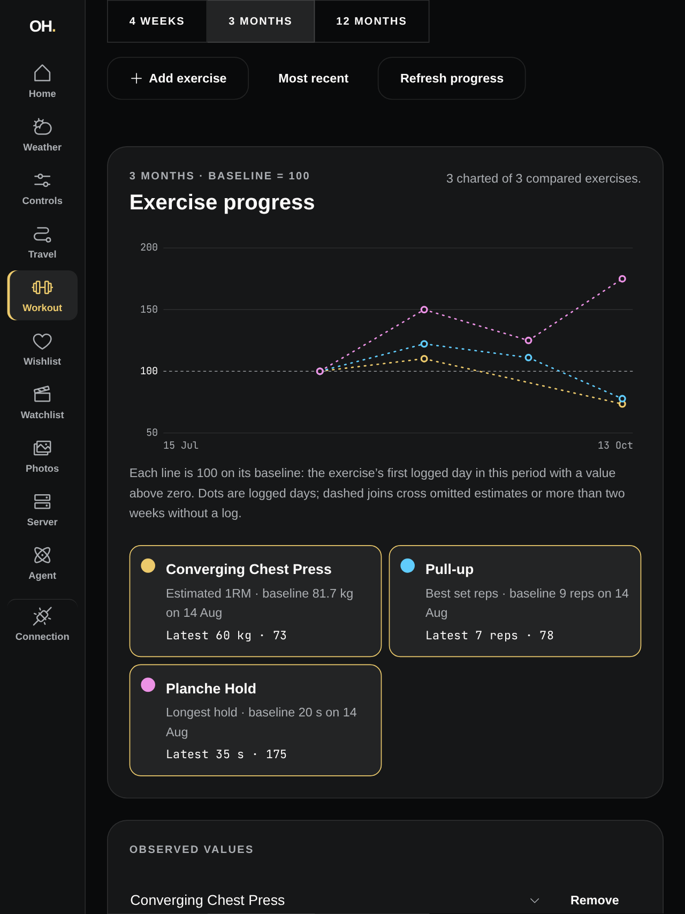

# Weighted exercise progress evidence

Issue [#125](https://github.com/patrickhaahr/openhome/issues/125), beneath
[#81](https://github.com/patrickhaahr/openhome/issues/81) and release
[#69](https://github.com/patrickhaahr/openhome/issues/69).

## Before and after

The baseline is `0596c04` on `master`. Both captures use the same four synthetic
Workouts through production authenticated Axum routes over separate migrated,
in-memory SQLite databases. They compare a weighted press, unweighted pull-ups
and a timed hold. The weighted press goes from an 81.7 kg added-load estimate to
90 kg, then declines to 60 kg; its 11-rep day is explicitly omitted.

The 1024 × 1200 capture frame includes the chart and the raw-value explanation.
It is browser evidence, not an iPad screenshot. No household data or credentials
appear in these images.

| Before | After |
| --- | --- |
|  |  |

## Automated and browser checks

- `devenv shell -- just api-check` passed, including authenticated numeric, mixed
  observation, unsupported, absence and legacy Progress Series compatibility cases.
- `devenv shell -- just dashboard-check` passed: formatting, lint, typecheck,
  132 rendered/transport tests and production build. The rendered weighted workflow
  uses the actual migrated fitness routes, exercises decimal parsing, line toggles
  across period changes, raw observations, omitted dates and a declining index.
- Regeneration of SQLx's checked-query cache completed with
  `devenv shell -- just api-sqlx-prepare`.
- Browser layout checks at 1024 × 768 and 768 × 1024 reported no horizontal
  overflow. Eleven synthetic Exercises yielded eleven legend controls and six
  initially visible lines. The portrait three-line comparison's toggle controls
  measured 283 × 125 CSS pixels, above the 44-pixel touch minimum.
- Large weighted indexes retain both observed points and at most six y-axis
  grid lines, bounding SVG work rather than creating thousands of ticks.

## Remaining hardware gate

The iPad skill's paired-device probe returned `No device found`; `usbmuxd` was
inactive. Physical iPad Safari touch, readability and load acceptance remains
unverified. Browser viewport checks are not a substitute. Keep #125 and its
parent/release acceptance open until that device evidence is recorded.
