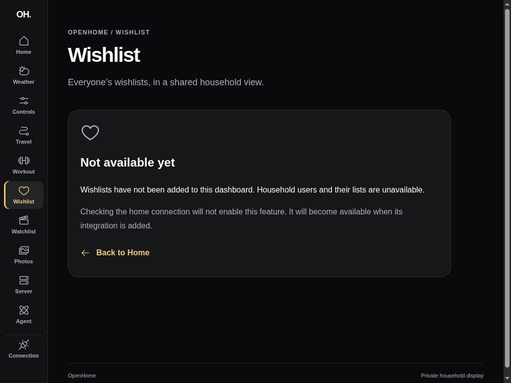
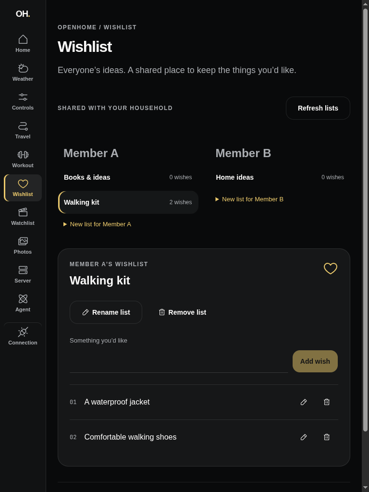

# Shared Wishlist dashboard — #98

The prior `/wishlist` view was a feature placeholder. The new shared view lists
all Household Users and their named Wishlists and supports member configuration,
list creation/rename/removal and generic title-item addition/edit/removal.

Browser evidence uses the isolated `just dashboard-health-fixture-run` Axum
example with migrated, temporary in-memory SQLite, production authenticated
health/Wishlist routes and synthetic public member names. The Dashboard calls
Start server functions, which forward requests with a server-held synthetic API
key. No household configuration or real credentials appear in the captures.

The rendered round trip created Member A and Member B, created Walking kit and
Home ideas, added A warm jacket, edited its title to A waterproof jacket,
renamed the list, cancelled a removal, confirmed a removal, and added new wishes.
Browser reload and Refresh lists read persisted data back from Axum. Landscape
and portrait browser viewports demonstrate responsive layout; they do not claim
physical iPad/Safari release verification.

Automated proof uses the same production routes and migrated SQLite. API tests
cover explicit destination targeting, auth, validation, name conflicts, cascades
and retries after editing/deletion. Dashboard tests render the full list/item
workflow against that API, retain failed drafts, and deliberately drop a
successful addition's response before remounting and retrying: only one item
persists. A Start SSR check independently verifies the private read boundary and
absence of upstream URL/credential leakage. The existing real MCP-to-Axum
contract suite verifies shared reads and unchanged read-only training tools.

| Before (landscape) | After (landscape) |
| --- | --- |
|  |  |

