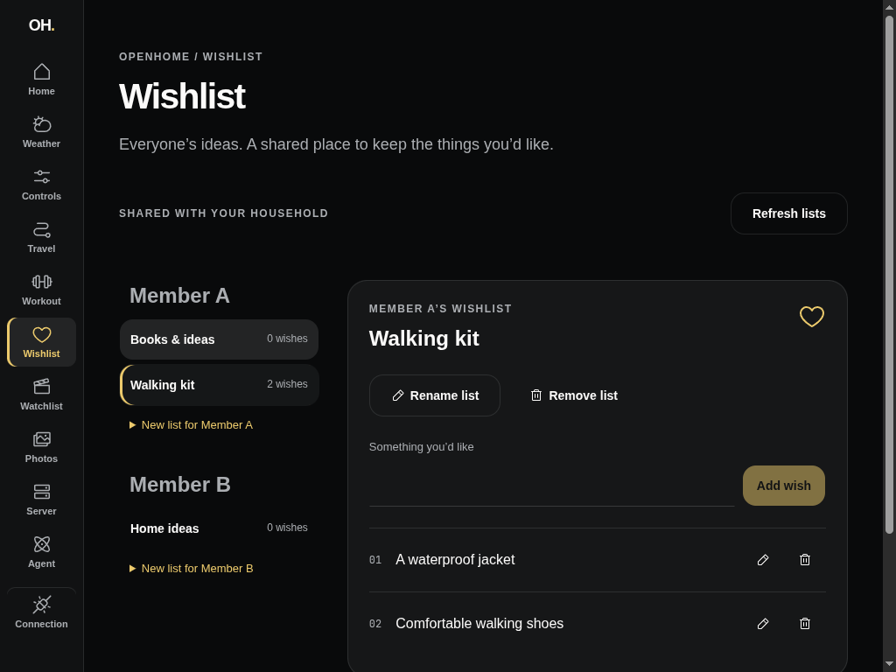
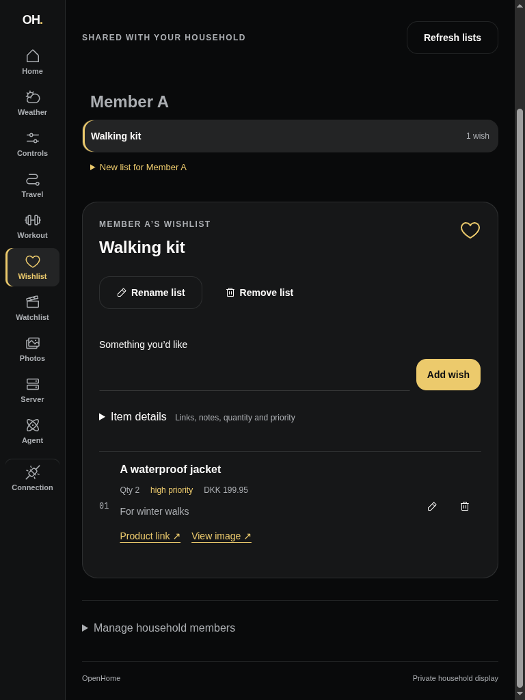

# Rich Wishlist Items — #99

The shared Dashboard now adds and edits title, product/image links, notes, price
text with currency, quantity and priority. Axum owns validation and persistence;
MCP list/read/update/delete use the same store and stable destinations. Generic
requests remain generic. Product URL metadata fetching is reserved for #100.

## Rendered workflow

The collaborative browser used `just dashboard-health-fixture-run`: migrated,
isolated in-memory SQLite, production authenticated Axum Wishlist routes and a
synthetic server-held API key. It created Member A, Walking kit and A warm jacket,
then edited the item to A waterproof jacket with example.com product/image links,
DKK 199.95, quantity 2, high priority and For winter walks. A full browser reload
read every stored field back through Start. The 1024×768 landscape and 768×1024
portrait viewports had no horizontal overflow. These captures do not establish
physical iPad/Safari release acceptance.

The baseline below reuses the title-only Dashboard evidence from #98, already on
the target branch. New captures contain synthetic public data only.

| Before: title-only items (#98) | After: rich stored context |
| --- | --- |
|  |  |

## Automated acceptance

- Authenticated migrated Axum routes verify field persistence, invalid fields,
  atomic rejection, omitted-field preservation, explicit nullable clearing,
  complete owner/list/item targeting, legacy receipt migration and deleted-item
  retry retirement.
- The real MCP Streamable HTTP client calls Axum to add a rich item, read it,
  partially update it, replay the edit, propagate validation/destination errors,
  replay the original addition without reverting edits, delete, and read the
  empty list. Tool discovery checks management schemas/annotations and preserves
  all read-only training contracts.
- Rendered Dashboard tests use authenticated Axum to create/edit/read fields,
  retain failed drafts and clear optional context. Open editors merge refreshed
  pristine fields, preserve dirty drafts, and PATCH only changed fields so
  concurrent agent edits to other fields survive saving. A forwarding server deliberately
  loses an accepted addition's response; reload restores the original rich draft
  and retry ID without duplication. The same seam verifies legacy title-only
  pending intentions survive an upgrade, including Unicode title normalization.
- `devenv shell -- just api-check mcp-check dashboard-check` provides the modified
  area gates; SQLx checked-query metadata is refreshed with `just api-sqlx-prepare`.
