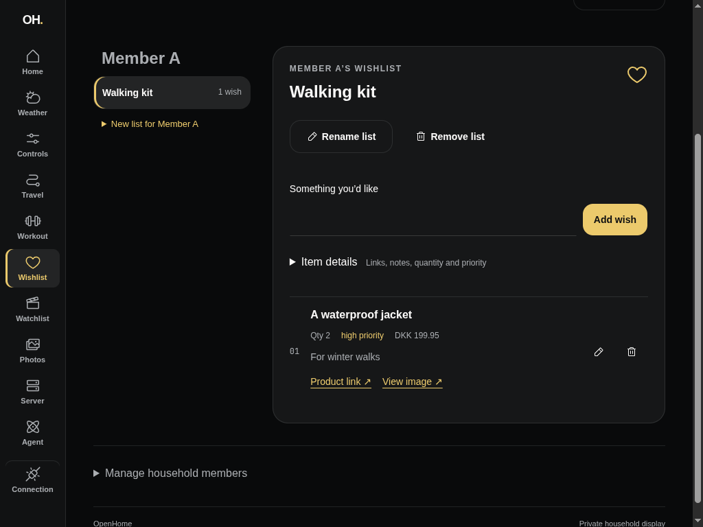
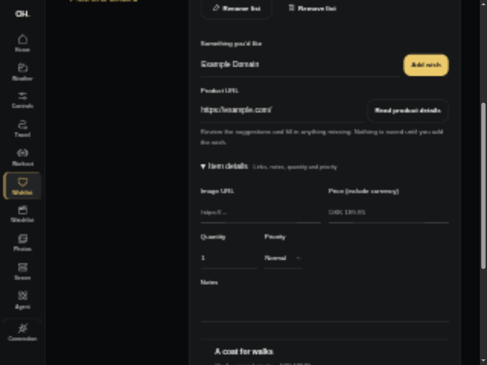
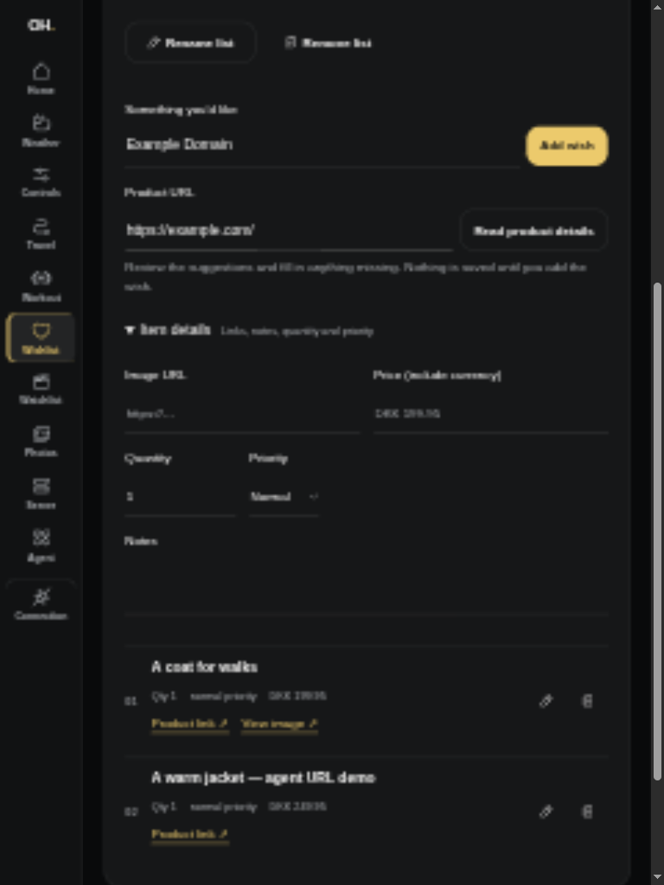

# Product URL Wishlist assistance — #100

Recorded 2026-10-12 using anonymous synthetic data and the isolated authenticated
Axum Wishlist fixture with migrated SQLite. Production Start and the real MCP
executable used the same API. No household configuration or credentials appear
in these artifacts.

## Browser workflow

The collaborative browser created Member A, then refreshed to see the URL ideas
list created through MCP. It pasted `https://example.com/`, requested product
details, and received a partial draft titled Example Domain. It changed the
title to A coat for walks, supplied a synthetic image link and DKK 199.95, saved,
and read the same fields after a full browser reload. MCP subsequently read this
Dashboard-created item from the same list. A second preview stayed editable and
did not add another item. Both 1024×768 landscape and 768×1024 portrait had no
horizontal page overflow. These browser captures do not establish physical
iPad/Safari release acceptance.

| Before: manual rich entry (#99) | After: URL suggestions ready for review |
| --- | --- |
|  |  |

## Actual agent/MCP URL workflow

The implementing agent acted as Hermes per #73's clarification, using an
authenticated Streamable HTTP session against the real MCP executable and Axum
fixture. The public example.com page intentionally demonstrates partial
metadata; complete product metadata is independently covered with controlled
external HTML responses at authenticated API routes.

| Tool operation | Observed result |
| --- | --- |
| `household_users`, `create_wishlist`, `wishlists` | Discovered Member A and explicitly created URL ideas |
| `wishlist_url_metadata` with owner/list IDs and `https://example.com/` | `isError:false`, `status:partial`, title Example Domain, null image/price; no item written |
| Review fields, then `add_wishlist_item` | Stored A warm jacket — agent URL demo, the demo URL and manually supplied DKK 249.95; `replayed:false` |
| Exact add retry with `request_id:url-agent-demo-100` | Same item ID/timestamp, `replayed:true` |
| `wishlist_items` | Exactly the Dashboard item and one agent URL item |
| Preview `http://127.0.0.1/product` | `isError:true`, status 400; no write |
| Change the title while reusing the addition request ID | `isError:true`, status 409; no duplicate |

## Automated proof

Authenticated API tests use migrated SQLite and controlled HTTP responses while
retaining the production address policy. They cover public relative redirects,
full/partial/empty metadata, HTML entity decoding, relative images, ignored
canonical destinations, blocked IPs and mixed public/private DNS answers,
private redirects, oversized/slow/non-HTML/error responses, redirect loops,
auth, owner targeting and zero writes from previews. Test-only socket mappings
connect vetted synthetic public hosts to local responders; there is no runtime
SSRF bypass setting.

The existing real MCP transport harness checks discovery/schema/read-only and
open-world annotations, blocked preview errors, ownership errors, rich URL item
CRUD and addition retry identity alongside unchanged training contracts.
Rendered tests independently cover review/correction and preservation of typed
fields, explicit saving and manual recovery after an actual blocked API preview.
The reviewer identified stale generated fields after a changed URL. The rendered
regression failed before the repair; changing URLs now clears only untouched
suggestions, and a second preview populates the new title while manual edits
remain intact.
The reviewed-suggestion rendering case uses a protocol fixture for UI behavior;
metadata extraction is tested at its API owner. Existing lost-response tests
continue to protect stored rich drafts and retry IDs.

`devenv shell -- just api-check`, `just mcp-check` and `just dashboard-check`
passed, including the Dashboard production build. No SQLx queries or migrations
changed; the new destination check reuses the checked list query.
