# Final dashboard PNGs

Actual Chromium captures of the current Executor v2 prototype, taken 11 October 2026. All images use a 1024×768 CSS-pixel viewport except Home portrait (768×1024). These are the current visual references for all ten sidebar pages, plus Transit, the 3D route view and portrait Home.

The images contain synthetic household data and unrelated public Copenhagen map data. The wishlist retains previous demo test additions; no stored data was deleted for these captures. Photos and Calendar show their current unfinished integration states. Map pages and fonts depend on network access. Physical iPad/Safari verification is still pending.

Screenshots capture the visible viewport. Wishlist has 2 px of vertical overflow with the current demo entries; the transit overlay scrolls independently, so its lower integration-details control may be partly outside the visible area. These images are visual references, not evidence of live integrations or a feature-complete release.

See [AGENTS.md](../../AGENTS.md) for setup, deployment, privacy and recapture instructions. This folder is included in version control; temporary screenshots elsewhere remain ignored.

| View | URL page / UI selection | PNG |
| --- | --- | --- |
| Home | `home` | [home.png](home.png) |
| Routes | `travel` | [routes.png](routes.png) |
| Transit | `travel → Transit` | [transit.png](transit.png) |
| Weather | `weather` | [weather.png](weather.png) |
| Controls | `controls` | [controls.png](controls.png) |
| Workout | `workout` | [workout.png](workout.png) |
| Wishlist | `wishlist` | [wishlist.png](wishlist.png) |
| Watchlist | `watchlist` | [watchlist.png](watchlist.png) |
| Photos | `photos` | [photos.png](photos.png) |
| Calendar | `calendar` | [calendar.png](calendar.png) |
| Agent | `agent` | [agent.png](agent.png) |
| Routes in 3D | `travel → 3D` | [routes-3d.png](routes-3d.png) |
| Home in portrait | `home` | [home-portrait.png](home-portrait.png) |

## Home

Four cards in two rows; seven-day weather, time/date and standalone agent avatar.

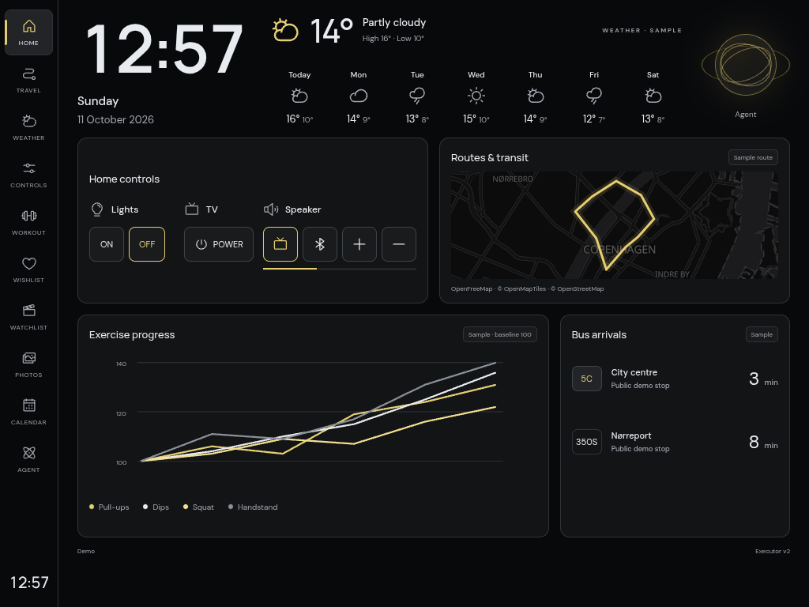

## Routes

2D public Copenhagen basemap and an illustrative loop; route generation is not connected.

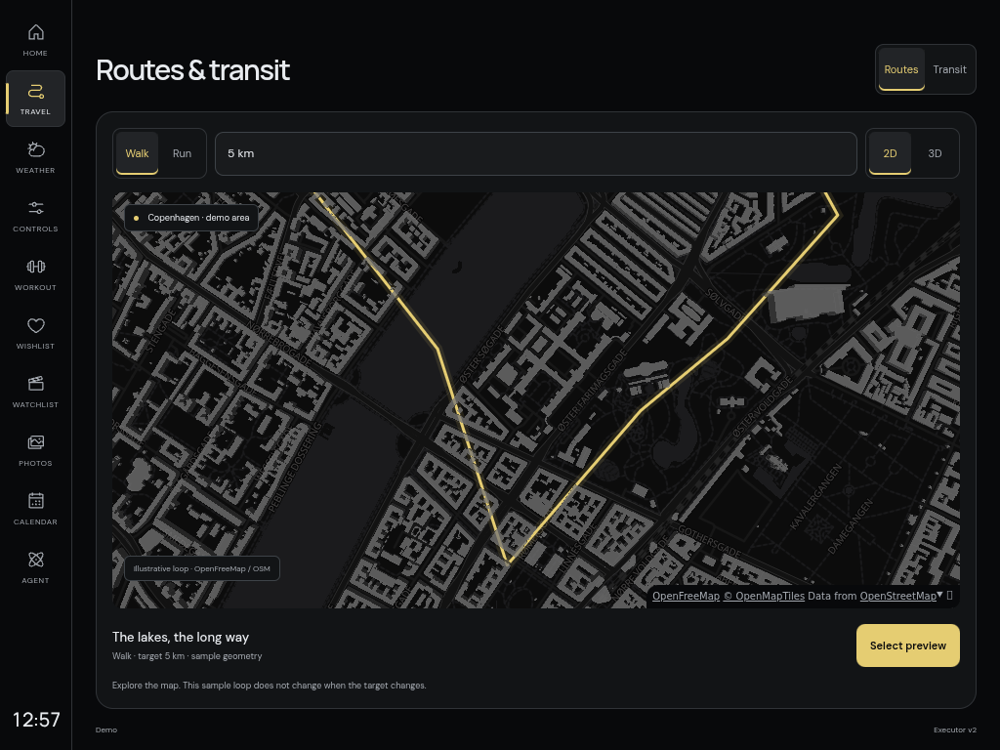

## Transit

Journey layout and sample bus estimates; Rejseplan and Buster are not connected.

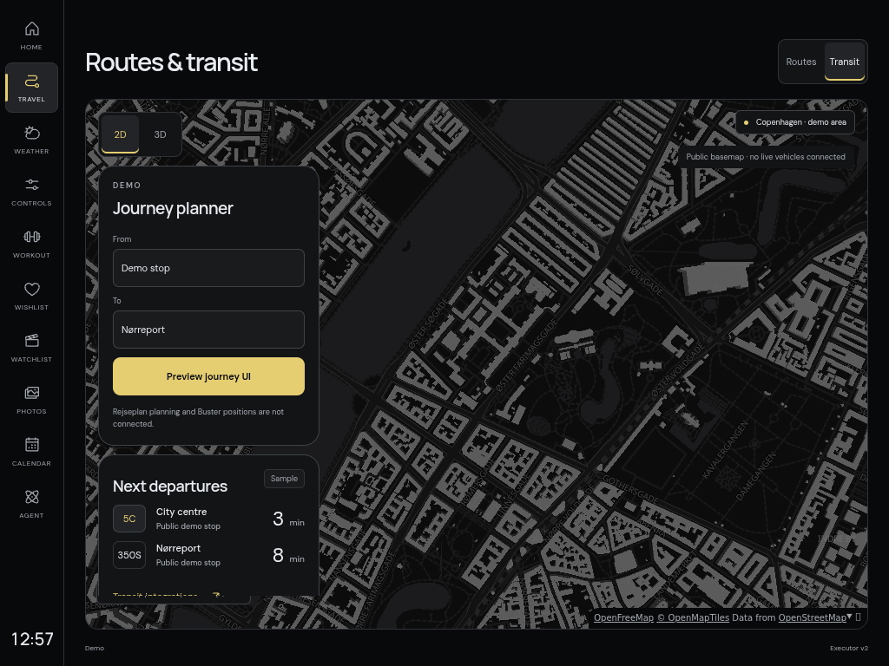

## Weather

Sample conditions and seven-day forecast.

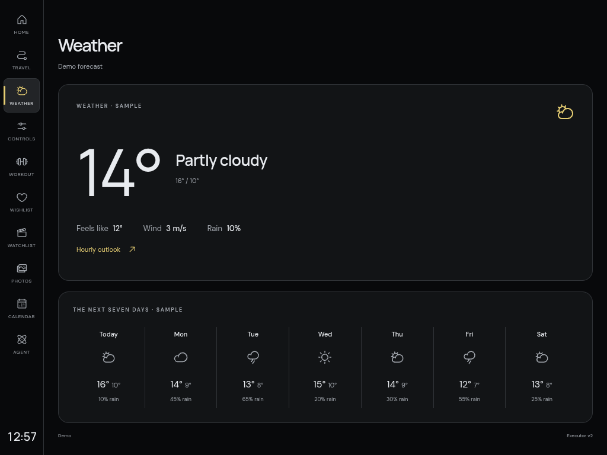

## Controls

Demo lights, TV and speaker controls; no real device commands.

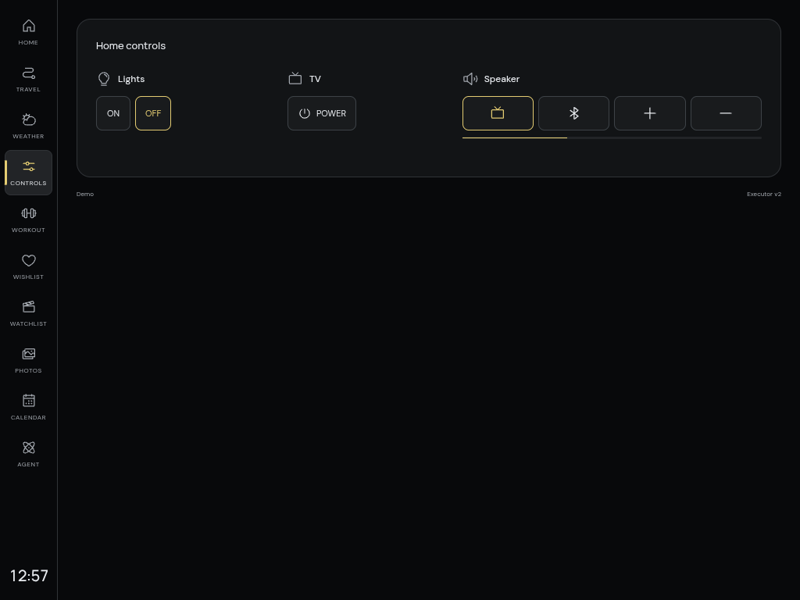

## Workout

Synthetic normalized exercise progress with independent line toggles.

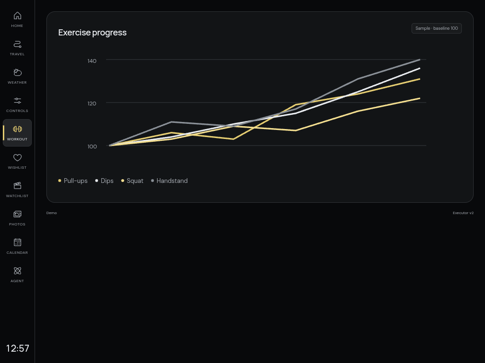

## Wishlist

Both anonymous users together; isolated Executor demo SQL data, including earlier test additions.

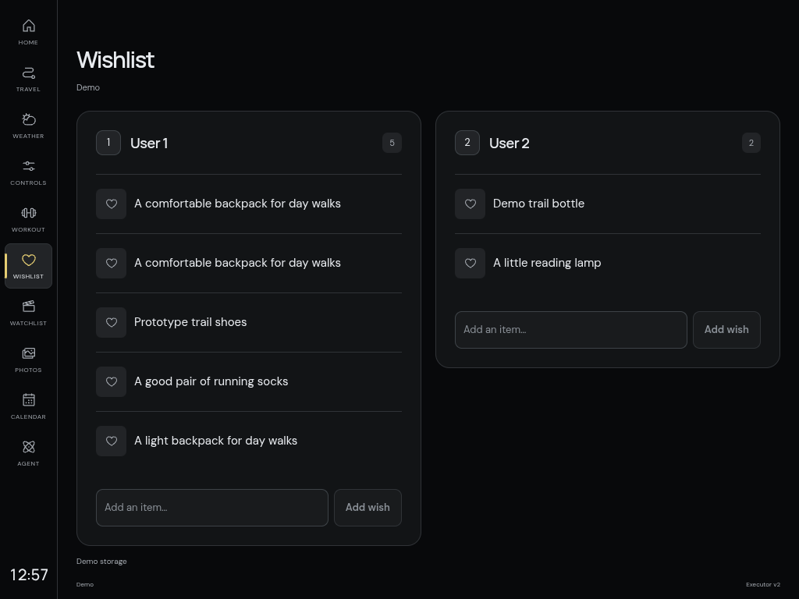

## Watchlist

Both anonymous users, fictional titles and planned/watching/completed states; resets on reload.

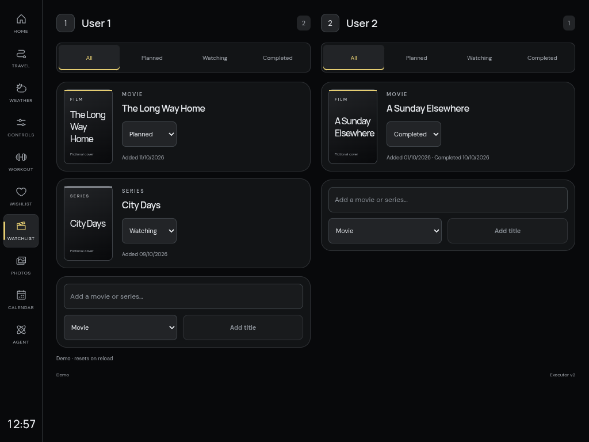

## Photos

Current Immich integration status page; not connected.

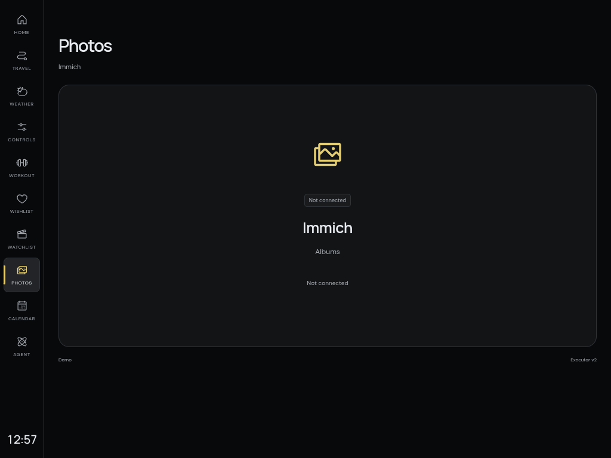

## Calendar

Current Proton Calendar integration status page; backlog.

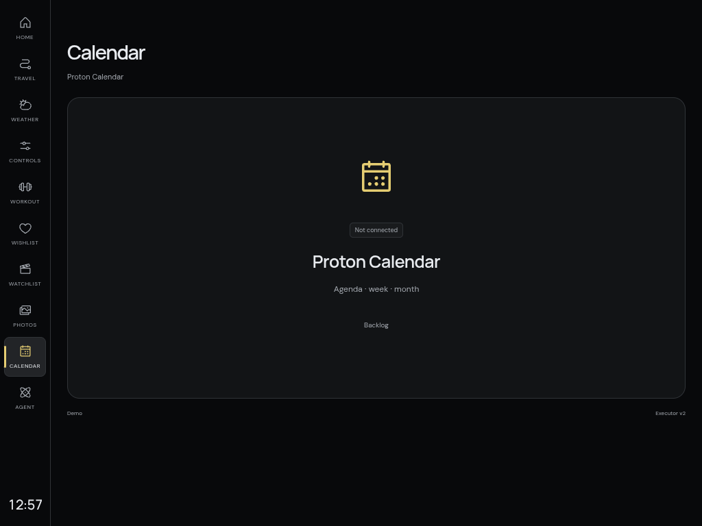

## Agent

Idle orb and demo conversation tools; Hermes and live voice are not connected.

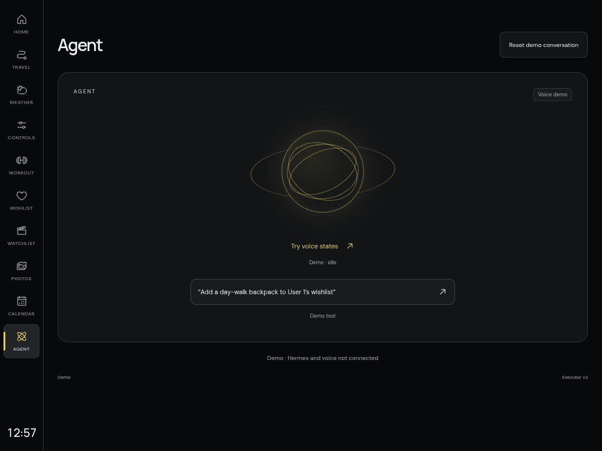

## Routes in 3D

MapLibre building extrusions; a 3D map, not satellite imagery.

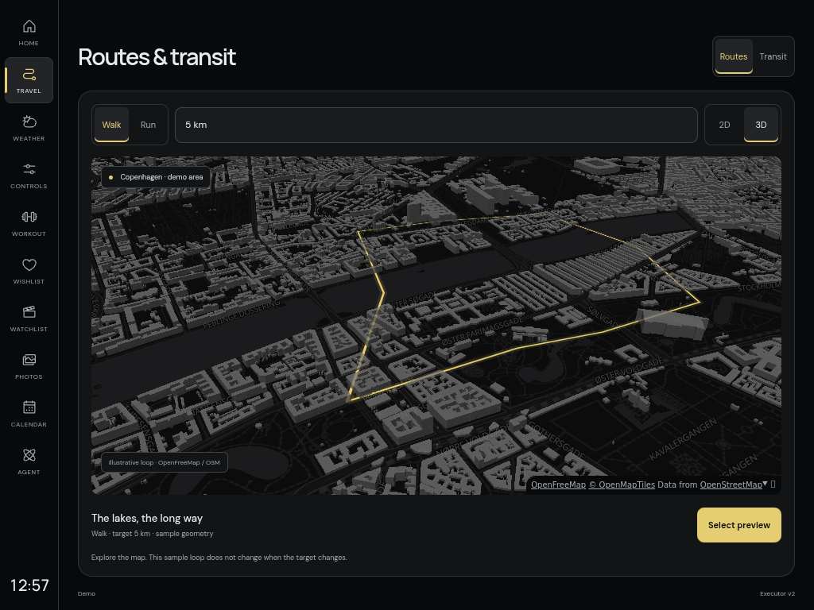

## Home in portrait

768×1024; the four Home cards still occupy two rows.

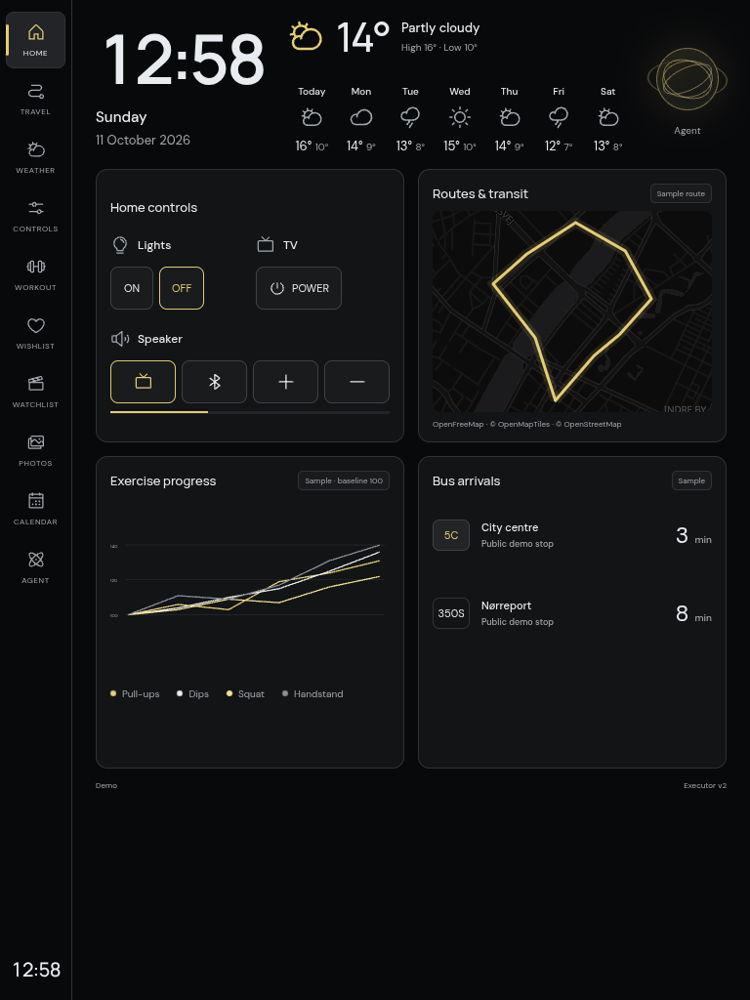
