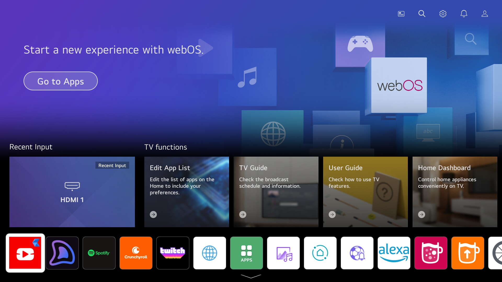
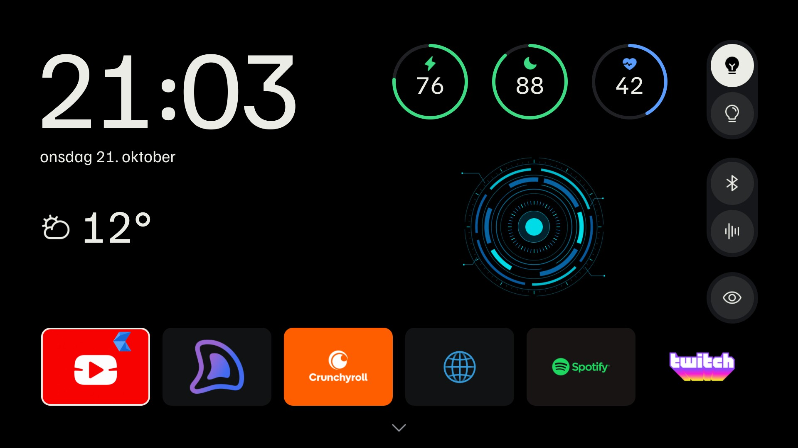
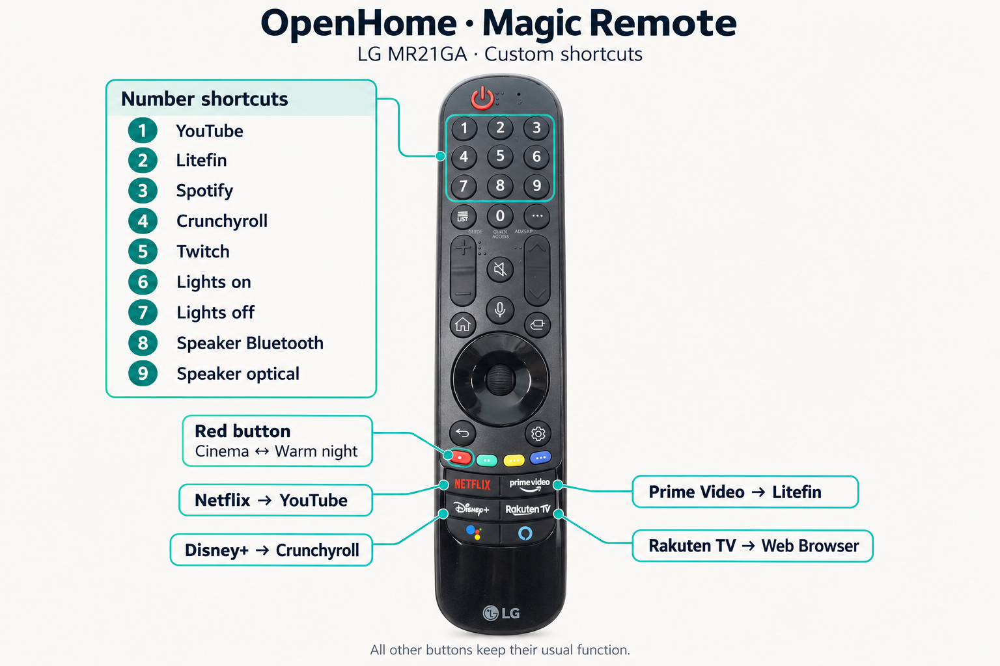

# OpenHome TV

Working branch: `tv`. Device: LG 55NANO806PA, webOS 6.5.3 / firmware 03.53.45.

- [Findings, changes and verification boundaries](docs/FINDINGS.md)
- [Exact rollback commands](docs/ROLLBACK.md)
- [Primary-source research](docs/RESEARCH.md)
- [OpenHome launcher design](docs/DESIGN.md)
- [Cinema picture settings](docs/CINEMA.md)

## Screenshots

| Before: LG Home | After: OpenHome TV |
| --- | --- |
|  |  |

- [OpenHome app drawer](screenshots/openhome-apps.jpg)
- [Circular agent speaking concept](screenshots/ember-speaking.jpg)

## Layout

| Directory | Responsibility |
| --- | --- |
| `launcher/` | Native QML interface, fonts and icons |
| `bridge/` | TV-local OpenHome client, preview fixture and contract tests |
| `runtime/` | Scripts installed on the TV: boot, privacy, client supervision and picture switching |
| `tools/` | Workstation build, installation, SSH, backup, capture and verification commands |
| `docs/` | Design, research, findings, picture settings and rollback instructions |
| `assets/` | Annotated remote guide |
| `screenshots/` | Selected public before/after screenshots |
| `private/`, `upstream/` | Ignored device data, build output and pinned third-party source |

`tools/tv_paths.py` shares the local TV root and SSH command between workstation
scripts. Runtime scripts are self-contained; their installed `/var/lib` paths
are independent of this repository layout. Paths in `docs/` are relative to
`tv/` unless marked as absolute or shown in commands run from the repository root.

`upstream/` contains the three Git clones at the revisions in `docs/FINDINGS.md`.
`private/` holds proprietary firmware copies, personal settings, screenshots,
SSH socket/known-hosts and the 69 MiB baseline backup. Both directories are
ignored by Git; do not publish their contents. No SSH password is stored.

Qt tooling parses the QML locally; the TV itself validates its QtQuick 2.12 runtime.
The existing dashboard dependencies must be installed to export its exact Phosphor
icons. Generated PNGs/SVGs stay under ignored `private/icons/` and enter the TV bundle.
Run project commands from the OpenHome root:

```sh
devenv shell -- just tv-connect
devenv shell -- just tv-check
devenv shell -- just tv-verify
devenv shell -- just tv-screen home
devenv shell -- just tv-client-check
devenv shell -- just tv-deploy
devenv shell -- just tv-picture-shortcut
devenv shell -- just tv-inputhook-startup
```

`tv-check` needs the ignored upstream checkout and private baseline; it has no
TV side effects. `tv-verify` attempts the blocked Alexa launches/activations and
reads their outcomes plus privacy settings. It needs the TV on and SSH connected.
`tv-screen` captures the actual display into `private/<name>.jpg`.

Initial installation recipes intentionally refuse to overwrite an existing installation.
`tv-deploy` updates the OpenHome UI/client and preserves the original Pear UI on the TV.
Root changes live under
`/var/lib` and runtime bind mounts, never in signed firmware partitions.

Step 9 now includes live weather, Charge/Rest/Effort, lights on/off and speaker
Bluetooth/optical commands. The circular agent is a fullscreen visual concept with a manual
speaking animation. Microphone capture, speech models and Hermes are not implemented.

The client runs independently of Home under `/var/lib/openhome-tv`, listening only on
`127.0.0.1:39479`. The API key is piped from the existing CLI configuration to a
root-owned mode600 file, never included in QML or Git. See [the client contract](bridge/README.md).
Home calls only the local allowlist; the client calls Axum using verified HTTPS.
The existing TV→Pi Tailscale firewall rule already permits this route, so no network
configuration changed. Live verification found Pi LAN10.0.10.4; 10.0.10.3 is zaza.

## Remote



[Full-size shortcut guide](assets/remote-keymap.png). Photo: [Huoltopalvelu, LG MR21GA](https://www.huoltopalvelu.com/LG-TV-remote-control-MR21GA);
annotations created with ImageGen and checked against the configured shortcuts.

The TV has no visible labels or instructions: Danish date, clock and numerical
readings accompany the dashboard's exact icons. Left/Right chooses apps; OK opens
one. Up reaches the agent or the right-hand controls. Up/Down moves through the
vertical controls; Left reaches the agent. Down from apps opens the full drawer.
Back closes the drawer; Back/X closes the agent; hold OK on an app opens LG's original reorder view.
Magic Remote hover/click also works. No selection indicates observed device state.
The LG Apps tile is hidden from both dock and drawer; its firmware is preserved.
LG Input Hook is visible. Bluetooth/optical and the full-size eye button share
the right rail’s circle/capsule design, without a speaker header or volume buttons.
The eye button switches picture profiles: white means the warm/dim Expert Dark
Room profile, dark means the reference-oriented Cinema profile, and dim means unknown.
Opaque app backgrounds fill their rounded cards; transparent logos keep their sizing.

App shortcuts use Input Hook's native `launch` action. The existing app shortcuts
on 2–5 keep their targets:

| Remote button | Action | Input Hook key ID |
| --- | --- | --- |
| 1 | YouTube Cobalt AdFree (`youtube.leanback.v4`) | 2 |
| 2 | Litefin (`org.litefin.app`) | 3 |
| 3 | Spotify (`spotify-beehive`) | 4 |
| 4 | Crunchyroll (`com.crunchyroll.webapp`) | 5 |
| 5 | Twitch (`twitch.adamffdev.v1`) | 6 |
| Netflix | YouTube Cobalt AdFree (`youtube.leanback.v4`) | 1037 |
| Prime Video | Litefin (`org.litefin.app`) | 1038 |
| Disney+ | Crunchyroll (`com.crunchyroll.webapp`) | 1042 |
| Rakuten TV | Web Browser (`com.webos.app.browser`) | 1044 |
| 6 | Lights on | 7 |
| 7 | Lights off | 8 |
| 8 | Speaker Bluetooth input | 9 |
| 9 | Speaker optical input | 10 |

Keys 6–9 call the existing loopback TV client using the TV's native curl command.
The client forwards the four allowlisted actions to Axum over verified HTTPS;
credentials stay in its root-only configuration. These shortcuts share Home's
existing command busy/rate limits and do not start Node on each keypress.

The **red remote button** also switches Cinema ↔ warm night without opening Home.
Input Hook runs `picture-toggle.py` through a nonblocking file lock; the script
reads the native mode, changes only `pictureMode`, and verifies the result.
Home subscribes to native mode changes so the eye follows the remote shortcut.
The helper uses the TV's existing Python runtime to avoid starting Node on every
keypress; the measured full switch and readback take about 0.84 seconds.
This shortcut is limited to the configured default-input 2D SDR profiles; it
rejects other inputs/HDR rather than applying the SDR settings there. Other
Input Hook shortcuts are preserved. `tv-picture-shortcut` installs the binding
and refuses to overwrite a different red-button action.

`tv-inputhook-startup` installs `50-openhome-inputhook`, which refreshes LS2's
volatile developer-service manifests before starting Input Hook. This firmware
can retain a sandboxed launcher in its service cache even when the elevated
definition is already on disk; a normal `scan-services` does not refresh that
cache. The helper uses the TV's Python 2.7 runtime and Pear's native LS2 client,
with a ten-second deadline per command, so a missing reply cannot stall boot.
The upstream Input Hook startup hook and all saved key mappings are preserved.

## YouTube updates and picture warmth

The RF1705 custom repository is saved in Homebrew Channel. Choose **YouTube Cobalt
AdFree** at the top of its catalogue for updates; the default repository's
**YouTube AdFree** is a different package using the same application ID.
Stable v1.2.5 is installed as `youtube.leanback.v4`; the old v1.1.7
`com.cobalt.youtube.adfree` installation was backed up and removed.

The eye switches the current SDR input between Cinema and Expert Dark Room.
Cinema now uses Warm2, neutral RGB gains, gamma2.4, backlight50, black level50,
contrast80 and colour50. Expert Dark Room retains the earlier warm/dim controls:
Warm3, backlight30, green gain−15 and blue gain−40. Global Reduce Blue Light and
automatic energy saving are off; the eye changes only the profile. Other inputs
and HDR picture presets remain separate, although those two global switches also
affect them. See [Cinema settings and measurement limits](docs/CINEMA.md) and
[rollback](docs/ROLLBACK.md).

## Future voice input

LG's [MR21GA diagram](https://www.lg.com/us/support/pdf/remotes/2021-Magic-Remote-MR21GA.pdf)
labels a microphone on the Magic Remote, which the [exact TV model](https://www.lg.com/uk/tvs-soundbars/smart-tvs/55nano806pa/)
supports. A separate far-field microphone in the TV chassis has not been confirmed.
LG developer staff [do not expose a microphone stream to ordinary webOS TV apps](https://forum.webostv.developer.lge.com/t/accessing-audio-data-stream/9355).
Root inspection found native microphone services, but no audio was captured or access
proven. Voice/Hermes design remains future work.
